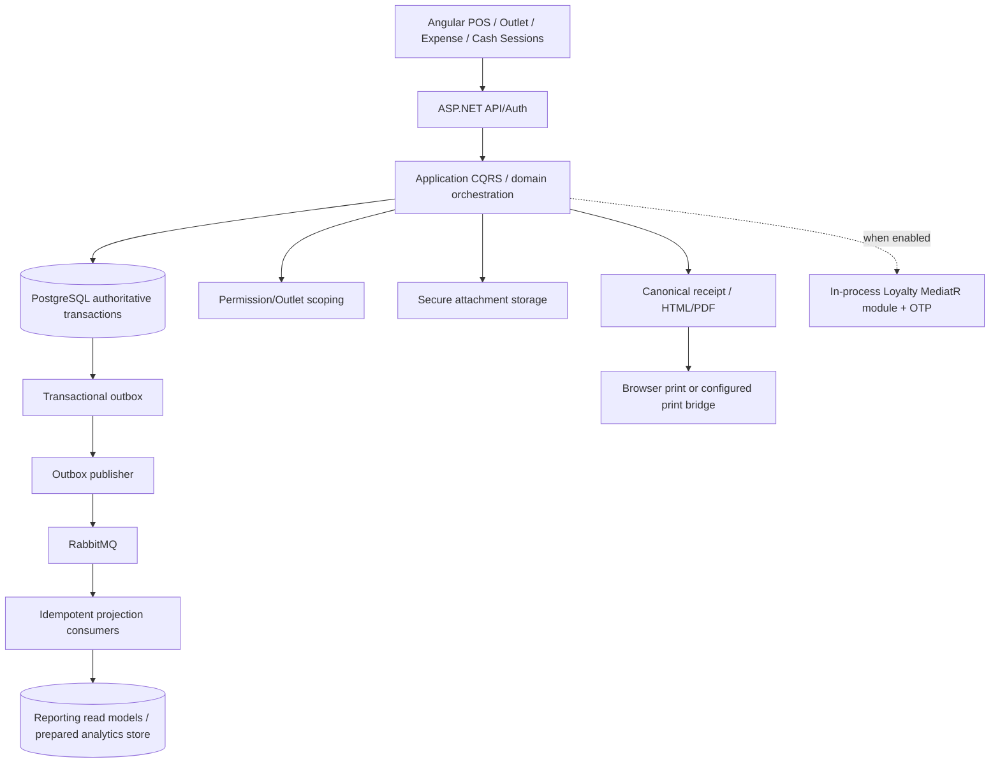
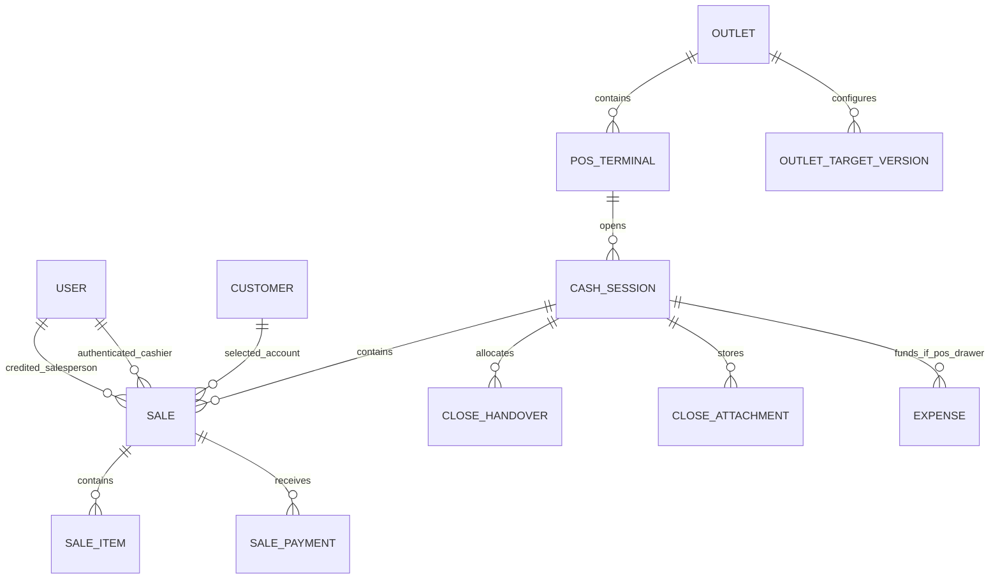

# IraniMart POS v2 — Master Low-Level Design (LLD)

**Document ID:** IM-POS-LLD-MASTER  
**Version:** 1.2 — approved decision aligned technical blueprint  
**Date:** 2026-11-02  
**Status:** Revised technical specification for review; implementation NOT authorized  
**Target folder:** `Docs/08_Sales_And_POS/`  
**Companion:** `IRANIMART_POS_MASTER_SRS_V1_2.md`  
**UX reference:** `iranimart_pos_prototype.html` (design/behavior reference; demo JS is non-authoritative)

**v1.2 precedence note:** Sections 19–30 control where prior technical sketches conflict, especially D2/D4/D10/D12/D13/D14.

## 1. Engineering contract and precedence

The uploaded baseline identifies existing ASP.NET/Angular implementation candidates: `src/RetailPOS.Application/Sales/Commands/CreateSaleCommand.cs`, `src/RetailPOS.API/Services/SaleCreationAdapters.cs`, `src/RetailPOS.API/Controllers/SalesController.cs`, `src/RetailPOS.API/Controllers/PosController.cs`, `src/RetailPOS.Application/Pos/Queries/GetPosStockHintQuery.cs`, `retailpos-frontend/src/app/pages/pos/pos-screen.component.{ts,html}`, existing `Infrastructure/Audit/AuditService`, `Application/Identity/Permissions/PermissionCatalog`, `Infrastructure/Settings/JsonSystemSettingsStore` and `Infrastructure/Inventory/StockLedgerWriter`. Paths are based on Rev 3 read-only evidence; verify again against the implementation branch.

This LLD specifies logical responsibilities, contracts, persistence and safe rollout. Names are illustrative until matched to actual code. Approved SRS business behavior supersedes inconsistent baseline statements (notably 15h vs 20h, cash in/out, void window, loyalty backend scope). Respect existing .NET Core/domain patterns, MediatR/CQRS where present, EF Core transaction patterns, PostgreSQL, existing permissions, outbox/RabbitMQ and existing Angular design tokens. Do not build another checkout service or financial ledger.


### 1.1 Cross-module specification dependencies

The following files are external **authoritative** loyalty specifications in the same `pos-v2` repository, and must be read before the loyalty integration gap analysis:

- `Docs/Customer_Loyalty_Module/CUSTOMER_LOYALTY_MODULE_SRS.md`
- `Docs/Customer_Loyalty_Module/CUSTOMER_LOYALTY_MODULE_LLD.md`

Treat the Loyalty Module SRS/LLD as authoritative for point earning, redemption, OTP, tier lifecycle, immutable ledger, campaign mechanics, returns/reversal and financial liability. This POS LLD owns adapter boundaries, session/checkout orchestration, account selection and UX bindings; it **must not duplicate** loyalty ledgers/calculation rules or introduce conflicting earning formulas. Implementation agents must read those repository files in full before constructing API/DTO and transaction contracts. If a rule conflicts, flag for approval rather than silently deciding.

## 2. Context, boundaries and proposed package map



**Bounded responsibilities:** Sales domain owns sale/payment/stock commit in existing transaction orchestration; CashSession application service owns session lifecycle/reconciliation; Outlet management owns terminal and target configuration; Expense Module owns expense posting/payment and optional cash-drawer association; Loyalty Module owns points ledger/OTP; analytics consumers own derived reporting only. Session close always calculates from authoritative source, **not** eventual projections.

Suggested feature folders (adjust to existing layout): `Application/Pos/Commands|Queries`, `Application/CashSessions/Commands|Queries`, `Application/Outlets/Terminals|Targets`, `Infrastructure/Persistence/Configurations`, `Infrastructure/Messaging/Outbox|Consumers`, Angular `pages/pos`, `pages/cash-sessions`, `pages/outlets`, shared components only when reused.

## 3. Domain model and relational schema proposal

### 3.1 Core entities (reuse if already present)

| Entity / aggregate | Essential fields / notes |
|---|---|
| `PosTerminal` | `Id`, `BusinessId`, `OutletId`, `Code`, `Name`, `Description?`, `IsActive`, `CreatedAtUtc`, `UpdatedAtUtc`, concurrency token. |
| `CashSession` | `Id`, `BusinessId`, `OutletId`, `TerminalId`, `BusinessDate` (date), `OpenedAtUtc`, `OpenedByUserId`, `OpeningCash`, `Status`, `ClosedAtUtc?`, `ClosedByUserId?`, `CountedCash?`, `ExpectedCashSnapshot?`, `Variance?`, `OpeningNotes?`, `ClosingNotes?`, row-version. |
| `CashSessionClosingHandover` | `Id`, `SessionId`, `Method` (`CashToPerson`, `BankDeposit`), `Amount`, `GivenByUserId`, `TakenByUserId?`, `Recipient`, `BankAccountId?`, `Reference?`, `DepositDate?`, `DepositStatus?`, `Notes?`, audit. |
| `CashSessionAttachment` | `Id`, `SessionId`, `StorageKey`, `OriginalFilename` (metadata only), `ContentType`, `ByteLength`, `Hash?`, `UploadedBy`, `CreatedAtUtc`, `Kind`. |
| `OutletSalesTargetVersion` | `Id`, `BusinessId`, `OutletId`, `EffectiveFrom`, `EffectiveTo?`, seven weekday amounts or normalized child rows, audit/concurrency. |
| `OutletPeriodTargetOverride` | `Id`, `TargetVersion/Outlet`, `PeriodType` (`Week`, `FirstHalf`, `SecondHalf`, `Month`), `PeriodStart`, `PeriodEnd`, `ManualAmount`, `IsOverride`, audit. |
| Existing `Sale` | Add/verify `BusinessId`, `OutletId`, `TerminalId`, `CashSessionId`, `BusinessDate`, `CreatedAtUtc`, `SaleDateTime`, `CashierUserId`, `SalespersonUserId`, `CustomerId`, monetary snapshots, `IdempotencyKey`, `Status`. |
| Existing `SaleItem` | `ProductId`, `ProductVariantId`, variant display snapshot, qty/UOM, selling unit price, discount amount/type, tax component rate/amount snapshot, net line total. |
| Existing `SalePayment` | method, cash received/allocated/actual change, paid amount, reference, status and immutable corrections; distinct from `CashSessionClosingHandover`. |
| Existing `Expense` | Add/verify `PaymentSource`, `PaymentAccountId`, `OutletId?`, `CashSessionId?` (required for POS Drawer paid/posted outflow), posted/paid UTC and reversal association. |
| Existing `Customer` | `BusinessId`, optional original phone, normalized phone, protected `IsSystemWalkIn`; business-scoped unique normalized phone for registered phone-bearing customers. |
| `OutboxMessage` / `InboxReceipt` | Event ID, aggregate type/id, event version, tenant context, payload, occurred UTC, publish attempts/status; consumer dedupe key. |
| Derived summaries | `OutletBusinessDaySummary`, `TerminalSessionSummary`, `CashierBusinessDaySummary`, `SalespersonBusinessDaySummary`, `ProductVariantBusinessDaySummary`, `PaymentMethodBusinessDaySummary`, `TargetVarianceSnapshot` (as warranted by existing reporting service). |

**Database constraints/indexes:**

- Unique `(BusinessId, OutletId, NormalizedCode)` for terminals, including inactive historical codes; code/name must not be identity.
- **Partial unique** `(OutletId, TerminalId)` for cash session rows where persisted status is `open` (adjust to actual enum/index provider); opening and closing serialize against same terminal/session and use row-version/concurrency lock. Cross-outlet association validated in application and by FKs.
- Session FK from sale; scope integrity verified and compound unique/check constraints where useful. Closed session immutable financially; retain audit.
- Unique `(BusinessId, NormalizedPhone)` **where normalized phone is non-null**; migrate/merge legacy duplicate phones only after approved data-quality review; system Walk-in exempt when phone absent.
- Unique `(BusinessId, OutletId, ClientTransactionKey)` or verified existing checkout idempotency index; repeated key returns original committed result.
- Unique `(ConsumerName, EventId)` for inbox/projection processed events; appropriate indexes on business/date/outlet/terminal/session/status, customer/phone and active target version.
- Monetary decimal precision and date/time mapping follow existing schema. Do not use JS floating point or SQL float as monetary source of truth; round at documented monetary boundaries.

### 3.2 Relationship diagram



### 3.3 Outlet-owned terminal configuration and runtime resolution

The **existing Outlet Create/Edit screen** is the UX owner of terminals (not a separate POS Terminals administration page). Reuse existing Outlet controller/service and its create/edit form, adding embedded `POS Terminals` list + Add/Edit/Delete/Deactivate modal/drawer and Sales Targets section. This is an additive enhancement to the screenshot's current Outlet Name, Address, Contact Number and Manager form. `OutletId` is derived from the current create/edit context.

**Create transaction:** stage terminal rows in the Outlet form; persist parent Outlet and children with validated codes atomically or through the repository's supported equivalent workflow. **Edit transaction:** load all terminals belonging to the specified outlet (including inactive, clearly marked); allow edits and physical deletion only for unused terminals. Validate unique `(BusinessId, OutletId, NormalizedCode)`, history immutability, current open/overdue session, authorization and row-version before mutations. Do not move historical terminals to another outlet.

**Runtime selection:** `GetEligibleTerminals(BusinessId,OutletId,Actor)` reads the same persisted `PosTerminal` records; filter by active status and authorized outlet. Open Cash Session and POS Sales both use this endpoint/service, never an independently seeded terminal list. One valid item -> auto-select; multiple -> selector; zero -> actionable setup-required state (no cash open/checkout). Backend validates the selected `TerminalId` and session/outlet correspondence independently. If a terminal is deactivated after a page loads, reject stale selection and prompt a reload; never silently switch a cart to another terminal.

**Navigation:** POS terminal setup is reached through `Administration → Outlets → Create/Edit Outlet → POS Terminals`; Cash Sessions and POS Sales consume these terminals. If a legacy standalone `POS Terminals` menu already exists, inventory it during gap analysis and propose reuse/redirect/removal only with approval, to avoid two conflicting configuration sources.

## 4. Service interfaces and application commands

Use MediatR-style requests if existing solution uses MediatR/CQRS; otherwise adapt to existing application service registration.

| Command/query | Request | Result/side effects |
|---|---|---|
| `GetEligibleTerminals` | outlet/context | authorized active terminals; 1 auto-selection hint. |
| `SaveOutletTerminals` | outlet + staged rows + concurrency | upsert allowed rows; validate name/code/history/active session. |
| `SaveOutletSalesTargets` | weekday values/effective date/period overrides | effective-dated saved target version, auditable. |
| `GetCurrentCashSession` | selected terminal | open/overdue immutable snapshot and server clock. |
| `OpenCashSession` | terminal, opening float, notes, idempotency key | validate permissions/one-open, derive BusinessDate and OpenedAt on server, persist + outbox. |
| `GetCashSessions` | outlet scoped filters/page | paged history. |
| `GetCashSessionDetails` | sessionId | historical overview, payments, cash/expense facts, handovers, attachments, activity. |
| `GetAuthoritativeClosePreview` | sessionId | persisted-source expected breakdown and version for close; no projection reliance. |
| `CloseCashSession` | sessionId, counted cash, variance reason, denomination?, handovers[], attachment IDs[], request key, expected row-version | atomic session transition, authoritative recompute, freeze summary + handover; audit/outbox. |
| `FindCustomers` / `QuickCreateCustomer` | query/normalized phone and business | existing/customer insert with duplicate concurrency handling. |
| `LookupEligibleSalespersons` | outlet | only active assigned outlet users. |
| `CompleteSale` | sessionId, terminalId, salespersonId, optional customerId, cart, payments, optional authorized effective date, idempotency | existing SaleService executes authoritative transaction; cashier derived from auth. |
| `Create/PayExpense` | payment source/account and optional session | existing approval/post flow; posted POS Drawer expense references exact eligible session. |
| `GenerateReceipt` | sale ID / 80mm or A4 | canonical immutable snapshot rendered HTML/PDF. |

**Important:** The baseline includes speculative route names. Map these commands into actual current controllers, result envelope, validators and authorization middleware. Do not introduce duplicate `POST /api/sales` orchestration or duplicate customer/receipt endpoints.

## 5. Lifecycle and concurrency algorithms

### 5.1 Opening

1. Authenticate actor, determine `BusinessId` and allowed `OutletId`; resolve eligible `TerminalId`; reject zero/inactive/cross-outlet.
2. Obtain terminal-scoped transaction lock or equivalent serialized uniqueness enforcement; check no open/overdue session.
3. Read authoritative server UTC and outlet timezone. Compute immutable `BusinessDate` from opening instant. `OpeningCash >=0`; amount may be zero.
4. Insert session with `Open` status, opening amount, notes, actor; write audit and `CashSessionOpened` outbox record in **same** transaction; commit. On duplicate key/concurrency, return existing/collision response without double open.
5. Return persisted session and current server timestamp; Angular navigates to POS. No frontend-generated opening date as authority.

### 5.2 Sale completion with exact 20-hour boundary

```csharp
// Illustrative orchestration; integrate inside existing checkout UoW.
var nowUtc = clock.UtcNow;
var session = await sessions.GetForUpdateAsync(request.CashSessionId, ct);
if (session is null || session.TerminalId != request.TerminalId ||
    session.BusinessId != user.BusinessId || !user.CanUseOutlet(session.OutletId))
    throw PosError("CASH_SESSION_REQUIRED");
if (session.Status != Open || nowUtc >= session.OpenedAtUtc.AddHours(maxDurationHours))
    throw PosError("CASH_SESSION_OVERDUE");
// Validate outlet-assigned salesperson and optional customer, stock, VAT,
// discounts, tenders, permissions, configured invoice and idempotency.
// Commit all monetary/stock/sale/ledger facts + outbox atomically.
```

**Concurrency rule:** Lock/recheck at a serializable session boundary shared with closing, and **recheck authoritative time at final commit gate** so a transaction that began before cutoff does not commit an unauthorized sale at/after cutoff. Long-running transactions must not sneak through. Sale printing occurs post-commit and failures cannot rollback sale.

**Payment model:** Cash allocated amount is capped at outstanding payable; physical cash retained is tender received less change given. Card/mobile amounts must match authorized allocations and references where configured. Full payment; no credit. Multi-tender totals must reconcile to final payable, while cash excess produces change, not extra sales revenue. Discounts mutually exclusive, server recomputes totals, no client price override.

### 5.3 Expiry

`Overdue` is strictly derived from `OpenedAtUtc + DurationSnapshotHours` and server UTC. Persisted lifecycle state remains `open` until it becomes `closed`; a derived-overdue event/attempt audit may be deduplicated without introducing a persisted status. Warning thresholds 18h/19h UI-based display; server returns expiry deadline and its own time. At or after the snapshotted session cutoff (maximum 20h) disable completion and preserve noncommitted cart; after new session requery price, VAT, stock, customer and tender before enabling checkout. Do not automatically reopen session or carry old session ID.

### 5.4 Authoritative closing calculation

```text
ExpectedDrawerCash = OpeningCash
                   + SUM(net retained cash from completed session sales)
                   - SUM(paid+posted nonreversed POS Drawer expenses for session)
                   - SUM(cash refunds and applicable net void cash reversals)
                   + SUM(approved compensating drawer entries, if existing policy permits)
Variance = CountedCash - ExpectedDrawerCash
RetainedAtOutlet = CountedCash - SUM(handover or deposit allocations)
```

**Guard against double-count:** Payment allocations and void/refund effects need canonical classifications. If net sale/payment totals already include a reversal, do not subtract a second separate reversal. Use immutable source facts and once-only reversal references. Separate card/mobile reporting, excluded from cash drawer.

Close algorithm: authorize closer; lock session; confirm Open or Overdue and no concurrent sale/expense unsettled; recompute expected cash in transaction; validate counted >=0, variance reason if nonzero, denomination reconciliation if supplied, handover sum ≤ counted and declared retained amount consistency; validate recipient/account and uploaded attachment associations. Persist immutable close snapshot and handover evidence, set Closed/ClosedAtUtc/ClosedBy, outbox event + audit atomically. Any external bank verification is a separate asynchronous status, **not** automatic confirmed deposit. Race with sale or expense must serialize so no post-close impact occurs.

### 5.5 Posted drawer expense

Do not add separate Cash Out records. Source transaction remains Expense/Payment. At actual paid/posted cash disbursement: validate exact active/outlet terminal session in its payment transaction, store session linkage (not merely draft selection), create original payment/accounting fact and outbox; closing queries it once. Cancel/reverse creates linked correction, does not edit immutable posting fact. Petty Cash and Bank sources must never affect the terminal drawer.

### 5.6 Void and return readiness

`VoidCompletedSale(saleId, reason)` requires `sales.void`, eligible completed state and authorized business/outlet; **no age restriction**; atomically apply exactly-one reversal of stock, payments/ledger and reporting event, while preserving original receipt and history. Returns/exchanges later link original sale item allocations and emit proportional corrections; their execution remains outside current phase.

## 6. Angular UI component tree and state

```text
PosShell / ExistingPosScreen (reuse existing route and services)
 ├─ CompactSessionHeader
 │   ├─ OpenedAt + live OpenFor
 │   ├─ LoggedInCashier + SalespersonSelect
 │   ├─ CloseSessionIcon (confirm) + FullscreenToggle
 │   └─ Outlet / Terminal / SaleNo context
 ├─ CheckoutWorkspace (CSS grid left/right)
 │   ├─ CartPane
 │   │   ├─ SearchBarcodeInput (embedded ProductBrowse icon)
 │   │   ├─ CustomerLoyaltyPanel
 │   │   ├─ CartTable (variant+thumbnail; editable qty+discount)
 │   │   └─ StickyCartFooter (Hold, Recall, Link Loyalty, Clear)
 │   └─ PaymentPane
 │       ├─ NavyTotals (items, qty, MRP, SD, VAT, discount)
 │       ├─ TenderDetailsTable (round, payable, cash/card/mobile, change)
 │       ├─ InvoiceDiscount/CustomerTender inputs as allowed
 │       └─ StickyCompleteSaleFooter (ONLY Complete Sale)
 ├─ FindCustomerModal / QuickAddCustomerModal
 ├─ LoyaltyRedeemModal (feature-gated integration state)
 └─ SaleCompletedModal
CashSessionsLanding
 ├─ OutletTerminalContext + Status
 ├─ DailyTargetCards (target, actual, signed variance)
 ├─ OpenCashSessionAction + ReadyToStart
 └─ Filtered/PagedHistory -> CashSessionSummary
OpenCashSessionPage -> right-side OpeningSummary + StickySubmitFooter
CloseCashSessionPage -> Context / Reconciliation / Denominations / Handover+Files + StickyFooter
OutletEdit -> OutletInfo / PosTerminalEditor / SalesTargetsEditor
ExpenseEdit -> AccountSelection / PaymentSource / ConditionalCashSession
```

**UI state strategy:** Use existing Angular reactive forms/state conventions; avoid rewriting entire POS with a new UI framework. Separate `ActiveSessionState` (authoritative session ID/expiry/server offset), `CartDraftState` (items/customer/salesperson/payment/discount mode), `CustomerLoyaltyState` (registered customer vs nominated loyalty account; actual holder distinction), and `ClosingDraftState`. Persist/recover pending cart conservatively on reload/expiry as approved; never reuse a committed transaction key for a newly changed cart. Use `trackBy` for rows, OnPush as appropriate, ensure timer unsubscribes. No `setInterval` clock as authority; UI display uses server offset and refresh on focus/reconnect.

**Sticky footer CSS:** Left cart and right payment each form a bounded flex column (`min-height:0`); only content section scrolls, action footer is `flex-shrink:0`, sticky/bottom and high enough z-index. At narrower widths provide responsive layout without hiding Complete Sale. Avoid global body scroll under modal/fullscreen. A `button` with tooltip + `aria-label` for icon-only Close/Fullscreen. Use real keyboard handlers, not only display F2/F4/F6/F7/F9 labels; do not override active text editing unnecessarily.

**Prototype fidelity corrections:** Prototype includes sample dates, status counts, loyalty values and illustrative accounting figures; do **not** bake them into Angular or seed data. Correct breadcrumb `Sales > POS > Cash Sessions`. Latest visual ref has three content axes: top condensed session info, context row, main cart/tender. Fullscreen keeps the same UX except hiding ERP shell.

## 7. UI functional states, dialogs, navigation

| From | Action | Destination / state |
|---|---|---|
| Navigate POS | Valid session | Current POS checkout, current terminal; load context. |
| Navigate POS | No valid session | Cash Sessions Landing; show recent closed sessions + outlet targets. |
| Landing | Open Session | Open form; single terminal auto-selected/multiple chosen; summary updates with opening amount. |
| Landing | View closed session | Cash Session Summary read-only, Print/PDF, Back, View Related Sales. |
| POS | Close icon | Close Cash Session screen; no immediate destructive close. |
| POS | Fullscreen | Hide global shell; maintain cart/search/customer/tender and Exit Fullscreen. |
| POS | Lookup | Customer search/loyalty account selection; select/quick-add conditional permissions. |
| POS | Quick Add | Form name+normalized phone mandatory; optional DOB/gender; Create & Select. |
| POS | Link Loyalty | Select family account independent of actual buyer. |
| POS | Redeem | Only if loyalty feature enabled, service online and OTP eligibility; otherwise informative disabled. |
| POS | Hold/Recall | Existing hold persistence (if implemented), sticky left actions. |
| POS | Complete Sale | Server commit then sale-completed modal, receipt print/PDF fallback. |
| Close page | Review | Preview counted vs expected, handover/retained cash and exceptions. |
| Close page | Confirm | Validate and close, then summary/landing; cannot double close. |
| Closing/history | Print/Download | Canonical archived summary print/PDF from current authoritative close snapshot. |

## 8. Logical API contracts (adapt to repo routes)

All APIs require authentication, validated Business and Outlet access, consistent response envelopes, correlation IDs, proper 401/403/404/409/422 behavior, and idempotency for financial mutations. Route sketches **are not mandates**:

| Verb/path sketch | Input / response | Permission / special rules |
|---|---|---|
| `GET /outlets/{id}/pos-terminals` | terminal list and eligibility | outlet view |
| `POST/PATCH/DELETE /outlets/{id}/pos-terminals/...` | Name/Code/Description/Active | outlet/terminal manage; history guard |
| `GET/PUT /outlets/{id}/sales-targets` | effective weekday targets and period overrides | outlet target view/edit |
| `GET /outlets/{id}/target-performance?businessDate=` | 3 cards with snapshot/freshness | scoped reporting view |
| `GET /cash-sessions?outletId=&terminalId=&...` | paginated filter and summary | session view |
| `GET /cash-sessions/current?terminalId=` | Open/Overdue/no active, server time | session access |
| `POST /cash-sessions` | terminal, opening cash, optional note + key | session open, unique check |
| `GET /cash-sessions/{id}` | details/handover/attachments/activity | session view |
| `GET /cash-sessions/{id}/close-preview` | authoritative cash breakdown/version | session close |
| `POST /cash-sessions/{id}/close` | counted, reason, denoms?, handovers, attachments, idempotency | atomic guarded closing |
| `GET /cash-sessions/{id}/summary.pdf` | PDF content | print/view permission |
| `POST /cash-sessions/{id}/attachments` | scoped multipart staged file | upload permission; size/type scan |
| `GET /users/eligible-salespersons?outletId=` | paged active assigned users | sale permission/outlet scope |
| `GET /customers/search?phone=` | normalized matches | `customers.view` |
| `POST /customers` | name, phone, optional gender/DOB | `customers.create`; unique conflict |
| Existing `POST /sales` | session, terminal, salesperson, customer, items, payment, key, optional effective sale date | existing `sales.create` + all server-side validation rules |
| Existing `POST /sales/{id}/void` | reason/idempotency | `sales.void`, no age window |
| Existing Expense endpoints | source + account + linked session when POS drawer | existing expense/payment permissions |
| Existing Receipt endpoints | immutable receipt 80mm/A4/PDF/print outcome | existing sales view/print |

### 8.1 Example checkout DTO shape (illustrative)

```json
{
  "cashSessionId": "<existing-session-guid>",
  "terminalId": "<terminal-guid>",
  "salespersonUserId": "<eligible-user-guid>",
  "customerId": "<selected-account-or-walk-in-guid>",
  "saleDateTime": null,
  "clientTransactionKey": "<stable-uuid>",
  "items": [{"variantId":"<guid>","quantity":2,"discountPercent":0}],
  "invoiceDiscountPercent":0,
  "payments": [{"method":"Cash","amount":3000,"cashTendered":3000}]
}
```

Do not send `CashierUserId`, actual authoritative unit price/stock, computed VAT, or `BusinessDate` as trusted client authority. Client may display totals, but server recomputes from authenticated context, configuration, historical price and existing pricing pipeline.

## 9. Customer normalization and loyalty integration boundary

- Normalize Bangladesh number to single canonical format using tested rule (e.g., `+88017...`); verify mobile length/prefix and legitimate non-Bangladesh cases if applicable. Normalization is a lookup/identity behavior, not membership proof.
- On Quick Add, normalize, query existing, insert with filtered unique DB index; handle racing insert unique violation as conflict and offer existing matching customer if authorized. Do not merge records without consent/data migration process.
- Sale `CustomerId` references selected registered account or seeded Walk-in. A sister's phone may be selected; UI may display `Family loyalty account selected`; do not assert account-holder is purchaser. Actual purchaser details not required.
- Feature flag `Loyalty.ReadEnabled` may show tier/points if authentic service available. `Loyalty.RedemptionEnabled` only after real approved loyalty service integration with OTP 6 digits, reservation, expiry, ledger, online availability. Avoid implementing fake success modal or 94-point hardcoding from prototype. Future loyalty earn is from eligible payable after VAT/discount, respecting approved SRS; do not calculate offline guesses as real credits.
- Sensitive numbers masked in result cards, raw normalized phone stored only as necessary. OTP must not be logged or stored in plain audit.

## 10. VAT, discount, payment and money

- UI says `VAT`; backend generic `TaxComponent{Type, Rate, TaxableBase, Amount, Inclusive}`. Snapshot per line and sale, preserve existing business inclusive/exclusive policy; do not hardcode VAT=10% or any screenshot example.
- Discount mode state `None | Line | Invoice`. Entering other mode when current has nonzero discount: confirmation with explicit clear; Cancel retains source mode and values. Backend rejects simultaneous nonzero line and invoice discount. Coupon and promotion engine separate.
- Calculation order/round-off must reuse existing authoritative service. Verify sales payable and loyalty eligible base separately; VAT should not be confused with revenue. Money decimals and configurable precision; no client-derived final authority.
- Split payment: maintain tender allocations and payment references. Cash over-tender returns change. Card/mobile do not generate physical change or increase drawer beyond confirmed cash portion. Payment-incomplete sale never reaches Completed.

## 11. Reporting projection design and event contracts

### 11.1 Event envelope

```json
{
  "eventId": "<uuid>", "type": "SaleCompleted", "schemaVersion": 1,
  "aggregateId": "<sale-id>", "aggregateVersion": 1,
  "businessId": "<business-id>", "occurredAtUtc": "2026-11-02T09:00:00Z",
  "correlationId": "<request-id>", "payload": {
    "outletId": "<outlet-id>", "terminalId": "<terminal-id>",
    "cashSessionId": "<session-id>", "businessDate": "2026-11-02",
    "cashierUserId": "<user-id>", "salespersonUserId": "<user-id>",
    "customerId": "<customer-id>", "invoiceNo": "<invoice>",
    "gross": 0, "discount": 0, "vat": 0, "netExVat": 0,
    "items": [], "tenders": []
  }
}
```

Values are **schema example only**, not real transactions. Derive event after authoritative commit with immutable snapshots. Reuse existing event envelope where available and add fields/version. Proposed durable events: `CashSessionOpened`, `CashSessionOverdue`, `CashSessionClosed`, `CashDrawerExpensePosted/Reversed`, `CashHandoverRecorded`, `BankDepositRecorded/Confirmed` only if state exists, `SaleCompleted`, `SaleVoided`, `PaymentCompleted`, `InventoryDeducted`, `OutletSalesTargetChanged`, `CustomerRegistered/Linked`, `PosTerminalChanged`. Do not emit every UI cart edit to RabbitMQ.

### 11.2 Outbox/inbox and projection update

Within sale/session/expense database transaction insert outbox record; background publisher retries with backoff and DLQ monitoring; consumer records inbox event ID/version in same transaction as projection changes. Distinguish at-least-once delivery from exactly-once **financial effect**, achieved by dedupe/uniqueness and idempotent reversals. For corrections, process additive delta under durable event ID; late/out-of-order events use version/aggregate ordering or replay safe reconciliation. Provide admin rebuild by source scan/snapshot and compare before/after totals.

Proposed grains:

| Projection | Grain | Metrics |
|---|---|---|
| OutletDay | BusinessId/OutletId/BusinessDate | count, qty, gross, discounts, netExVat, VAT, void/refund effects |
| TerminalSession | BusinessId/TerminalId/CashSessionId | transaction count, sales, cash/noncash totals, close/variance |
| CashierDay | BusinessId/OutletId/BusinessDate/CashierUserId | transaction count, attributable processed sales |
| SalespersonDay | BusinessId/OutletId/BusinessDate/SalespersonUserId | credited sales count and value |
| VariantDay | BusinessId/OutletId/BusinessDate/VariantId | quantity, gross/net, category snapshot |
| MethodDay | BusinessId/OutletId/BusinessDate/PaymentMethod | tender allocated/retained amounts |
| TargetVariance | BusinessId/OutletId/BusinessDate/TargetVersion | applicable target, actual, variance and freshness |

**Elasticsearch:** Existing architecture preference is a prepared analytical search store served by a dashboard service with outbox/RabbitMQ. Use this if repository infrastructure actually provides it; otherwise propose minimal compatible projection storage and a later elastic read index, with explicit repository review approval. Never query transactional tables with large dashboard aggregates during checkout; never use reporting projections for authoritative closing or stock.

## 12. Receipts, printing and summary PDF

- Canonical receipt document generated from committed immutable sale snapshot (`Header`, `SaleInfo`, `Lines`, `Totals`, `Tender`, `Footer`, `OutputMetadata`). Size profile 80mm thermal default, A4 optionally; HTML print and PDF use same payload/formatting rules and shared template partials.
- Attempt auto print when configured. A browser cannot reliably enumerate arbitrary local printers or guarantee silent dispatch; abstract `IPrintProvider` or equivalent for standard browser dialog versus managed local bridge/desktop provider. On known missing/offline error offer Save PDF/Cancel. Record `ReceiptGenerated`, print attempt/result, PDF, reprint and failure; printing failures cannot roll back committed sale.
- Cash Session PDF/Print uses closed snapshot + attached handover and variance metadata, not screenshot mock numbers. Include session identifiers, business date, close actor/times, item/payment aggregates, cash calculation, handover and audit reference; attachments may be listed rather than embedded unless policy allows.

## 13. Permissions, auth and security

| Operation | Mapping rule |
|---|---|
| Sale view/complete | Existing `sales.view`/`sales.create`; session and outlet access. |
| Void | Existing `sales.void`, reason mandatory, regardless of age. |
| Backdate | New/existing user-level `sales.backdate`, server verified; no future date. |
| Customer lookup/create/edit | Separate `customers.view/create/edit`. |
| Terminal management | Existing outlet update/terminal-specific permission, repository review mapping. |
| Targets | Outlet sales-target edit/view, separate from cashier checkout. |
| Session view/open/close | Granular permissions; shared session use does not imply close. |
| Expense posting | Expense/payment permissions and account scope; session binding checked. |
| Bank/handover & attachment | Explicit close/evidence permission with outlet scope, safe download. |
| Projection rebuild | Privileged admin operations, never cashier. |

Audit domain success and denied critical attempts (actor, time, tenant/outlet/terminal/session, request correlation, non-sensitive previous/new values, reason). `403` must not invalidate a valid authenticated session. Attachments use approved local/S3 abstraction with content-type/size and safe object key; access authorization, scanning where available. Encrypt sensitive credentials and do not persist loyalty OTP in events.

## 14. Test design: unit, integration, UI and performance

**Domain/unit:** all 20h exact boundary and midnight; target weekend/weekday mapping, leap February, manual override retention; phone canonicalization; money/discount calculations; session/expense expected cash; denomination/retained/handover; relative loyalty holder attribution; display VAT vs backend tax.

**Database/integration:** duplicate terminal code, uniqueness for one open/overdue session under parallel opens, concurrent close vs payment commit, deferred expense posting after close, idempotent void/expense reversal, phone duplicate race, outlet authorization, closed-session freeze, partial payment rollback, negative-stock impossible, outbox transaction rollback, inbox redelivery and rebuild. Avoid test runs against production.

**Angular/E2E:** visual regression screenshots at 1366×768 and 1920×1080 vs v3; sticky cart and Complete Sale, scroll behaviors, modal focus and Escape, keyboard shortcuts and barcode focus, Quick Add/Lookup/Link account, loyalty-disabled state, single browse icon in search, correct tender table (no tabs), cash opening summary, listing filters/links, read-only session details and print/PDF, closing variance reason and attachment validation, ERP fullscreen and restore.

**Performance targets:** preserve baseline normal-LAN <2 sec startup, <100ms cache hit lookup/scan, <1 sec typical 20-line checkout, <2 sec print initiation if supported. Benchmark with representative outlet SKU volume and concurrent cashiers; do not claim universal SLA without testing.

## 15. Schema evolution, migration safety and implementation neutrality

This is an **intended-state LLD**, not a command to add tables when equivalents already exist. Review current EF Core mappings, PostgreSQL schema, migration history and data before choosing a migration. Prefer additive columns with safe backfill and indexes; never fabricate historical TerminalId/CashSessionId attribution for transactions that predate those features. For normalized customer phones, diagnose duplicates before unique indexes. Historical target settings must not be invented. Keep rollback, online migration impact, financial precision and tenant isolation explicit.

No development sequence or implementation gates are mandated here. First perform read-only repository gap analysis and document concrete deviations; request approval for any SRS/LLD changes; only afterward implement approved corrections.

## 16. Repository gap-analysis checklist and known design decisions

Inspect (do not assume): `SaleService` checkout transaction and idempotency, `PosController` search/stock, existing CashSession/Terminal entities, configuration and migrations, Outlet form, user/outlet assignments, `PermissionCatalog`, Expense paid/post/approval state machine, receipt print adapters, customer seeded Walk-in and phone duplicates, audit service, SQL money precision, target existing module, storage provider, outbox publisher/RabbitMQ consumer, Elasticsearch/dashboard service, and approved loyalty SRS/LLD interfaces.

**Settled rules:** 20h nonbypass, no standalone Cash In/Out, Drawer vs Petty Cash, outlet-integrated terminals and targets, seven weekday targets and semi-month halves, family loyalty account selection and one normalized phone, actual cashier separate from salesperson, VAT UI/generic Tax backend, sticky left/right POS actions, session history/detail and dedicated Open/Close pages.

**Implementation-only conflicts to escalate:** How existing Expense posting maps to a cash debit; unverified bank deposit pending/confirmed status; physical retained-cash transfer to next session; policy when editing effective business/financial period; historical target versioning; real loyalty read/redeem provider present or absent; exact login/terminal association; legacy sales migration. User approval required before choosing materially different behavior.

## 17. Requirement-to-test traceability

| Area | SRS sections | LLD sections | Required evidence |
|---|---|---|---|
| Terminal and target | 5 | 3,4,8,11 | constraints, calendar tests, outlet edit screenshots |
| Cash opening & history/detail | 6 | 3–7,12 | single active, view/print/PDF, historic immutability |
| Cutoff/business date | 7 | 5.2–5.3 | 19:59:59 allowed, 20:00:00 blocked, midnight |
| Checkout/cart | 8,11 | 5,6,7,10 | UX sticky screenshots, atomic sale and stock |
| Customer/loyalty | 9 | 8–9 | duplicate/masked lookup and gated redemption |
| Expense/closing/handover | 10 | 3,5.4–5.5 | no double cash impact, handover/attachment audit |
| Reporting | 12 | 11 | replay, idempotent projection, target variance |
| Security/receipt | 11,13 | 12–14 | permissions, print failure, audit and PDF |

---

**Final handoff instruction to Copilot:** Read SRS v3 + LLD v3 + original baseline/addendum + verified prototype v3. Inspect live repository and report differences first. Do not copy demo data/logic from HTML, do not implement unsupported full loyalty engine, do not introduce standalone Cash In/Out, do not shorten the 20-hour cutoff, and do not begin implementation until the user approves repository review.


## 18. Cross-module technical design details

### 18.1 Canonical checkout consistency boundary

`CompleteSaleCommand` must carry a stable client transaction/idempotency key and validated session, terminal, selected salesperson, selected customer and tender lines. Authentication supplies actual `CashierUserId`, not the request payload. Within the authoritative transaction validate: business/outlet scope, session state, exact 20-hour server-UTC age, stock availability under concurrency, pricing/discount/VAT, loyalty reservation status if applicable, tender allocation, and unique invoice numbering. Commit sale, stock ledger, payment records, audit and durable outbox atomically. Print/PDF dispatch follows commit and never reverses success on printer failure.

Where a payment provider is external or payment settlement asynchronous, existing integration policy determines authorization/capture sequencing; never claim an unconfirmed external payment is settled. An idempotent retry returns the already committed response, not another sale.

### 18.2 Session closure consistency boundary

Take a terminal-session scoped concurrency lock or equivalent safe isolation that serializes sale/expense posting against closure. Determine expected drawer cash from **authoritative** completed cash tenders net of change, valid paid/posted POS-drawer expenses, applicable cash refunds/reversals and opening float. Cross-check no late events can financially post to a session after close. Capture counted amount, variance and reason; record handover allocations and closing snapshot idempotently. Allocate `retained = counted - sum(handover/deposits)` and reject negative retained. Bank deposits may be pending separately from confirmed deposits. A closing summary reads immutable financial snapshot plus explicitly linked immutable activity/history.

### 18.3 Customer/loyalty boundary

Normalize Bangladesh mobile numbers consistently (e.g. `017...` ↔ `+88017...`), use business-scoped uniqueness for registered non-null values, never apply uniqueness to protected Walk-in absent-phone records, and handle concurrent Quick Add conflicts by returning existing customer or a clear duplicate error. Loyalty customer association is independent of actual purchaser. Integrate with the separately approved Loyalty service using explicit provider adapters for balance, tier, earning preview, reservation, OTP verification, redemption commit/cancel and reversal. Only show confirmed point awards on receipt/completion; a network failure after checkout must use idempotent recovery and reconciled status, not invent awarded points.

### 18.4 Outlet targets and projection keys

For a target effective range, store weekday values and month/period-scoped overrides with an `Auto|Manual` discriminator; time boundaries use outlet timezone. For month-based target preview, iterate actual calendar days, not `(weekly target × 4)`. Aggregate actual outlet net sales by `(BusinessId, OutletId, BusinessDate, MetricDefinitionVersion)` across all terminals, with completed sales, voids, refunds and corrections applied as idempotent deltas. Store event source offsets or `ProcessedEventId` uniqueness and last-reconciled timestamp. If target projection is stale, label freshness and use a supported authoritative fallback.

### 18.5 Detailed UI state machine

Checkout UI states: `NoTerminal`, `NoSession`, `SessionOpen`, `OverdueBlocked`, `SaleDraft`, `Submitting`, `Completed`, `ReceiptFailure`. Distinct overlays: `CustomerLookup`, `QuickAdd`, `LoyaltyLinked`, `LoyaltyOtp`, `CashOpening`, `CashClosing`, `SessionSummary`, `SaleCompleted`. Sticky action bars must be sibling elements of independently scrolling item/payment content; avoid `position: sticky` under overflow ancestors that scroll the whole page. Bottom-right only Complete Sale, bottom-left Hold/Recall/Link Loyalty/Clear; payment method entry occurs within the single tender table. Print/reprint belong to the post-sale confirmation and sale detail, not duplicates in the payment footer.

Session list should expose context bar, target cards, previous-history filters and table with link to historical read-only Session Summary. Open form follows the supplied navy two-column header/content + right summary design; close screen sections include overview, cash reconciliation, denomination option, handover/attachments and confirmation footer. Keep prototype v3 styles and accessibility. No HR breadcrumb leakage.

### 18.6 API payload invariants and authorization

Validate **all** IDs using authenticated business/outlet context. Terminal configuration belongs inside Outlet Create/Edit API/workflow, not a second disconnected terminal CRUD subsystem. Server derives session `OpenedAtUtc`, `BusinessDate`, opener and closing timestamp. Sale request may contain `SalespersonUserId` and customer ID, never trusted `CashierUserId`; submitted sale date allowed only with `sales.backdate`, and never reassigns session `BusinessDate`. Closing request supplies counted cash, variance reason when nonzero, handovers, attachments and concurrency token; server computes expected cash from ledger, rejects mismatched asserted totals. Read-only session details use permission-filtered history. All monetary decimals follow existing precision/rounding policy.

### 18.7 Event durability, corrections and observability

Transactionally persist domain facts and outbox entry together, then publish with retry and DLQ; consumer inbox/unique event IDs ensure at-least-once delivery doesn't double count. Each event includes schema version, causal identifiers, BusinessId, OutletId, TerminalId/CashSessionId where relevant, UTC occurrence, BusinessDate where appropriate, correlation/idempotency identifiers, and immutable before/after or reversal deltas. Document ordering per aggregate and rebuild from transaction/ledger source. Report lag, failed projection updates, terminal/session conflicts, checkout cutoff failures, discrepancy events, receipt failures, and reconciliation mismatches with sensitive phone and OTP redaction.

### 18.8 Repository gap-analysis output format

For every SRS requirement and LLD contract produce a structured row: `Requirement ID | Existing implementation evidence | Status (Implemented/Partial/Missing/Conflict/Unknown) | DB impact | API impact | Angular impact | Accounting/Stock impact | Risk | Proposed specification amendment | Proposed fix | Verification tests`. Include schema diff, event map, stock and payment atomicity evidence, current loyalty integration readiness, exact file/path references, and prototype visual comparison screenshots. This analysis is **read-only**. Amend SRS/LLD after approval of findings; do not begin code changes until the revised blueprint is signed off.


---

## 19. Version 1.2 engineering amendments and verified repository baseline

**Normative precedence:** §§19–30 of this LLD supersede incompatible earlier pseudocode/model sketches; all unchanged earlier POS UX, target, receipt and cash-session contracts remain. Align with SRS v1.2 §§18–26 and approved D1–D14 (including Late Sales D12.1–D12.5). Documentation only: **no implementation, migration or database execution authorized**.

Rev 3 evidence identifies actual checkout as `src/RetailPOS.Application/Sales/Commands/CreateSaleCommand.cs`, API adapter `src/RetailPOS.API/Services/SaleCreationAdapters.cs`, persistence `src/RetailPOS.Infrastructure/Sales/SaleCreationStore.cs`, POS `src/RetailPOS.Application/Pos/` and `src/RetailPOS.Infrastructure/Pos/`, SQL EF context `src/RetailPOS.Infrastructure/Data/RetailPOSDbContext.cs`, frontend `retailpos-frontend/src/app/pages/pos/pos-screen.component.*`, settings `src/RetailPOS.Infrastructure/Settings/JsonSystemSettingsStore.cs`, event stack `Infrastructure/Integration/IntegrationOutbox.cs`. Rev 3 ran 541 DB-free tests, checked 61 applied migrations and no EF model drift but ran **no PG integration tests**. Migrations present on disk were reported *untracked in Git*; restore reproducible migration history before rollout. Recheck paths, branches and actual schema before code changes.

**Existing schema mismatches to migrate, not silently pretend resolved:** `cash_sessions.business_date timestamptz` vs `sales.business_date date`; existing global JSON 15h setting; POS `OpenedAt` local-kind under legacy Npgsql; no BusinessId on products/categories/variants/customers; global WALKIN; terminal creation only in development seed; `sales.sale_number` no unique index and three seeded empty strings; `sale_payments.tendered` lost on default cash checkout; session-sale close lacks conflicting locks; existing unique partial session index only `status='open'`; outbox exists but is not used by Sales. Rev 3 report §O is the evidence register.

## 20. Aggregate boundaries, identity, settings and terminal provisioning

### 20.1 Scoped catalogue and customer model

Product, ProductVariant and Category gain nonnullable business ownership **after approved data audit**; filter all product lookup, variant APIs, pricing, category hierarchy, stock lookup, import/export and checkout by effective authenticated business. Database constraints and FK consistency prevent a sale or inventory assignment from crossing businesses; product codes are unique per business as determined by migration/index design, not globally imposed by accident. Customer gets BusinessId + NormalizedPhone and per-business WALKIN; migrate and retain `trg_customers_protect_walkin` semantics with `(business_id, customer_code)` uniqueness. No automatic fabricated customer attribution. Use `IUserOutletAccessService` and role-switch context; Super Admin needs explicit effective BusinessId for sale/GL, owner may select any own-business outlet, ordinary users only active assigned outlets; all queries enforce server scope.

### 20.2 Terminal drafts, cash settings and timezone

Reuse `OutletWriteStore` and `OperationalLocationSourcePersistence` to atomically create/update Outlet and confirmed PosTerminal children. UI default is an **unsaved suggestion** `Counter 1` during Outlet Create and Business Onboarding. Zero active terminals is a legal Outlet state but a POS startup failure. One active terminal auto-selected; two or more **must be explicitly selected**—do not pass null and resolve first/default server side. Terminal FK delete policies change from `Sale.TerminalId SET NULL`/terminal Outlet Cascade where history loss is possible to Restrict/history-preserving semantics following migration diagnostics. Open/overdue sessions block deactivate, historical terminals cannot move or delete. TerminalCode stable outlet-scoped normalized identity.

Add business-scoped POS settings in PostgreSQL with `MaxCashSessionDurationHours` default 20, valid >0≤20, write permission and audit. Effective session duration immutable at open. Business default IANA timezone, optional Outlet override; snapshot resolved `TimeZoneId` per session. Set `BusinessDate` from server UTC instant translated by TimeZoneInfo to configured zone, store as PostgreSQL `date` (`DateOnly` or explicit date type) and retain `OpenedAtUtc` as UTC instant. Do not compare Npgsql Local-kind `DateTime` ticks to UtcNow; normalize at store boundary and test TZ UTC/Asia-Dhaka/DST. Changing settings mid-session cannot mutate snapshot/cutoff.

### 20.3 Suggested SQL entity additions (schema contract, not migration approval)

| Entity / modification | Relevant columns / constraints |
|---|---|
| `business_pos_settings` | `business_id PK`, `max_session_hours` constrained `(0,20]`, `default_timezone_id`, audit/version |
| `outlets` | `timezone_override_id nullable`; stable `invoice_prefix` + uniqueness/history rules |
| `cash_sessions` | `business_date date`, `opened_at_utc timestamptz`, `time_zone_id_snapshot`, `duration_snapshot_hours`, close snapshot, concurrency; only persisted `open/closed` |
| `products/categories/product_variants` | business ownership, same-business parent FKs, ownership/backfill audit |
| `customers` | BusinessId, NormalizedPhone, business-scoped unique indexes, business-protected WALKIN trigger |
| `sales` | `entry_type (Regular/Late)`, `business_id`, `effective_sale_date`, `occurred_at nullable`, `created_at_utc`, `invoice_issued_at_utc`, `daily_sequence`, `invoice_prefix_snapshot`, `salesperson_user_id`, original receipt/session reference nullable |
| `sale_payments` | `allocated_amount`, `cash_tendered nullable`, `change_given nullable`, `net_cash_retained nullable`, `tender_evidence_status`, payment method/provider/reference, snapshot/actor |
| `sale_financial_postings` | immutable source snapshots, stable posting intent key, status Pending/Posted/Failed, audit/retry/exception references |
| `cash_session_adjustments` | append-only source SaleId, original session when known, classification, cash effect/reconciliation delta, actual recorded UTC and source document |
| `cash_difference_approvals` | variance fact, creator/reviewer/approved UTC, D7 exceptions where appropriate, posting intent/status |
| `invoice_daily_counters` | composite PK BusinessId,OutletId,BusinessDate, `next_sequence` or `last_allocated`; persisted atomically |
| `late_sale_details` | source SaleId unique FK, original manual receipt normalized + unique `(BusinessId,OutletId,NormalizedManualReceipt)`, required reason, source evidence, cash handling, original session nullable, exception state |
| `late_sale_evidence` | secure file metadata, scope, hash, uploader, source relation |
| durable event outbox/inbox | **reuse existing** `integration_outbox_messages`, inbox/delivery/envelope, do not create parallel event log |

Names are logical; adapt to actual EF naming and migration conventions, preserve nullable historic rows until backfill is validated. Do not apply SQL without explicit approval.

## 21. Checkout transactional pipeline and GL decoupling (D10, D14)

### 21.1 Sale service: authoritative behavior

Reuse the current MediatR `CreateSaleCommand` handler/store transaction and split sale creation into shared, tested domain routines callable by Regular POS and Late Sales without duplicating sale/payment/stock accounting facts. **Do not reuse the normal active-session guard for Late Sales**: Late mode has its own historical authorization/closed-session reconciliation gate. Common core validates authenticated business/outlet, source variant/inventory ownership, customer scope, input quantity, effective product price evidence, tax/discount exclusivity, monetary totals, payment evidence, xmin stock and idempotency.

Regular POS pricing: use existing `IPosCartPriceCalculator`/`CalculatePosCartPricesQuery` inside transaction with cache bypass (`ReadFromCache:false`), never trust posted UnitPrice/Tax/Discount/CashierId. Late mode accepts original transaction price only with original receipt/reference and audited evidence, and validates calculations independently of today's pricing; never use late override as a loophole for normal POS. For both, recalculate deterministic line VAT allocation including invoice discounts such that `SUM(SaleItem.VatAmount) == Sale.Tax` exactly after rounding/distribution; respect configured inclusive/exclusive tax; never mint legacy loyalty points in the checkout handler.

### 21.2 Sale/close session serialization

Normal sale (within one PG transaction): `SELECT ... FROM cash_sessions WHERE id=@id FOR SHARE`; verify scoped open status, immutable duration, UTC deadline and terminal, and recheck `clock.UtcNow` at final commit gate. Close: `SELECT ... FOR UPDATE` before computing authoritative summary, conditional update `WHERE status='open'`, single cutoff timestamp; expense physical drawer effects take a conflicting lock on same session. A sale acquiring SHARE before close prevents close from excluding uncommitted sale; a late arriving sale after close lock waits, sees closed and aborts. Atomic cutoff specification must describe acceptable DB commit-time envelope; for strict commit-before-deadline, avoid open-ended work after final check and use DB time/short bounded transaction. Do not rely on FK key-share alone (it does not conflict with non-key close update). Exactly one concurrent close succeeds; other returns committed immutable result or conflict. Derived overdue remains stored `open` and is excluded from new session startup via existing partial index.

### 21.3 Atomic sale facts and asynchronous GL

Within existing DB UoW, commit: Sale + SaleItems + SalePayments + stock deductions/xmin + stock ledger + immutable line tax/cost/discount and financial journal-intent payload + audit + **existing integration outbox event**. **Do not post synchronous GL journal inside the sale transaction under D10.** On commit, outbox publisher delivers to idempotent consumer; consumer posts GL using existing journal commands, source key `sale:{saleId}:posting:v1`, stores Pending/Posted/Failed/retry/outbox status, alerts finance on unresolved accounting setup/period errors. Failure never undoes committed sale; no silent journal omission. Void/refund creates linked reversal-intent event exactly once. Accounting journal posting date and historical effective date are separate; closed-period exceptions require authorized intervention, never silent dateshift. Outbox method selection: `IntegrationOutbox.AppendSourceChangeAsync` requires an open transaction; `AppendAsync` also requires a required-audit scope (`IRequiredAuditTransaction`) for same business. Explicitly test which producer path follows existing Audit v2 invariant.

### 21.4 Payment snapshots

For each normal cash payment persist allocated, tendered, change and retained decimals; assert `tendered >= allocated`, `change=tendered-allocated`, `retained=allocated`, Σallocations = authoritative payable. Method whitelist cash/card/mobile and verified optional refs/provider state for noncash; reject under/overallocations other than cash tender overage returned as change. Late mode may have NULL historical tender/change when `TenderEvidenceStatus=Unknown`, but requires verified allocated amount and D12 cash handling evidence. Refunds are new linked immutable payment/cash effects, never payment edits. Source drawer reconciliation sums **retained**, not tendered, and avoids subtracting void/refund twice.

## 22. Invoice allocation — D13

Given `OutletPrefix=DHK01`, `BusinessDate=2026-11-28`, sequence=1, number is `DHK012611281`. Algorithm: inside sale transaction acquire row for `(BusinessId,OutletId,BusinessDate)` by atomic UPSERT + `UPDATE ... RETURNING` (or equivalent per-key row lock), allocate monotonic numeric sequence starting at 1 and concatenate `prefixSnapshot + businessDate.strftime('%y%m%d') + sequence.ToString(InvariantCulture)`; no separators or zero padding. Both Normal and Late code paths use this **single** allocator. New Cash Sessions, different terminals and calendar entry date do not reset a same-BusinessDate counter; late entry into an old date consumes next available old-day value. Prefix must be immutable after assignment or versioned with reservation of old prefixes; ensure uniqueness of final rendered number per business. Store structured keys plus rendered number and `InvoiceIssuedAtUtc` separately. Unique `business_id,sale_number` and `business_id,outlet_id,business_date,daily_sequence` as appropriate after diagnostics; existing three seeded empty `sale_number` values need safe partial index/backfill with separate approval, and no historical invoice may be renumbered silently. Allocator and sale commit should be consistent; rolled-back allocation may produce a gap depending on implementation, gaps permitted, never duplicate. Idempotency replay returns original invoice, payload mismatch 409. Keep original manual receipt reference independent of official invoice number.

## 23. Late Sales detailed design — D12.1–D12.5

### 23.1 UX, permissions, contracts

Angular routes: `/sales/late-sales` (paged/filterable default), `/sales/late-sales/new` (compact form, no POS fullscreen/timer/Hold), `/sales/late-sales/:id/view` (read-only details, evidence, reconciliation, links to ordinary Sales History). Menu visible with `late_sales.view`; New with `late_sales.create`; validate scopes server side. Reuse existing UI_KIT, product selector, customer search/Quick Add, money and receipt components. List filters include original business date vs system entry time, source outlet/terminal, actor, receipt, payment and reconciliation state.

Suggested API/CQRS (route names illustrative until actual controller routing reviewed):

| Endpoint / MediatR query-command | Security and result |
|---|---|
| `GET /api/late-sales` / `GetLateSalesQuery` | `late_sales.view`, business/outlet scoped, pagination/date filters; reuse Sale read models |
| `GET /api/late-sales/{id}` / `GetLateSaleDetailsQuery` | `late_sales.view`; full immutable source and reconciliation/audit |
| `POST /api/late-sales` / `CreateLateSaleCommand` | `late_sales.create`; direct completes only after authoritative validation; `201/200` and SaleId/SaleNumber/late ref |
| `GET /api/late-sales/session-candidates` | eligible original closed/open sessions for selected outlet/terminal/date; no cross-tenant leak |
| `GET /api/late-sales/duplicates` | tenant/outlet-scoped normalized manual receipt conflict hint; DB uniqueness remains final arbiter |

Create DTO fields: `outletId`, `terminalId`, `originalBusinessDate`, `originalOccurredAt?`, `customerId?`, `items [{variantId,quantity,originalUnitPrice,discount,vatEvidence?}]`, `originalPayments [{method,allocatedAmount,tendered?,change?,providerReference?,evidenceStatus}]`, `originalManualReceiptNumber`, `reason`, `originalCashSessionId?`, `cashHandlingClassification` when cash, `evidenceAttachmentIds[]?`, `idempotencyKey`. Server ignores any client CashierId, BusinessId authority, SaleNumber, GL status, stock-balance override or system-entry timestamp. `OriginalCashSessionId` validated for context/date; absence creates audited exception, not manufactured session.

### 23.2 Direct completion UoW

1. Resolve effective business and permitted outlet/terminal, user with `late_sales.create`, customer/variant business ownership and source evidence.
2. Normalize receipt number, acquire unique key `(business,outlet,manualReceipt)`, obtain or reject existing based on idempotency + canonical payload hash.
3. Validate original business date is not future, original historical unit prices/discount/VAT and invoice payment totals; original refund/tender unknowns must be explicit. Validate optional original session belongs to same outlet/terminal/date; classify cash as AlreadyCounted, SeparatelyHeld, or Unknown.
4. Validate current available outlet inventory, deduct atomically using xmin/transaction, append stock ledger with `EffectiveAt` original date + `RecordedAtUtc` current actual timestamp. **Do not** decrement again when an earlier manual adjustment already accounts for units: require a separate controlled inventory reconciliation before creation. Never bypass nonnegative-stock rule.
5. Allocate official invoice for **original** business date via §22, generate separate LateSaleReference, persist common `Sale` record with EntryType Late and historical original date + actual immutable CreatedAtUtc, items, payments, audit, durable financial intent and outbox atomically. Record original-session link or missing-session exception, append-only cash-reconciliation fact without rewriting a closed snapshot.
6. Commit; return official SaleNumber, LateSaleReference and Sales History deep link. Async GL, event projection, Finance exception monitoring; no synchronous accounting rollback and no extra manager approval.

### 23.3 Closed-session immutable reconciliation

Persist an original CashSession close snapshot once. An identifiable historical LateSale referencing the closed session creates an append-only `CashSessionAdjustment` citing source SaleId, original BusinessDate, movement amount, tender classification and whether funds were counted. Present two views: `OriginalCloseSnapshot` (never modified) and `ReconciledAsOfNow` (original + linked late adjustments + separately audited custody exceptions), with a transparent delta. Unknown cash custody never automatically adds a physical drawer receipt. SeparatelyHeld cash requires custody/account evidence. Card/mobile payments have no physical drawer effect. D1 refund cash effect uses the **active dispensing session**, not the historic session. D2 variance journals require subsequent approval before async GL. If no original session, write `MissingOriginalSession` exception and historical sales inclusion still proceeds if critical payment/stock evidence is valid. Corrections are append-only; no historic CashSession status reopening.

### 23.4 Inventory accounting and late price

Original price comes from manual receipt/evidence, not current price calculator; validate per-line amount, tax basis/discount semantics with server-side deterministic rounding, protect against arbitrary price spoofing by requiring Late permission and audit references. Current stock is physically decremented at *entry*, while historical effective occurrence is separately recorded for reporting. Period valuation/COGS should use defensible evidence/valuation; when unavailable create visible cost exception instead of fabrication. Posting historical GL effective date in a closed financial period requires controlled finance resolution; retain immutable original date and posting approval trail, do not alter already-closed journals silently. For VAT use legally applicable transaction tax point and preserve observed original VAT evidence, not arbitrary backdating of tax filings.

## 24. Unified sale stream and reporting projections (D12.5)

One canonical `sales` source and shared SaleCompleted/SaleVoided/Refunded event family; `EntryType` is metadata, **not a filter excluding Late**. Every consumer includes Late by default: Sales History, outlet daily/weekly/monthly targets, cashier/salesperson productivity, product/category/variant reports, customer history, inventory stock ledger/COGS, VAT and GL feeds (subject to period controls), refunds/exchanges, reconciliation, prepared dashboards, Elasticsearch projections and AI Business Advisor/forecasting input. Require explicit tests for each known report consumer and scan for hidden predicates `SaleDate`, `CreatedAt`, `Status` and `EntryType` that accidentally exclude Late. Date-grouped sales metrics use `BusinessDate` for both Regular and Late. For Late, that is historical original date; for Regular, cash-session opening date. Projection consumer upserts by `(BusinessId,SaleId,EventId/Version)` and applies incremental correction/backfill for old date buckets, with rebuild comparators against authoritative sales data. Do not count the same sale twice because it appears on two menu pages; never derive cash close from eventual projection. Elastic backend is aspirational/config-only in Rev 3 (no client package); document the selected read model baseline rather than assuming a working Elasticsearch API.

**Reporting metric contract:** net product sales excl VAT after discounts and linked void/refund reductions (subject to authoritative return definitions); Sales Targets use that metric, with version and freshness stamp. Different reports may expose gross, VAT, cash allocation separately, but each must count completed Late sale exactly once. If old report snapshots were distributed, preserve version/as-of and publish restatement indicator for late historical entries.

## 25. Refund, expense and cash difference workflows

- **D1:** immutable OriginalSale reversal and separate CashRefundDisbursement effect linked to currently active cash session. Enforce sale/outlet/customer business, active valid terminal/session and permission. Same-session cancellation nets to correct cash, and old closed snapshot remains immutable. Refund of split tender follows original payment allocation and approved Returns/Exchange SRD.
- **D2:** close transaction persists status closed, immutable expected/actual/difference, audit/outbox and pending difference-approval fact, without posting GL synchronously. Independent authorized Finance approval produces an idempotent GL posting intent; worker posts difference journal, retries failures and records Pending/Posted/Failed/Rejected with immutable review audit. Zero variance skips journal. Closed session always remains closed even if GL worker fails.
- **D7:** expense source POS Drawer / Petty Cash / Bank has scoped payment account and physical disbursement event. Maker-checker by default checks `creator != approver` and `submitter != approver` at handler and database/command boundary, even if `expenses.edit` alias maps approve. Business Owner exception requires explicit setting, separate authorization check and immutable audit. Late approval does not rewrite physical cashier close snapshot; compensating reconciliation fact instead. Retain existing approval state machine where possible.
- Drawer expected formula must classify every cash fact by **physical dispensing/receiving session** and source ID, not by status-filtered sale totals plus blanket subtract: `Opening + SUM(verified retained cash receipts) - SUM(verified cash disbursement/refunds) - SUM(verified drawer-paid expense) + SUM(compensations)`, all once-only and net of change. When void changes legal sale but no physical refund occurred, do not fabricate cash outflow. Handovers are custody transfers, not operating expenses.

## 26. Eventing, audit, auth and security implementation

- Use current `IntegrationEnvelope` fields (`MessageId, BusinessId, Producer, MessageType, SchemaVersion, AggregateType, AggregateId, CorrelationId, CausationId, OccurredAtUtc, PayloadJson, PayloadHash, EnvelopeHash, SourceVersion`) instead of inventing a duplicate envelope. Atomic producer with source transaction + outbox, idempotent consumer with inbox, exponential retry/dead letter/reconciliation. Never fire-and-forget `LoggingSaleEventPublisher` for financial facts.
- Reuse Audit v2; sale actor always from auth claims, original manual price evidence and exception reason audited; read/export evidence permission and storage scoped; the receipt GET must remain read-only, actual print attempts explicit POST/event.
- Validated `sales.create` is not equal to `late_sales.create` or `cash_sessions.close`; separate granular permission catalog entries, role mapping, independent check and negative tests. `BusinessOwner` wildcard doesn't widen location tenancy; `SuperAdmin` explicit business header required for sale. OriginalSaleId/replacement link must be verified same business and authorized original sale; held cart cashier not client-provided.
- Normalize and business-scope telephone uniqueness and Walk-in protection. Retire legacy `customers/{id}/add-points` and `/redeem-points` unsafe endpoints. Approved Loyalty D5 fresh zero balance: retain old integer balances only for historical audit, never import or earn retroactively from late entry. Loyalty integrations via in-process MediatR ports, atomic reservations in checkout where required; do not create a parallel points system.

## 27. Test infrastructure, migration plan and safety gates

**Test isolation:** Rev 3 determined `RETAILPOS_TEST_POSTGRES` unset falls back to Development PG at port 5435. Before any DB-backed test, explicitly set Test stack connection (reported 55432), remove that fallback and ensure isolated disposable databases. Build schema using EF **migrations** (not `EnsureCreatedAsync`) so Walk-in trigger, partial indexes and raw-SQL constraints exist. No PG tests were run in Rev 3; do not assert verified runtime concurrency or timezone until executed. No persistent Dev migration without user permission.

| Test family | Minimum coverage |
|---|---|
| PG session concurrency | Sale vs close, double close, exact expiry under custom <=20h snapshot, expense vs close, sale requires active session, no double cash effect |
| PG identity/tenant | Customer normalized phone race, business catalogue ownership, Walk-in trigger, role-switch/Super Admin context, historical terminal authorization |
| PG invoicing | Same outlet/day two-terminal concurrency, daily reset, old-date Late invoice, prefix collisions, idempotent retry/mismatch and empty legacy invoice migration |
| Late Sales integration | Direct entry/no manager approval, original price, current-stock deduction, prior adjustment prevention, no negative stock, missing session exceptions, append-only historic reconciliation |
| Cross-consumer reports | One Late Sale visible in standard Sales Report, target, customer history, product/category metrics, stock ledger/COGS, VAT, GL intent, receipt, return eligibility, dashboard/AI projection; one sale counted once; historical date update |
| Money | Single/split tender, change/retained and historical unknown evidence; rounding VAT lines reconciles to total |
| GL/outbox | Atomic financial intent/outbox, rollback no event, idempotent consumer, blocked period Pending/Failed, approved variance journal only, zero variance no journal |
| Time zone | UTC + Asia/Dhaka + DST zone and session crossing midnight with BusinessDate SQL `date`, host TZ independence |
| UI/E2E | Permission-based menu/list/new/view, 1366×768 POS, active terminal selector, payment, late evidence/cash handling, accessibility keyboard |

**Migration order (approval gates, not commands):** (1) fix migration files untracked in Git and snapshot reproducibility; (2) read-only business/customer/catalog/invoice/prefix duplicate diagnostics and production copy verification; (3) additive business/outlet scope and terminal/setting/timezone; (4) safe customer/WALKIN trigger and invoice/date type constraints; (5) new sale financial/payment/late fields and daily counter; (6) outbox+finance posting intent and reconciliation; (7) backfill only explicitly validated legacy rows, preserve original invoices and historical sale fields; (8) migrate dependent queries, projections, permissions/UI; (9) migrations-built Test stack and rollback rehearsal. Never assume 1-business dev data represents production.

## 28. Requirement mapping and provisional acceptance traceability

| SRS ID | LLD sections | Minimum gate |
|---|---|---|
| FR-CAT-01, FR-CUST-04, FR-AUTH-01 | §§20.1,26 | AC-19, AC-26 |
| FR-TERM-04, FR-CFG-01, FR-TIME-04, FR-CS-04R | §§20.2,20.3,21.2 | AC-20–22 |
| FR-VR-01, FR-GL-02, FR-EXP-APP-01 | §§23.3,25 | AC-23–25, AC-31 |
| FR-GL-01, FR-PAY-01/02 | §§21.1–21.4 | AC-27, AC-34 |
| FR-LATE-01–09 | §23 | AC-28–32 |
| FR-INV-01 | §22 | AC-29, AC-33 |
| FR-REPORT-04–06 | §24 | AC-30 |
| FR-RCPT-03, FR-SEC-01–03 | §§23,26 | AC-29, AC-34–35 |

## 29. Compatibility and explicitly deferred dependencies

The SRS v1.2 supersedes pre-verification assumptions that all sale/GL posting must commit synchronously, that Overdue is a persisted state, that default 20h cannot be configured shorter, that the original `SaleDate` is the normal POS BusinessDate or that only the original sale page contributes to reporting. In-process Loyalty integration is governed by its own SRS/LLD and D5 fresh-start cutover policy. Returns/Exchange SRD must resolve partial-line return and VAT reversal. Legal VAT/tax-point treatment and closed-period accounting correction must be validated with authorized Finance before production; do not invent legal dates. All 14 owner decisions approved, but full document sign-off, runtime testing and implementation authorization remain separate gates.

## 30. Technical freeze readiness statement

v1.2 is a complete proposed implementation contract incorporating the approved decisions and the verified gaps without modifying the repository. It is ready for **user/architect document review**, not a declaration of database, code or production readiness. Actual implementation must not begin without explicit approval, safe migration plan and test infrastructure isolation.
