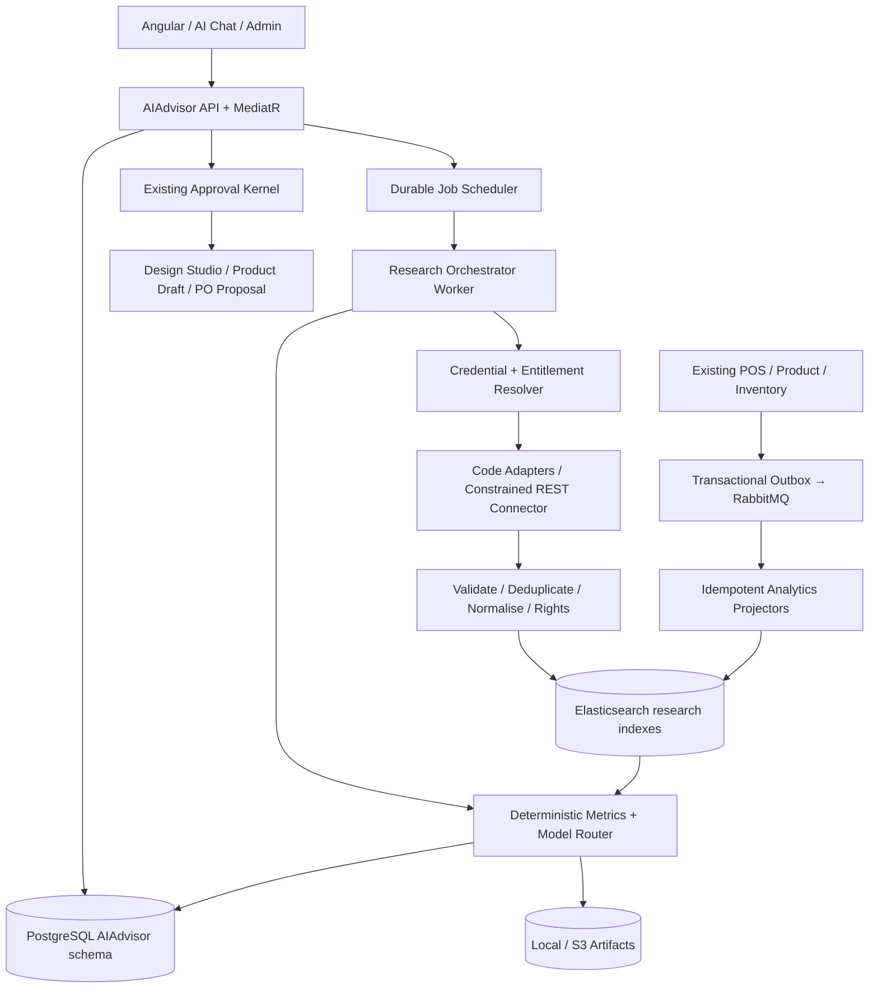

# IraniMart AI Business Advisor — Low-Level Design (LLD)

**Version:** 1.0 | **Date:** 2026-10-27 | **Status:** Implementation design baseline, subject to G1–G3 acceptance gates  
**Companion:** `AI_BUSINESS_ADVISOR_SRS.md`  
**Repository location:** `Docs/AI_Business_Advisor/AI_BUSINESS_ADVISOR_LLD.md`  
**Initial deployment:** IraniMart / 7 showrooms; tenant-aware from day one.

## 1. Constraints and invariants

Preserve approved Decisions **D01** Hybrid Connectors; **D02** Hybrid Credentials; **D03** Hybrid Source Management; **D04** Tiered Retention; **D05** Controlled Autonomy. None are renegotiated in this document.

- PostgreSQL is source-of-truth for configuration, research execution control, recommendations and approvals; Elasticsearch is a rebuildable analysis/search read store; Local/S3 is pluggable artifact storage.
- Existing ERP/POS continues to own sales, stock, price, orders and financial transactions. AI module does not own or directly write these tables.
- Every request has explicit `TenantId`, `ActorId`, authorisation context, correlation ID and optional OutletIds (never inferred from a broad inventory setting).
- No private third-party AI prompts or unapproved platform data ingestion. Source evidence never grants tool/command authority.
- Begin as modules/workers in existing .NET solution (no unnecessary service split); isolate contracts for later service extraction.

## 2. Suggested .NET solution boundaries

```text
src/
  Modules/
    AIAdvisor/
      AIAdvisor.Domain/
        Entities/ ValueObjects/ Enums/ Events/
      AIAdvisor.Application/
        Commands/ Queries/ Handlers/ Validators/
        Contracts/ Behaviours/ Policies/
      AIAdvisor.Infrastructure/
        Persistence/ Connectors/ Secrets/ Elasticsearch/
        Jobs/ Providers/ ObjectStorage/ Messaging/
      AIAdvisor.API/
        Endpoints/ Dtos/ Authorization/
      AIAdvisor.Worker/  # can be hosted in current worker process
  Shared/
    Contracts/Observability/Security/
frontend/src/app/features/business-intelligence/ai-advisor/
  pages/ components/ services/ models/ routes.ts
Docs/AI_Business_Advisor/
```

Dependencies: API→Application→Domain; Infrastructure implements Application ports; Domain references no providers. Reuse existing MediatR, FluentValidation, approval kernel, tenant context, transactional outbox, messaging, logging and Local/S3 abstraction where available. Physical folder names should adapt to existing repository conventions without changing boundaries.

## 3. Logical architecture and dataflow



Outbox delivery is at-least-once; consumers must be idempotent. Research connector calls are outside database transactions. AI provider responses must validate against versioned JSON schemas before persistence. Report status can be `Partial` if external sources fail.

## 4. PostgreSQL schema (suggested `ai_advisor`)

All tenant-private entities include `tenant_id`, `created_at`, `updated_at`, `created_by`, and `row_version` or equivalent optimistic concurrency token. UUID primary keys follow existing naming conventions. `NULL tenant_id` is **not** a bypass: use explicit `scope_type` + mutually exclusive tenant/global rules and separate authorisation for global assets.

| Table | Key columns | Constraints / responsibilities |
|---|---|---|
| `provider_definitions` | id, code, adapter_type, capability_json, auth_modes, supported_regions, policy_version, active | Platform-managed catalogue, unique code; code-based connector configuration / generic allowed endpoints |
| `provider_connections` | id, provider_id, scope_type, tenant_id?, credential_owner, secret_ref, status, expiry_at, quotas_json, costs_json, policy_ack_version | No raw secrets; unique active connection per scope/role/config where relevant |
| `connector_endpoint_policies` | id, definition_id, allowed_host, path_template, method, schema_json, mapping_json, max_bytes | Generic connector SSRF/safety and schema limits |
| `research_sources` | id, scope_type, tenant_id?, platform, source_type, canonical_key, url, country, category_json, approval_state, trust_metadata_json, licence_json | Unique `(scope_type,tenant_id,platform,canonical_key)` using null-safe strategy; global is explicitly distinguished |
| `source_discovery_candidates` | id, tenant_id, candidate_key, discovered_by_job_id, proposed_source_json, score_json, decision, decided_by | Evidence and approval history |
| `research_watchlists` | id, tenant_id, name, category_filters_json, keyword_set_json, source_ids_json | User-curated watchlists |
| `research_schedules` | id, tenant_id, cron, timezone, window_json, category_json, scope_json, enabled, budget_policy_id | UTC execution, timezone-aware windows; DST safe |
| `research_jobs` | id, tenant_id, requester_id, kind, dedupe_key, status, request_json, coverage_json, started_at, ended_at, error_summary | Unique dedupe key per tenant/scope/window; cancelled/partial terminal states |
| `research_job_steps` | id, job_id, provider_connection_id, source_id, capability, status, attempts, next_retry_at, quota_cost, cursor_ref, error_code | Resumable execution checkpoints |
| `research_observation_refs` | id, tenant_id, job_id, provider, external_id, evidence_hash, canonical_uri, observed_at, rights_policy_id, es_doc_id, purge_at | Evidence mapping; no unlicensed payload in PostgreSQL |
| `research_reports` | id, tenant_id, job_id, version, prior_report_id, scope_json, coverage_json, status, summary_json, artifact_ref, generated_at, ai_run_id | Versioned immutable published report; versioned drafts allowed |
| `research_findings` | id, report_id, finding_type, claim_json, evidence_refs_json, confidence_json, caveats_json | Supported claims only |
| `recommendations` | id, tenant_id, report_id, type, subject_json, evidence_json, rationale, impact_json, assumptions_json, confidence_json, status, assignee_id, evaluated_at | Separate recommendation aggregate; optimistic concurrency |
| `recommendation_actions` | id, recommendation_id, action_type, downstream_ref, status, approval_instance_id, idempotency_key | One recommendation may produce many drafts; unique idempotency key |
| `recommendation_reviews` | id, recommendation_id, reviewer_id, decision, reason, occurred_at, version | Immutable review history; kernel is authority |
| `recommendation_outcomes` | id, recommendation_id, window_json, metric_version, actual_json, confounders_json, evaluated_by | Correlation caveats, baseline and comparison |
| `ai_provider_profiles` | id, scope_type, tenant_id?, provider_code, model_code, config_json, secret_ref, allowed_task_types | No raw keys/prompts containing PII |
| `ai_execution_runs` | id, tenant_id, job_id, task_type, provider, model, prompt_version, usage_json, cost_estimate, status, schema_version | Cost and provenance |
| `usage_ledger` | id, tenant_id, connection_id, job_id, units, metric, estimated_cost, charged_cost?, occurred_at | Append-only usage metering |
| `retention_policies` | id, scope_type, tenant_id?, data_class, max_age_days, provider_limit, retention_basis, active | Effective shortest-allowed retention |
| `audit_events` | id, tenant_id, actor_id, event_type, entity_ref, decision_json, correlation_id, occurred_at | Security sanitised append-only audit |
| `inbox_messages` | consumer, message_id, tenant_id, processed_at | Unique `(consumer,message_id,tenant_id)` |
| `outbox_messages` | id, tenant_id, type, payload_json, correlation_id, published_at, retry_state | Atomic writes on business commands |

**Indexes:** time-ordered `research_jobs(tenant_id,status,created_at DESC)`; `sources(tenant_id,platform,approval_state)`; `recommendations(tenant_id,status,created_at)`; `research_reports(tenant_id,generated_at DESC)`; unique `dedupe_key` per scope; GIN indexes for selective JSONB only when proven by query plans. For RLS use existing business tenancy strategy and verify service-account policies; never rely solely on Angular filters.

### Database migration rules

Migrations reviewed before deployment, forward-only production rollout; unique keys and foreign keys must be included. Use current EF Core mapping conventions and optimistic concurrency. Provider response payloads stay out of transactional rows where rights or volume prohibit storage.

## 5. Elasticsearch index strategy

Prefer tenant-scoped filters and alias/authorisation enforcement in application; platform-global evidence lives in separate rights-gated indices. Never trust client-provided tenant identifiers alone.

| Logical alias | Document contents | Suggested lifecycle |
|---|---|---|
| `ai-market-evidence-v1` | provider/source/doc hash, country, date, permitted text/metadata, design extraction, observed metrics, rights & purge time | time-based rollovers; raw retention |
| `ai-market-signals-v1` | category, style, language, sentiment, intent, confidence, source+model provenance, tenant/global scope | provider-aware 24-month ceiling |
| `ai-market-trends-daily-v1` | bucket day, category/style, platform, mention/engagement metrics **with units**, coverage and source mix | up to approved multi-year aggregate policy |
| `ai-competitor-prices-v1` | competitor, product/variant, listed currency/price, observed time, reference URL | time-based price history |
| `ai-product-performance-v1` | tenant/outlet/SKU/design, day, net units, returns, net revenue ex-VAT, COGS, margin, stock availability | retained as ERP-governed projection |
| `ai-inventory-ageing-v1` | tenant/outlet/SKU, inventory availability, ageing, movement summaries | rebuilt from inventory events/snapshots |
| `ai-design-attributes-v1` | tenant/product/designRef, cut, fabric/uncertainty, colour, sleeve, embroidery, embeddings if licensed | rights-scoped product classification |

Documents include `schema_version`, `tenant_id` or explicit `global_scope`, `source_rights`, `observed_at`, `ingested_at`, `expires_at`. Keep marketing trends search-relative values distinct from raw social counts. Elasticsearch is rebuildable, not canonical for approval actions. Use ILM for index retention where it fits document rights; implement per-document purge for shorter rights or takedowns. A global index cannot automatically be shared with tenants unless provider terms allow reuse.

## 6. External provider contracts

```csharp
public interface IMarketDataConnector
{
    string ProviderCode { get; }
    Task<CapabilityManifest> GetCapabilitiesAsync(ConnectorContext context, CancellationToken ct);
    IAsyncEnumerable<ExternalObservation> CollectAsync(
        ResearchRequest request, ConnectorContext context, CancellationToken ct);
}

public interface ICredentialResolver
{
    Task<ResolvedProviderAccess> ResolveAsync(
        Guid tenantId, string providerCode, string requiredCapability,
        CredentialPreference preference, CancellationToken ct);
}

public interface IAiModelProvider
{
    Task<StructuredModelResult<T>> GenerateAsync<T>(
        AiTaskRequest task, CancellationToken ct) where T : class;
}

public interface IArtifactStore
{
    Task<StoredArtifact> PutAsync(ArtifactWriteRequest request, CancellationToken ct);
    Task DeleteAsync(string reference, CancellationToken ct);
}
```

`ExternalObservation` contains `ExternalId`, `CanonicalUrl`, `ObservedAt`, `RetrievedAt`, `ContentType`, `PermittedFields`, `Rights`, `CountryEvidence`, `EngagementMetricsWithUnits`, `SourceId`, `ProviderCorrelationId`, `ExtractionWarnings`. `ConnectorContext` is immutable and exposes a scoped secret handle, not a plaintext secret to logs or models. No connector can reach internal hosts or cloud instance metadata.

**Generic REST connector:** admin-defined HTTPS host allowlist (DNS/IP checked before and after redirects), fixed allowed methods, approved base paths, request/response JSON schema, max pagination/bytes/calls, mapping expressions in a safe declarative format (no arbitrary JS, SQL, shell or dynamic code), policy approval, egress guard, rate limit and audit. Credentials never embedded in dynamic URL fields.

**Credential precedence:** requested explicit BYOK/managed → verify connection and rights → if unavailable return `CredentialUnavailable` / `Unsupported`, never billable fallback without explicit tenant configuration. Refresh OAuth tokens with server-side concurrency locking and masking.

## 7. CQRS request catalogue

| Command / Query | Key behaviour |
|---|---|
| `UpsertProviderConnectionCommand` | Authorise connection owner; store secret reference; validation; rotate/revoke events |
| `RegisterResearchSourceCommand` | canonicalise, capability/rights check, source dedupe, audit |
| `DiscoverResearchSourcesCommand` | budget-limited source candidate generation |
| `ReviewResearchSourceCommand` | approve/reject; policy enforced; state transition |
| `ScheduleResearchCommand` | validate cron/zone/caps; scheduler registration |
| `RequestResearchReportCommand` | resolve scope and budget; dedupe; create job + outbox |
| `CancelResearchJobCommand` | cooperative cancellation with status guard |
| `GetResearchJobQuery` | scope permission and detailed coverage/status |
| `GetMarketTrendsQuery` | validate category/scope/units/rights, aggregate ES |
| `GetOutletFashionPerformanceQuery` | derive allowed outlet list server-side; ES performance projections |
| `GetReportQuery` / `ListReportsQuery` | tenant/outlet scope and versioned evidence references |
| `AskBusinessAdvisorCommand` | verified scoped retrieval; budget; streamed/queued answer with citations |
| `GenerateDesignBriefDraftCommand` | recommendation-linked draft, no product publication |
| `CreatePurchaseProposalDraftCommand` | downstream draft with typed command and idempotency |
| `ReviewRecommendationCommand` | existing Approval Kernel, concurrency/version check, audit |
| `EvaluateRecommendationOutcomeCommand` | compare observed KPIs with assumptions and confounders |
| `PurgeExpiredResearchDataCommand` | provider/tenant and privacy-controlled cascade purge |

Pipeline behaviours: authentication → tenant/outlet authorisation → validation → idempotency → rate/budget → business transaction → audit/outbox → response. Ensure external calls are never made within long-lived DB transactions.

## 8. API surface (`/api/ai-advisor/v1`)

| Verb | Route | Notes |
|---|---|---|
| GET | `/providers` | provider + capability matrix, policy states |
| GET/POST | `/connections` | metadata only; create secret via secure server-side operation |
| PUT/DELETE | `/connections/{id}` | rotate, disable, revoke; masked reads |
| GET/POST | `/sources` | tenant-scoped source listing and creation |
| POST | `/sources/discover` | candidate discovery job |
| POST | `/sources/{id}/review` | approval of candidate/source |
| GET/POST | `/schedules` | frequency, timezone, limits |
| POST | `/research/jobs` | on-demand request; returns 202 + job ID |
| GET | `/research/jobs/{id}` | status, coverage, timings, partial errors |
| POST | `/research/jobs/{id}/cancel` | stop outstanding work where feasible |
| GET | `/trends` | category/window/platform filters and comparative series |
| GET | `/outlets/performance` | authorisation-filtered outlets |
| GET | `/reports` | paginated history |
| GET | `/reports/{id}` | published snapshot, evidence, confidence |
| GET | `/recommendations` | filter status/type/category/outlet |
| POST | `/recommendations/{id}/review` | permissioned approval integration |
| POST | `/recommendations/{id}/design-brief` | creates draft only |
| POST | `/recommendations/{id}/purchase-proposal` | creates draft only |
| POST | `/advisor/questions` | verified-retrieval chat Q&A / async job |
| GET | `/usage` | per-tenant/provider budget usage |

All pagination bounded; read requests do not accept arbitrary cross-tenant scope. Unsafe operations require anti-CSRF controls per auth scheme, audit and idempotency key. Use `ProblemDetails` with stable error codes (`CAPABILITY_UNAVAILABLE`, `PROVIDER_ACCESS_DENIED`, `INSUFFICIENT_EVIDENCE`, `BUDGET_EXCEEDED`, `APPROVAL_REQUIRED`, `VERSION_CONFLICT`, `RESEARCH_PARTIAL`).

### Example research request

```json
{
  "scope": "MarketAndBusiness",
  "question": "Which burqa designs should we test next month?",
  "categories": ["BurqaAbaya"],
  "region": "BD",
  "period": {"from": "2026-10-01", "to": "2026-10-27"},
  "outletIds": [],
  "providerCodes": ["google", "youtube", "approved-market-sources"],
  "runMode": "OnDemand",
  "requestedFormat": "StructuredReport"
}
```

An empty `outletIds` array means *apply permitted outlet scope*, not *access every outlet*. Tenant/actor context is resolved server-side.

## 9. Background job state machine and idempotency

`Queued → Validating → Collecting → Normalising → Correlating → Generating → Publishing → Completed`; terminal/alternate `Partial`, `Failed`, `Cancelled`, `PolicyBlocked`, `BudgetExceeded`. Steps persist checkpoints; retries occur for transient failures with bounded attempt limits and DLQ. Each job has a stable request fingerprint `(tenant, categories, period, scope, scheduleTick or requestId)`; duplicate schedule ticks cannot publish duplicate reports.

A report may be `Partial` and usable even if one of five legal providers is down. Display which providers failed/unsupported and which data windows remained unobserved. Provider quota errors are not silently treated as a zero-trend signal.

## 10. ERP integration events and projection correctness

Existing transactional write + outbox in the same database transaction → publisher → RabbitMQ → inbox-guarded projection worker → ES.

Candidate events: `SaleCompleted`, `SaleVoided`, `SaleReturned`, `SaleExchanged`, `ProductCreatedOrUpdated`, `ProductVariantChanged`, `InventoryMovementPosted`, `StockAdjusted`, `PurchaseReceived`, `SellingPriceChanged`. Align exact event names with existing domain contracts rather than creating duplicate events.

Projection dimensions: `tenant_id`, `outlet_id`, `product_id`, `variant_id`, `design_id`, `business_date` (business timezone), `sale_id`/revision. Monetary calculations use existing finance/tax semantics and decimal arithmetic. Idempotency and correction events must prevent duplicate counts and reconcile negative adjustments correctly. Maintain projection reconciliation job comparing sample aggregated results to authoritative POS values. Restore/index rebuild runs from source events or authorised snapshots.

## 11. Trend and recommendation scoring

Implement deterministic trend features: week-over-week *comparable* within-platform mention growth, accessible sample counts, country evidence, source mix, organic/paid uncertainty, comment buying-intent labels, cross-platform corroboration, historical seasonality, internal comparable design sell-through/stockout/margin. Missing-source flags persist. No unsupported numerical probability prediction.

Suggested configurable starting evaluation weights: historical demand 30%, external evidence 20%, margin 20%, inventory fit 15%, differentiation 10%, supplier feasibility 5%. Compute composite only if minimum-coverage thresholds met. Missing feature is `Unknown`; factor weighting can be temporarily reweighted only with explicit configured rule and an explanatory notice; default is **Provisional**. A source trust score is distinct from claim confidence.

Prompt inputs are typed retrieved facts, not raw unrestricted instructions. Model output schema includes `claim`, `supportingEvidenceIds`, `counterEvidenceIds`, `assumptions`, `confidenceExplanation`, `proposedAction`, `estimatedOutcomeRangeOrNull`, `missingData`, `approvalRequired`. Reject unsupported source IDs and unsupported numerical claims before report publishing.

## 12. Recommendation workflow / Approval Kernel

Use existing policy/instance/decision API; no parallel approval engine. Recommendation review commands enforce `TenantId`, applicable outlet scopes, `RequiredPermission`, approver identity and optimistic lock. Design exploration approval is not supplier/procurement approval; downstream commercial approval separate.

Typed integration ports:

```csharp
public interface IDesignStudioDraftGateway
{
    Task<DraftRef> CreateBriefAsync(ApprovedResearchDesignBrief brief, string idempotencyKey, CancellationToken ct);
}
public interface IPurchasingProposalGateway
{
    Task<DraftRef> CreateDraftAsync(PurchaseProposalInput input, string idempotencyKey, CancellationToken ct);
}
```

Gateway accepts **draft-only** actions; publication/confirmation remains inside domain handlers outside the agent's credentials. On rejection / approval rollback, do not secretly execute pending drafts. Preserve approval versions, parent recommendation IDs and audit.

## 13. Frontend feature structure and UX

Routes (under existing permission-aware menu):

```text
/business-intelligence/ai-advisor/overview
/business-intelligence/ai-advisor/reports
/business-intelligence/ai-advisor/research/new
/business-intelligence/ai-advisor/research/jobs/:jobId
/business-intelligence/ai-advisor/trends
/business-intelligence/ai-advisor/competitors
/business-intelligence/ai-advisor/sources
/business-intelligence/ai-advisor/recommendations
/business-intelligence/ai-advisor/recommendations/:id
/business-intelligence/ai-advisor/chat
/business-intelligence/ai-advisor/settings/providers
/business-intelligence/ai-advisor/settings/credentials
/business-intelligence/ai-advisor/settings/schedules
/business-intelligence/ai-advisor/settings/retention
```

Use existing Able Pro standards, responsive route-based feature pages, loading/empty/error/partial states, visible date/provider evidence badges and outlet permission scoping. Reports and trends need keyboard-accessible filters and clearly different `Demo`, `Unavailable`, `Verified` states. Do not show mock numbers as live KPIs. APIs deliver permission-filtered counts, not raw data hidden by UI.

## 14. Security threat controls

- Tenant isolation test suite covers controller, CQRS, ES, cache, jobs, object access, global source reuse and external model context.
- SSRF hardening for generic connectors: URL allowlist, deny private/loopback/link-local/metadata networks, redirects validated, egress firewall, response size/time caps, disallow file/ftp protocols.
- Supply chain: API response schema validation and content sanitisation; HTML/blog/social copy untrusted; prompt injection protection (external source cannot initiate tools or set system rules).
- PII controls: minimised customer insights (aggregate-only default), explicit consent/entitlement where needed, no secrets or personal records in prompts without approved policy.
- Secret management: secure reference, masked UI, OAuth token rotation, separated BYOK scopes; never store plaintext in `provider_connections`.
- Budget controls applied before external calls, rechecked at step boundaries and on retry. No silent paid fallback.
- Incident actions: pause provider, revoke connection, purge ingested data if source rights revoked, replay safely.

## 15. Observability, cost, operational recovery

Use OpenTelemetry trace ID from API through job, connector, AI run, index and report. Metrics: queued/running jobs, per-provider error/429 ratio, source freshness, observations collected, dedupe rate, ES projection lag, model schema rejection, spend per tenant, partial reports, retention purge lag, approvals blocked. Alert on unexpected usage bursts, credential expiry, policy violations, repeated failures and reconciliation differences.

Recovery: queued jobs persisted; workers lease/checkpoint jobs; stale leases reclaimed; each stage idempotent. Object storage and Elasticsearch derived indexes rebuilt where permitted; PostgreSQL backups/PITR follow existing DR strategy. Deleted data may not be restored into active service during recovery without reapplying tombstones/purge journal.

## 16. Retention engine

Compute effective expiry from provider rights, tenant limits, category policy, licence, revocation and applicable law (the most restrictive). A daily purge job emits deletion tombstones to all applicable ES documents, source refs, Local/S3 objects, caches and downstream derived data where required. Aggregate retention is allowed only if non-identifying, rights permit, and deletion obligations are satisfied. Store purge execution evidence without retaining prohibited source data.

## 17. Testing strategy / rollout gates

**Unit:** Validators, state transitions, tenant/outlet filters, confidence/missing-data logic, cost/retention rules, authority checks, canonicalisation.

**Integration:** PostgreSQL transactions, EF migrations, RabbitMQ outbox/inbox, Elasticsearch tenant filters/projection rebuild, Local/S3, provider stub APIs, OAuth expiry/retry, generic connector host blocking.

**Contract:** Connector capability schema, approved provider samples and data rights, AI response JSON, ERP/domain event contracts, Draft gateways and Approval Kernel contract.

**E2E:** Schedule → partial provider failure → report with coverage → review → design draft → blocked unapproved purchase; cross-tenant forbidden queries; assigned outlet manager limited to assigned outlets.

**Load/security:** concurrent tenant jobs, provider throttling, AI spend caps, replay, route/RLS bypass attempts, prompt injection, SSRF, media deletion, backup restore purge.

**Gate G1:** verify commercial access/licences and retention per live connector; do not ship unsupported providers as enabled.

**Gate G2:** verify tenant/outlet security and rights-governed reuse before enabling external tenants.

**Gate G3:** verify design/purchasing typed integration and approval kernel enforcement before enabling downstream actions.

## 18. Phased implementation tasks

1. Domain aggregates, permissions, tenant boundaries, schema/migration, basic Angular shell.
2. Provider registry/credentials and safe connector framework; implement approved first provider(s) with stubs.
3. Source registry/manual watchlists and governed source discovery; execution jobs and budgets.
4. Evidence/provenance read models + structured AI extraction; lifecycle/purge.
5. ERP outbox projections and numeric parity tests; seven-outlet reporting.
6. Deterministic trend metrics and report composer; weekly/on-demand jobs; chat Q&A with citations.
7. Recommendation lifecycle, design draft integration and Approval Kernel; outcome evaluation.
8. SaaS operational hardening, tenant self-service, quotas and optional billing integration.

Each step should have independent tests and migration verification. Implement provider integrations only after access/licensing confirmation; maintain mocks for unavailable platforms.

## 19. Traceability

- D01: Connector adapters/generic config → schema + contracts + G1.
- D02: `provider_connections`, `ICredentialResolver`, quotas, billable fallback restrictions.
- D03: `research_sources`, candidate workflow, approvals, health checks.
- D04: PostgreSQL + ES + Local/S3, provenance, ILM/retention engine.
- D05: recommendation/approval aggregates and draft-only gateway commands, G3.

**No historical or hypothetical data in the prototype is evidence of actual IraniMart performance.**
