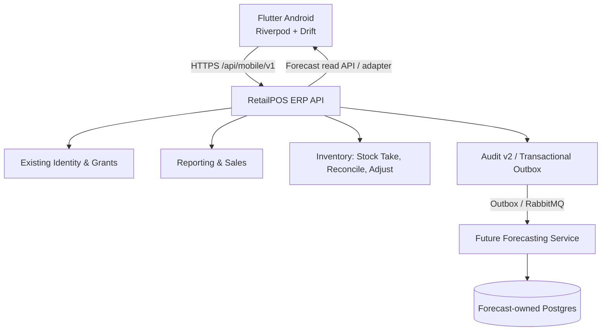
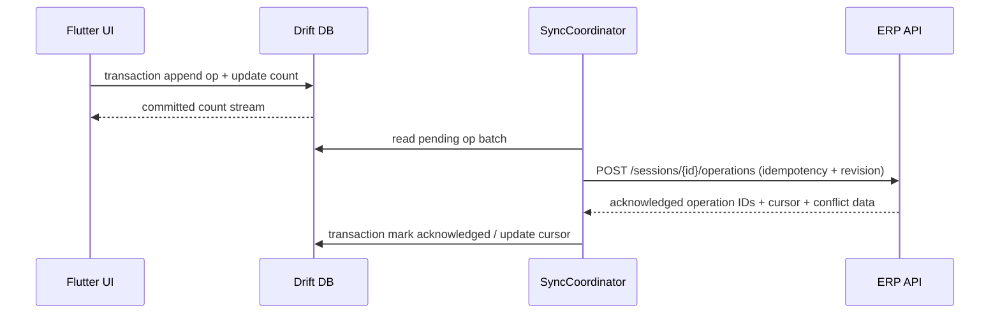

# IraniMart Business Mobile — Low-Level Design (LLD)

**Version:** 1.4 Draft | **Date:** 2026-10-13 | **Status:** Implementation blueprint; ADR gates apply
**Companion:** `IRANIMART_BUSINESS_MOBILE_SRS_v1.4.md` (read first)

## 1. Architectural decisions
**Decision:** Flutter is a standalone Android client, NOT a backend microservice. Reuse the existing RetailPOS/ERP monolith (ASP.NET Core CQRS/MediatR, PostgreSQL, existing security/audit and messaging) for identity, dashboards, stock take, reconciliation, approvals and inventory adjustments. Treat Forecasting as a bounded context with a stable API; extract to an independent service after data pipelines, model operations and scaling needs justify it. Never make mobile an inventory system of record.

**Rationale:** Stock take and approvals require strongly consistent access to ERP stock movements, inventory policies and journal/audit lineage. Extracting stock take now creates distributed consistency and duplicate-source-of-truth risk. Forecasting is asynchronous, computation-heavy, model-versioned and read-oriented, therefore a better future microservice boundary.

### 1.1 Context diagram

Actual endpoint routing may be via gateway or ERP BFF; no gateway required merely for one app. Reuse existing API standards rather than creating parallel auth/inventory infrastructure.

## 2. Repository and package architecture
Prefer a **feature-first clean architecture** with presentation/application/domain/data; keep pure domain independent of Flutter and packages. Avoid boilerplate abstractions without a justified purpose; stock take and syncing merit explicit use cases. UI widgets do not call HTTP, SQLite or domain mutation directly. Repositories own local/remote coordination.

```text
pos-v2/
  .github/workflows/{backend-ci.yml,frontend-ci.yml,mobile-ci.yml}
  Docs/Mobile/{IRANIMART_BUSINESS_MOBILE_SRS_v1.4.md,IRANIMART_BUSINESS_MOBILE_LLD_v1.4.md,ADRs/,api/,runbooks/}
  retailpos-frontend/               # existing Angular — do not relocate
  src/                              # existing ASP.NET Core — do not relocate
  tests/                            # existing .NET tests — do not relocate
  retailpos-mobile/                 # NEW Android-only Flutter app
  android/
  assets/brand/{company-logo-watermark.png,favicon.png}
  lib/
    main.dart
    bootstrap.dart
    app/{app.dart,router.dart,theme/,localization/,di/}
    core/
      config/{environment.dart,feature_flags.dart}
      error/{app_failure.dart,result.dart}
      network/{api_client.dart,auth_interceptor.dart,request_id.dart}
      security/{token_store.dart,session_manager.dart}
      database/{app_database.dart,migrations/}
      sync/{sync_coordinator.dart,retry_policy.dart,connectivity_monitor.dart}
      permissions/{capability.dart,scope_guard.dart}
      observability/{logging.dart,telemetry.dart}
      design_system/{widgets/,tokens/}
    features/
      auth/{presentation/,application/,domain/,data/}
      dashboard/{presentation/,application/,domain/,data/}
      stock_take/{presentation/,application/,domain/,data/}
      insights/{presentation/,application/,domain/,data/}
      forecasting/{presentation/,application/,domain/,data/}
      notifications/{presentation/,application/,domain/,data/}
      profile/{presentation/,application/,domain/,data/}
  test/{unit/,widget/,golden/,fixtures/}
  integration_test/
  tool/{quality_checks/,scripts/}
  pubspec.yaml
  pubspec.lock                     # commit for reproducibility
  analysis_options.yaml
```

**Dependency rule:** `presentation → application → domain`; `data → domain`, and application contracts depend on domain. `core` contains only reusable mechanisms, not feature business logic. Compose concrete implementations in `app/di`. No cyclic feature imports. Business rules and session transitions are server-authoritative.

### 2.1 Core data flow
`Widget → Riverpod Notifier/ViewModel → UseCase → Repository interface → Local/Remote Repository implementation → Drift/Dio`. Read streams move in opposite direction. Use immutable models, typed error results, cancellation, structured concurrency and constructor/provider injection. No service locator in business code, no static global mutable stores.

### 2.2 Monorepo isolation and CI rules
- Root `.gitignore` should add Flutter/Dart build output, Android ephemeral files, IDE caches, secrets and signing artifacts without ignoring checked-in Android Gradle wrapper, relevant generated source if explicitly standardised, or `retailpos-mobile/pubspec.lock`.
- `mobile-ci.yml` MUST use path filters scoped to `retailpos-mobile/**`, `Docs/Mobile/**` and relevant contract changes, and run format, static analysis, test suites and Android debug/release build as appropriate. Backend/Angular pipelines must continue to pass independently. CI must not access production credentials or sign with developer keystores.
- Keep Android application ID/environment, SDK/JDK/Gradle compatibility, deployment signing and store distribution documented in a reproducible build baseline. CI uses pinned Flutter SDK version, not floating latest.
- Keep repository-level development instructions discoverable for Copilot while avoiding duplicated, conflicting policy files. Do not alter existing backend/Angular project layout as a side effect.


## 2A. Enforceable Flutter architecture governance (NEW v1.3)

### 2A.1 Dependency direction and feature contracts

Each feature has `presentation/`, optional `application/`, `domain/` and `data/`. Business invariants belong in domain/application, not widgets. UI talks to application controllers/use cases; data implements domain-owned ports. DTOs never escape data across feature boundaries. `core/` is technical infrastructure, not a shared dumping ground for business rules. `shared/design_system` owns tokens/widgets only.

| Import source | Allowed | Forbidden |
|---|---|---|
| `features/<feature>/domain` | Dart SDK, own pure domain contracts | Flutter UI, Riverpod, Dio, Drift, other feature internals |
| `features/<feature>/application` | Own domain, pure application contracts | Widget pages, concrete infrastructure clients, another feature's `data/` |
| `features/<feature>/data` | Own domain/application contracts, core network/storage abstractions | Another feature's private repository or UI state |
| `features/<feature>/presentation` | Own application/domain API, shared design system, Riverpod/routing | Direct raw Dio/Drift access, another feature's private state or data source |
| `app/bootstrap` | Feature public composition exports, core providers | Business rules or product/stock calculations |

Cross-feature communication: explicit public application contracts in narrow `features/<feature>/public/` or composition-level orchestration; no cyclic dependencies. Reuse existing stock/identity/notification ERP ownership. Avoid artificial use-case wrappers where no invariant exists, but document exceptions in ADR and preserve testability.

### 2A.2 Dependency injection and lifecycle

- Use Riverpod providers as the DI/composition mechanism; keep domain constructors ordinary Dart constructors/interfaces and inject dependencies from app providers.
- Scope authenticated services, tenant/outlet context and offline cache per principal; invalidate/tear down providers on logout/scope change without deleting unreconciled operations.
- Keep Dio interceptors for token refresh (single-flight), correlation, retry classification and privacy-safe logging; don't retry business mutations unless idempotency keys are guaranteed.
- Keep GoRouter redirect guards consistent with verified server grants; UI hiding is not authorisation. Use Flutter-native widgets and one branded design system with token governance matching Figma.

### 2A.3 Continuous architecture enforcement

- Establish `analysis_options.yaml` strict analyzer/lints and format checks, scripted restricted-import checks or dedicated Dart dependency rules with negative fixture tests, and CI verification of no forbidden cross-feature or domain-to-framework imports.
- Keep unit, widget, integration, offline crash-recovery, backend PostgreSQL concurrency/contract and device smoke suites separated. No merge on failing `flutter analyze`, `dart format --output=none --set-exit-if-changed .`, or required tests.
- Use stable compatible packages (Riverpod, GoRouter, Dio, Drift, secure storage, scanning) validated from official sources during development; pin `pubspec.lock`, declare SDK constraints and dependency review cadence. Do not confuse an SDK version with proof that all latest packages are compatible.
- Require ADR log with context/alternatives/rationale/consequences/status and gate technical choices before coding. Suggested ADR-ARCH-01 (feature public contracts), ADR-ARCH-02 (API version/deprecation), ADR-ARCH-03 (package extraction), ADR-ARCH-04 (monitoring/PII), ADR-ARCH-05 (CI dependency enforcement).

### 2A.4 Evolution criteria

Keep one Flutter package initially. Extract Dart packages only when 2+ applications independently reuse a capability, team ownership/deployment boundary demonstrably warrants it, or CI/build scaling provides measured benefit. Extract backend microservices only after observed ownership, performance, deployment and data-consistency needs justify distributed complexity. Forecasting remains independently modelled but may be in-process initially. Preserve documented migrations and feature/public contract compatibility.

### 2A.5 Mandatory Copilot planning evidence

Before implementation the planning deliverables MUST include module dependency diagram, concrete folder/package plan, allowed/forbidden imports, DI graph, route/permission map, catalogue dataflow, immutable operation/sync protocol, OpenAPI version strategy, feature testing matrix, migration/recovery paths, package support matrix, ADR decision register, rollback plan and requirement-to-test mapping for CAT/ARCH/STK/SYNC/NOT. Mark unverified existing ERP capabilities as UNKNOWN rather than inventing them.

## 3. Technology selection and version policy
**Required policy:** choose current *stable* releases compatible with the chosen Flutter stable/Dart toolchain **on the implementation date**. Do not copy stale example versions, pre-release packages or blindly execute `pub upgrade --major-versions`. Lock tested resolved versions in `pubspec.lock`, commit the lockfile for this app, record `flutter --version`, `dart --version`, package versions, Android Gradle/JDK version, and security/license assessment in a dependency baseline document. Use `flutter pub outdated` and release notes before upgrades. Prefer mature actively maintained packages; justify any additional dependency.

| Concern | Preferred library | Design notes |
|---|---|---|
| State, async and DI | `flutter_riverpod` + `riverpod_annotation` as appropriate | Feature-scoped AsyncNotifier/Notifier and test overrides |
| Routing | `go_router` | Auth/permission redirects and Android back stack |
| HTTP | `dio` | Typed clients, auth refresh locking, redacted logs, timeouts, cancellation |
| Local DB | `drift` + SQLite | Transactional scan and outbox, schema migrations |
| Barcode | `mobile_scanner` | Android permission lifecycle, de-bounce/scan gating, real-device tests |
| Immutable models | `freezed`, `json_serializable` (optional) | Separate transport DTOs from domain where rules warrant |
| Secrets | `flutter_secure_storage` | Assess Android Keystore options and threat model |
| Network status | `connectivity_plus` | Connectivity hint only; API probe determines reachability |
| Report sharing | `share_plus`, `printing` / `pdf` only if needed | Prefer backend-generated official Excel/PDF |
| Observability | Existing approved error/reporting SDK | Consent, redaction, environment separation |
| Test | `flutter_test`, `integration_test`, `mocktail` or fakes | Test behavioral seams; avoid overmocking |
| Lint | `flutter_lints` or approved strict equivalent | Static analysis and complexity/dependency gates |

Do not include two different navigation/state-management stacks unless approved. If package/API changes break examples, follow current stable official docs and add ADR; never disable lints merely to satisfy CI.

Reference policy checked 2026-10-12: Flutter architecture recommendations and offline-first patterns; pub.dev package version should be re-verified during scaffold creation. References: https://docs.flutter.dev/app-architecture/recommendations ; https://docs.flutter.dev/app-architecture/design-patterns/offline-first ; https://pub.dev/packages/flutter_riverpod ; https://pub.dev/packages/go_router .

## 4. Branding and design implementation
Assets are official user-supplied files (do not redraw). Full logo for splash/login; monogram for compact header/app icon; preserve proportions. Theme: rich espresso `#35291F`, brown `#75583E`, brand gold `#C69B45`, champagne `#E7CF98`, warm ivory `#FAF7F2`, charcoal `#292724`. Semantic green/red/amber reserved for status. Material 3 components with reusable tokens, WCAG-aware contrast, text-scale and screen-reader support. Figma Make is visual reference; inspect output rather than shipping its prototype implementation as production Flutter code.

## 5. Identity, security and authorisation
- Reuse ERP auth. Before implementation inspect existing authentication endpoints, token refresh, claims/permissions, outlet assignments and logout semantics. Prefer standard OIDC Authorization Code + PKCE when supported; otherwise record a security-reviewed mobile flow ADR. Never put client secrets in APK.
- Access token held in memory when practicable; refresh credentials in platform-backed secure storage; reject insecure backup/restore behaviour. Refresh single-flight and retry only idempotent authenticated requests. No tokens in logs/crash reports.
- `GET /api/mobile/v1/me` returns user ID, business ID, available outlets, grants and API policy version; server independently checks each request. Introduce only additive, namespaced grants aligned to current permissions catalogue (provisional: `mobile.dashboard.view`, `inventory.stocktake.create`, `inventory.stocktake.count`, `inventory.stocktake.submit`, `inventory.stocktake.read`, `mobile.insights.view`, `mobile.forecasting.view`). Resolve exact names in Phase A.
- Use explicit `businessId`/`outletId` context but never trust client-provided scope; use validated server claims. Avoid leaking tenant data through export URLs/caches. Authorise each session ownership, read, event write and export.
- Capture device identifier pseudonymously if needed; no device fingerprinting without documented rationale.
- Encrypt sensitive local information at rest as supported by chosen SQLite/security stack; assess key rotation, backups, rooted-device limitations and retention.
- HTTPS, strict production endpoints, no certificate pinning unless lifecycle management exists; sanitise exceptions and PII.

## 6. Stock take domain model
Proposed server aggregates (reuse/extend current ERP entities after inspection):

```text
StockTakeSession
  id UUID, reference, businessId, outletId, scopeType, scopeDefinition
  status, revision, createdBy, countOwnerUserId, createdUtc, startedUtc
  submittedUtc, baselinePolicy, baselineUtc, catalogVersion
  rowVersion/concurrencyToken, finalSyncCursor, completenessDeclaration
StockTakeCountLine
  sessionId, skuId, barcodeResolved, physicalQty, rowRevision
StockTakeCountOperation (immutable, idempotent)
  operationId UUID, sessionId, clientSequence, deviceId, skuId
  action: ScanIncrement|Increment|Decrement|SetQuantity|Undo
  delta/quantity, previousOperationId?, actorId, reason?, clientUtc
  serverReceivedUtc, batchId, acceptedRevision
StockTakeSyncReceipt
  operationId, result, serverCursor, resultingLineRevision
StockTakeReconciliation
  sessionId, baselineReference, movementCutoff, snapshotVersion
  comparableExpectedQty, physicalQty, variance, discrepancyType
  reviewer, approval, adjustmentJournal/StockMovement lineage
```

Client local schema in Drift:
- `stock_take_sessions` (server ID, local state, revision, scope, outlet, catalogue version, sync state)
- `product_barcode_index` (business/outlet catalogue namespace, barcode, SKU, design, colour, size, active/version)
- `stock_take_lines` (local materialised counts by session+SKU)
- `stock_take_operations` (immutable operation IDs, monotonic client sequence, payload, sync status)
- `sync_batches` (batch ID, attempts, backoff, cursor, acknowledged operations)
- `session_sync_metadata` (last server revision, refresh UTC, catalogue revision)

Unique constraints: `(businessId, sessionId, operationId)` on server; `(sessionId, operationId)` local. Barcode resolution MUST define one active SKU per barcode within relevant tenant/location (aliases allowed but audited). Quantity integer >= 0. Negative correction cannot make a line below zero. Timestamps use UTC, and local display uses outlet timezone.

### 6.1 Scan transaction (must be atomic)
1. Scanner service emits raw detection; scan gate distinguishes repeated intentional scans from continuous detection frames.
2. Resolve barcode from local index. Ambiguous/unknown codes create a visible exception (no increment).
3. Start Drift transaction; append immutable operation with UUID and next sequence; update count materialisation; commit.
4. Only after commit, update UI feedback and state stream. Do not await network before acknowledgement to user.
5. SyncCoordinator queues pending operations opportunistically; batching backpressure ensures no camera/UI stall.
6. If transaction fails, show scan failure and DO NOT claim success.

**Undo:** append a compensating operation referring to the original operation; never delete already sync-able history. Manual absolute SetQuantity needs line revision and explicit conflict control; prefer compensating deltas where feasible.

### 6.2 Scan detection policy
A stationary barcode may produce frames continuously. Implement a bounded recognition gate requiring disappearance/re-arm or explicit operator trigger before treating same value as another intentional scan. Do not use blanket 1–2 second suppression that prevents rapid legitimate repeated scanning. Test camera UX on inexpensive Android devices, varied lighting, motion, labels and dense rails.

### 6.3 Single-owner policy (provisional ADR-M02)
MVP assumes one active counting owner/device per session, with server-enforced lease/revision and controlled ownership transfer. If business requires multi-counter stock take, design per-counter partitions and deterministic merge as a later feature; never permit uncoordinated concurrent SetQuantity overwrites.

## 7. Synchronisation protocol
Use **at-least-once transport + server idempotent application**, not assumed exactly-once networking.



- Operations maintain monotonic client sequence per session/device; unique UUID per operation; idempotency key per batch or operation.
- Server validates grant, session status, owner/device lease, catalogue mapping, revisions and operation semantics inside one DB transaction.
- Return per-operation accepted/rejected/duplicate statuses and durable server cursor. Acknowledgements stored locally atomically.
- Retry transient failures (429/5xx/timeouts) with bounded exponential backoff + jitter; respect Retry-After; fail-closed on 401/403 and terminal validation errors.
- Connectivity package is only a hint; lifecycle/resume/manual Sync triggers are essential. Android background scheduling is best-effort, not guaranteed.
- Submit endpoint requires no pending operations, server cursor parity, completeness declaration, server authoritative transition and expected revision. On conflict: never auto-submit, render explicit resolver.
- Switching user/business with unsynced data requires blocking warning/administrative recovery plan; purge caches securely after successful settlement and retention policy.
- Crash-safety tests must cover commit-before-ack, ack-before-local-update, duplicate batch replay, app killed during import, transaction rollback and schema migration.


## 7A. Product catalogue offline projection and synchronization (NEW v1.3)

### 7A.1 Authoritative ownership and lookup contract

**ERP is the only authoring source** for Product, Main/Product Code, Design, SKU/Variant, dynamic attributes and barcode aliases. Stock-taking clients receive a *projection* for authorised business/outlet/scope, never arbitrary full-tenant dumps. The server MUST ensure business/outlet restrictions and supply deterministic barcode resolution. A catalogue projection is not a stock quantity snapshot: ERP retains the inventory baseline separately.

Proposed canonical projection (adapt to inspected existing ERP data schema, never add parallel product tables without evidence):

```json
{
  "catalogueRevision": "cat-1042",
  "businessId": "business-opaque-id",
  "outletId": "outlet-opaque-id",
  "scopeId": "scope-opaque-id",
  "skuId": "sku-opaque-id",
  "productId": "product-opaque-id",
  "productName": "Premium Panjabi",
  "mainCode": "PNJ-1520",
  "designCode": "1520",
  "categoryLabel": "Panjabi",
  "variantStatus": "Active",
  "barcodes": [{"value": "08901234567890", "symbology": "EAN_14", "isPrimary": true}],
  "attributes": [
    {"attributeId": "colour-id", "name": "Colour", "valueId": "black-id", "value": "Black", "sortOrder": 1},
    {"attributeId": "size-id", "name": "Size", "valueId": "xl-id", "value": "XL", "sortOrder": 2}
  ]
}
```

Use product/variant opaque identifiers as durable keys; labels may change. Treat barcode as a string (leading zeros remain intact). Define normalisation and symbology explicitly and preserve original scanned value for audit. Avoid relying on price/cost and never send ERP on-hand quantities to a blind-counting interface.

### 7A.2 Drift tables and indexes (proposed)

| Table | Important columns, uniqueness, index |
|---|---|
| `catalogue_snapshots` | `(business_id, outlet_id, scope_id, revision)` unique; checksum, state Staging/Verified/Active/Retired, created/validated UTC, expiry UTC, sync cursor |
| `catalogue_products` | snapshot_id + product_id unique; product_name, main_code, design_code, category_label; search-normalised fields |
| `catalogue_variants` | snapshot_id + sku_id unique; product_id, active flag, variant display metadata |
| `catalogue_attributes` | snapshot_id + sku_id + attribute_id + value_id; name/value/sort order; support variable number of attributes |
| `catalogue_barcodes` | snapshot_id + barcode-normalised + symbology + sku_id; original barcode, alias/primary, eligibility; indexed lookup; server asserts unique active resolution or encodes ambiguity exception |
| `catalogue_sync_state` | business/outlet/scope, last_verified_revision, change_cursor, hash, last_checked_utc, last_success_utc, error state |
| `stock_take_catalogue_binding` | session_id, pinned_snapshot_id/revision, bound scope; never remap silently |
| `unresolved_barcode_observations` | session_id, operation UUID, original barcode, symbology, first/last scanned UTC, observation quantity, resolution state/reason |

Recommended: transactionally stage pages in a separate snapshot, validate item counts/hash plus referential integrity, then atomically mark Active. Keep any pinned snapshot and the last verified snapshot until retention/recovery permits deletion. Index barcode, `(main_code, design_code)`, searchable name and attribute values for low-end devices. No product images are required; optional thumbnails cached separately using LRU and quota. Sensitive local cache protection uses platform secure-key strategy and encryption decision ADR-CAT-06, not a claim of default Drift encryption.

### 7A.3 Proposed ERP catalogue API (subject to discovery)

| Method | Route | Semantics |
|---|---|---|
| `GET` | `/api/mobile/v1/catalogues/manifest?outletId=...&scopeId=...` | Authorised manifest with revision, counts, checksum, content schema, validity, and snapshot availability |
| `GET` | `/api/mobile/v1/catalogues/snapshot?outletId=...&scopeId=...&cursor=...` | Consistent paged snapshot, deterministic order; stable revision; continuation cursor; per-page hashes |
| `GET` | `/api/mobile/v1/catalogues/changes?outletId=...&scopeId=...&since=...&cursor=...` | Incremental adds/updates/deletes (tombstones) and next cursor, stable revision; expired cursor requests full resync |
| `POST` | `/api/mobile/v1/stock-takes/{id}/barcode-exceptions/resolve` | Audited, permitted online resolution linked to authoritative SKU; idempotent; never silently auto-resolve |

Adapt the v1.2 session-scoped `GET /stock-takes/{id}/catalogue` to return or reference a session-pinned catalogue revision. Do **not** implement overlapping inconsistent endpoints merely because both contract sketches appear in this document. Final API design is an ADR outcome. Prefer ETag/If-None-Match for manifest and `application/problem+json` stable errors (`CATALOGUE_EXPIRED`, `BARCODE_AMBIGUOUS`, `SCOPE_REVOKED`, `SKU_RETIRED`). Access control is enforced on every request, not only the initial download. Change feed publication must be transactionally consistent with ERP product changes, or use a consistent revision/watermark and tombstones; don't rely solely on `updatedAt` timestamps.

### 7A.4 Sync lifecycle and consistency

```mermaid
sequenceDiagram
  participant UI as Flutter Stock Take
  participant Cache as Drift Catalogue Cache
  participant API as ERP Catalogue API
  UI->>API: GET authorised manifest / version
  API-->>UI: Scope, revision, checksum, validity
  UI->>API: GET full snapshot or changes (paged)
  loop all pages
    API-->>UI: Products, SKUs, attributes, barcode aliases, tombstones
    UI->>Cache: Write staging snapshot (durable)
  end
  UI->>Cache: Verify totals/hash/references; atomically activate
  UI->>Cache: Pin verified revision for session
  UI->>Cache: Scan barcode locally -> immutable count op
  Note over UI,Cache: No network request per scan
  UI->>API: Sync count ops and submit after connectivity returns
  API-->>UI: Per-op acknowledgements / authoritative conflicts
```

- Initial download must finish *and verify* before reporting offline-ready. Check network via real authenticated API and freshness policy, not connectivity flag alone.
- Incremental updates use a server-defined stable revision, monotonically increasing cursors, tombstones and consistent snapshots; reject partial/invalid updates and leave previous verified snapshot intact.
- A stock take pins the mapping at preparation/start, so a later global cache refresh cannot mutate counts. Server validates the pinned revision and returns explicit exceptions if barcode ownership or SKU status has changed.
- For offline known barcode, a local Drift transaction resolves `(barcode,symbology, pinned snapshot, scope)` to exactly one valid SKU, appends immutable scan operation, updates materialised count and commits before showing success.
- Unknown/ambiguous barcode: persist `unresolved_barcode_observations` and show unresolved count. Don't increment a guessed SKU. On reconnect, resolve against current authoritative ERP mapping with permission/audit check; use compensating operation or approved mapping process to avoid duplicates.
- If session scope or user access expires, do not authorise new server operations; preserve pending local data for explicit recovery without exposing another business's cache. Offline lease duration, revocation semantics and new-session offline policy are blocking ADRs.
- Server must return explicit conflict codes for deleted/inactive SKU, changed mapping, stale cursor, scope mismatch and already-submitted session; never auto-post an inventory adjustment from client totals.

### 7A.5 Catalogue security, performance and observability

- Minimise PII/financial exposure; product metadata cache excludes purchase cost and margins. Apply local encryption based on threat model and library validation; put secrets in OS-backed secure storage, not plain preferences.
- Verify access to business/outlet at catalogue export and every sync; partition all keys and files by security scope and purge only per recovery policy.
- Define measurable performance targets at planning/UAT using representative actual SKU counts and low-end Android devices; benchmark initial download, local scan resolve latency, local insert durability, incremental sync and local search.
- Record catalogue revision, last success, counts, checksum failures, unknown barcode rate, sync conflicts and time-to-refresh in privacy-safe structured telemetry; include support diagnostics without recording access tokens.
- Fallback strategy: if API unavailable but session has a validated pinned snapshot inside accepted validity window, continue offline; if not, clearly block start or require an authorised policy exception.

### 7A.6 Tests and rollout gates

- Backend: fixture containing shared main-code variants, arbitrary attributes, barcode aliases and collisions, zero-leading barcodes, deletions and scope changes. Verify consistent pagination, change feed, tombstones, hash stability, auth and concurrent catalogue mutation.
- Flutter: SQLite migrations, staged import crash recovery, rollback on corrupt page, simultaneous refresh/scan, fast repeated barcode scanning, local lookup/search indexing, unknown/ambiguous records, app kill/restart, user switching and cache cleanup.
- End-to-end: scan same known barcode offline three times, submit exactly three on reconnect; catalogue change mid-session does not remap counts; stale/deactivated mapping requires explicit server conflict handling.
- Accept only after ADR-CAT-01–06 and actual ERP inventory identity mapping are approved. Produce OpenAPI schemas, migration review, performance evidence and requirements traceability CAT-001–015.

## 7B. Main Product / Variant / Barcode identity contract (v1.4)

### 7B.1 Cardinality and invariants

```text
ERP Main Product: ProductId=P100, MainProductCode=ABA100P, ProductName=Premium Panjabi
  ├── VariantId=V01: Colour=Black, Size=M    → primary barcode BC10001
  ├── VariantId=V02: Colour=Black, Size=L    → primary barcode BC10002
  ├── VariantId=V03: Colour=Black, Size=XL   → primary barcode BC10003
  ├── VariantId=V04: Colour=Black, Size=XXL  → primary barcode BC10004
  ├── White × (M,L,XL,XXL)                  → 4 other VariantIds / barcodes
  └── Navy  × (M,L,XL,XXL)                  → 4 other VariantIds / barcodes
```

12 sellable colour/size combinations = 12 authoritative variant identities and 12 unique primary barcodes. The sample barcodes above are invented test fixtures, **not** production barcode formats. `MainProductCode` is a parent/design lookup key and must not be used as a substitute for a variant key; `VariantId` is the stock-ledger/reconciliation key, even if barcodes later change. Preserve barcode strings, symbology and leading zeros. Discover actual ERP cardinalities and legacy exceptions before imposing new uniqueness constraints.

### 7B.2 Local catalogue projection and constraints (proposed)

Extend the Section 7A Drift schema; do not create a second unrelated catalogue model.

| Existing table | Additional contract/invariants |
|---|---|
| `catalogue_products` | `product_id`, `main_code` (required), `product_name` (required), `design_code` where distinct; index normalised `(scope, main_code)` for search; identity uniqueness follows ERP mapping |
| `catalogue_variants` | `variant_id`/existing `sku_id` (authoritative immutable ID), `product_id` foreign key, `is_active`; one row per actual combination, not per main product |
| `catalogue_attributes` | `(snapshot_id,variant_id,attribute_id,value_id)` and display name/value, deterministic ordering; no hardcoded Colour/Size-only schema |
| `catalogue_barcodes` | Original string `barcode`, `symbology`, `variant_id`, primary/alias status and effective mapping history. Validated unique **active primary** lookup within approved business/scope; ambiguous legacy data flagged as ineligible to auto-count |
| `stock_take_operations` (existing design) | Persist session, operation UUID, resolved `variant_id`, observed barcode, pinned mapping revision, delta/correction, timestamps and actor/device; parent main code is informative only |
| `stock_take_catalogue_binding` | Immutable pinned snapshot identity for each session; background catalogue refresh must never silently alter resolved variant IDs |

Store `MainProductCode` and `Barcode` in different fields at all boundaries. If display labels change, historical operations still point to the same variant identity and the pinned mapping evidence remains available.

### 7B.3 Catalogue contract example (proposed fields; align to ERP naming)

```json
{
  "schemaVersion": 1,
  "catalogueRevision": "rev-151",
  "operation": "upsert",
  "product": {
    "productId": "P100",
    "mainProductCode": "ABA100P",
    "productName": "Premium Panjabi"
  },
  "variant": {
    "variantId": "V03",
    "isActive": true,
    "primaryBarcode": "0012345678905",
    "barcodeSymbology": "EAN_13",
    "attributes": [
      {"attributeId": "colour", "name": "Colour", "valueId": "black", "value": "Black"},
      {"attributeId": "size", "name": "Size", "valueId": "xl", "value": "XL"}
    ]
  }
}
```

This schema is an illustrative contract only. Confirm ERP actual ID types, barcode validation/symbology and product projection; do not rewrite ERP product master. Full snapshots and delta events must deliver all changed parent, variant, barcode/alias and attribute relationships (including tombstones). A product rename should update all relevant variant display projections without changing immutable `VariantId`.

### 7B.4 Lookup, count, UI and export flows

1. Scanner decodes barcode **as string** and normalises only according to an explicitly approved, symbology-aware equivalence policy.
2. Transactionally look up `(business, scope, pinnedSnapshot, barcode, symbology)` and resolve **exactly one eligible `VariantId`**; join local parent product to obtain `MainProductCode` and `ProductName`, and attributes to show Colour/Size/other values.
3. Persist immutable scan operation and update the materialised count keyed by `(sessionId, VariantId)` in one local database transaction before success feedback. Multiple barcodes for one variant, if explicitly supported, must not create separate stock count lines.
4. For offline new barcode or legacy collision, store unresolved observations; resolution requires authorised server mapping/eligibility and must never change other variant counts silently.
5. Manual search by main code returns its variants; operator selects exact variant before increment. Review rows show main code and barcode separately.
6. Count submission sends authoritative `VariantId`, operation UUID, pinned mapping revision and observed barcode for validation; server checks scope, idempotency, eligibility and mapping history. Compare ERP baseline to physical count **per VariantId**.
7. ERP-generated Excel/PDF and Angular POS Stock Count detail show one row per variant, distinct columns `Main Product Code`, `Product Name`, `Colour`, `Size`/other attributes, `Barcode`, `System Qty`, `Counted Qty`, `Variance`, with optional grouped subtotals; exports are generated on the server with permission checks.

### 7B.5 Mandatory tests and decision register

- Twelve unique variants for `ABA100P`; mixed-colour/size scans never aggregate into the wrong line. Repeat scans of a single variant increment that variant only.
- Verify parent rename, attribute rename, barcode correction, alias expiry, inactive SKU, duplicate/ambiguous barcode, leading-zero barcode, incremental additions, snapshot pinning, offline restart/replay, idempotent backend submission, cross-business isolation and server-authored per-variant Excel/PDF.
- ADR-PROD-01: actual ERP Product/Variant/Attribute relationship and authoritative key types.
- ADR-PROD-02: uniqueness scope, primary barcode lifecycle, alias policy, barcode reuse and symbology handling.
- ADR-PROD-03: attribute/value snapshot contract and handling of missing combinations/inactive variants.
- ADR-PROD-04: legacy data remediation, report ordering/attribute columns and per-variant stock-ledger mapping.
- All ADRs remain **OPEN** until existing ERP discovery and explicit approval. Map `PROD-001`–`PROD-012` to backend and Flutter tests before implementation. Gate 0 must inspect the live codebase schema/models; Gate 2 catalogue sync and Gate 3 stock take cannot be accepted without this mapping.

## 8. Proposed ERP API contracts (contract-first, subject to existing API survey)
Use OpenAPI 3.1, explicit `/api/mobile/v1` namespace, JSON (camelCase), ISO-8601 UTC, UUID identifiers, RFC 7807 ProblemDetails with stable error codes, `X-Correlation-ID`, request idempotency for mutation endpoints, ETag/If-Match or expectedRevision for changes. Pagination with cursor where useful. Mobile should not depend on database row naming.

| Method | Path | Purpose |
|---|---|---|
| GET | `/api/mobile/v1/me` | Identity, grants, outlets |
| GET | `/api/mobile/v1/dashboard/summary` | Permission-scoped KPIs |
| GET | `/api/mobile/v1/dashboard/trends` | Date/outlet series |
| GET | `/api/mobile/v1/insights/products` | Filtered product metrics |
| GET | `/api/mobile/v1/stock-takes` | Status/history listing |
| POST | `/api/mobile/v1/stock-takes` | Create session |
| GET | `/api/mobile/v1/stock-takes/{id}` | Read session/status |
| GET | `/api/mobile/v1/stock-takes/{id}/catalogue` | Versioned SKU/barcode index |
| POST | `/api/mobile/v1/stock-takes/{id}/start` | Authoritative start transition |
| POST | `/api/mobile/v1/stock-takes/{id}/operations` | Idempotent operation batch |
| POST | `/api/mobile/v1/stock-takes/{id}/submit` | Final complete server submission |
| GET | `/api/mobile/v1/stock-takes/{id}/comparison` | Read-only ERP reconciliation |
| GET | `/api/mobile/v1/stock-takes/{id}/export?format=xlsx\|pdf` | Official export/print |
| GET | `/api/mobile/v1/forecasts` | Horizon and filter-specific forecasts |
| GET | `/api/mobile/v1/forecasts/designs/{designId}` | Design/variant explanation |
| POST | `/api/mobile/v1/forecasts/production-simulation` | Advisory what-if calculation |

The route sketches and `ScanIncrement` batch below remain future design candidates; they are not the API-05B deployed contract.

Illustrative future operation batch:
```json
{
  "batchId": "76d392b0-82b7-4c71-9187-d84ea51f47a2",
  "deviceSessionId": "device-local-pseudonym",
  "expectedSessionRevision": 7,
  "operations": [
    {"operationId": "e6dfa9fa-90e2-48c1-9ddc-398ad8cde84f", "clientSequence": 143, "skuId": "SKU-1520-BLK-XL", "type": "ScanIncrement", "delta": 1, "occurredAtUtc": "2026-10-12T11:03:00Z"}
  ]
}
```
Response should identify accepted, duplicate, rejected operations, current revision, new durable cursor and actionable conflicts. **Never** trust incoming client-computed aggregate quantity as ERP stock adjustment.

### 8.0A Implemented API-05B count-operation slice

The current versioned Mobile contract is implemented at:

- `POST /api/mobile/v1/stock-take/sessions/{sessionId}/operations:batch`
- `GET /api/mobile/v1/stock-take/sessions/{sessionId}/operations?afterRevision={revision}`
- `GET /api/mobile/v1/stock-take/sessions/{sessionId}/operations/{clientOperationId}`

The request uses `expectedRevision` and bounded `SetQuantity` operations keyed by exact `productVariantId`, `clientOperationId`, `deviceSessionId` and `clientSequence`. PostgreSQL stores accepted and rejected receipts, fingerprints canonical payloads, enforces unique operation and device-sequence keys, and serializes session writes with a row lock. The revision history returns up to 500 accepted operations and a `nextRevision`/`hasMore` cursor; rejected decisions are recovered by operation ID. See the API-05B acceptance report for full request/response and error semantics.

This implemented slice is not the complete SRS offline Stock Take workflow: it does not provide catalogue revision pinning, a device lease, undo/compensation, or unknown-barcode exception management. Session baseline read-window metadata is not a coherent catalogue-and-inventory snapshot or a movement cursor. Accepted Mobile counts are marked `Unresolved` for movement reconciliation, and ERP adjustment-draft generation fails closed for those counts. API-05C final submission and API-05D read-only history/results are now implemented (see §8.2A and §8.3).

### 8.1 Backend CQRS design
Suggested application handlers: `CreateStockTakeCommand`, `StartStockTakeCommand`, `IngestCountOperationsCommand`, `SubmitStockTakeCommand`, `GetMobileStockTakeQuery`, `GetStockTakeComparisonQuery`, `GetStockTakeExportQuery`; reuse existing stock take review/approval/adjustment handlers. Authorisation + validation in established pipeline; stock mutation under transaction; outbox and Audit v2 in same commit. Idempotency constraints in PostgreSQL. No mobile-specific code bypasses inventory service invariants. Add navigation/menu and grants in existing permission framework and seed idempotently.

### 8.2 Inventory baseline and reconciliation
Do not assume a static on-hand number throughout count. ERP must define snapshot instant and reconcile transactions during the window (sales, returns, receipts, transfers, adjustments). Detect movement concurrency and document cutoff, scope and snapshot policy; resolve ambiguous cases before approval. A count of zero is valid only for known in-scope SKU after explicit completed coverage. Adjustment posting once-only in ERP and audit traceable to approved session.

### 8.2A Implemented API-05D read-only history, reconciliation evidence and results

Implemented read-only Mobile routes under `/api/mobile/v1/stock-take/sessions`: `GET history`, `GET {sessionId}/lifecycle`, `GET {sessionId}/submissions` and `GET {sessionId}/results`. Existing list, detail, lines, operation and submission-status routes are reused; all Mobile read routes now honour `StockCount.ViewOwn` (sessions the caller created or submitted) versus `StockCount.ViewAll` (all sessions in authorized Outlets).

The lifecycle contract keeps four facts independent: submission job state (`Accepted`/`Processing`/`RetryScheduled`/`ErpSubmitted`/`Failed`), reconciliation (persisted ERP `MovementReconciliationStatus` plus an advisory evidence status), ERP approval, and inventory adjustment. Evidence is computed from `StockCount` baseline timestamps, `StockLedger` rows (creation time, `MovementSequence`, `BalanceAfter` chain) and `Inventory` only: a counted line is `Blocked` when the ledger cannot prove the baseline, ordering, balance chain or current inventory, `Unresolved` when a movement was created between baseline read start and the latest instant the count could have been observed (server receipt of the count, capped at ERP submission), and otherwise `NoConflictDetected`. Evidence never resolves the ERP flag, never changes StockCount/Inventory/StockLedger and no movement, device-lease or merge rule is invented. Variance (counted, baseline, difference) is exposed only for ERP-approved counts with `NoConflictDetected` evidence; Draft, Submitted and Rejected counts stay blind and reviewer rejection text is withheld. See `Planning/40_API05D_RECONCILIATION_HISTORY_ACCEPTANCE.md`.

### 8.2B Stock Count approval and asynchronous adjustment (Path B)

Stock Take and Stock Count are one ERP capability. Approval of a Submitted StockCount (Web, ERP user) atomically commits the approval, a durable adjustment job and a transactional-outbox message and returns `Approved`/`AdjustmentPending`; a background worker then creates the StockAdjustment through the existing draft/posting logic and commits Inventory, StockLedger, Accounting and `Completed` together. Automatic posting requires the combined existing permissions `StockCount.Approve` and `stock_adjustments.approve`, an approver different from the submitter, and deterministic movement evidence with no conflict; ambiguous evidence blocks the job without changing stock. Manual Stock Adjustment remains an independent supported path. Mobile never approves or posts. See `Planning/41_STOCK_COUNT_ASYNC_ADJUSTMENT_ACCEPTANCE.md`.

### 8.3 Approved asynchronous final-submission architecture (API-05C)
Final Mobile submission is accepted only after a PostgreSQL transaction persists the submission job, required session transition/lock and transactional-outbox event together. The HTTP API returns `202 Accepted` with a durable job identifier and status URL; this acknowledges durable queueing only and does not mean the existing ERP StockCount workflow has submitted, reviewed, approved or posted the count.

An outbox dispatcher publishes to RabbitMQ and a bounded background worker claims the durable job, revalidates the immutable count revision acknowledged by API-05B, and invokes the existing ERP StockCount submission command. PostgreSQL remains authoritative for job state and result; RabbitMQ is transport. Processing must be idempotent under duplicate delivery, preserve the original actor for audit, use bounded retries, recover abandoned jobs and expose safe operational redrive. The worker must not create another StockCount lifecycle or approve/post inventory.

This architecture is now implemented as API-05C (`POST/GET /api/mobile/v1/stock-take/sessions/{sessionId}/submissions[/{jobId}]`) and PostgreSQL-tested; live RabbitMQ validation remains outstanding and the persisted ERP movement reconciliation still blocks adjustment generation (API-05D adds read-only history/results; see `Planning/40_API05D_RECONCILIATION_HISTORY_ACCEPTANCE.md`). See `Planning/39_API05C_ASYNC_SUBMISSION_ACCEPTANCE.md` for the source of truth.

## 9. Flutter screens and state ownership
| Feature | Screen(s) | State owner | Data source |
|---|---|---|---|
| Auth | Splash, Login | AuthController | ERP session API + secure token store |
| Dashboard | Owner, Manager, Salesperson | DashboardNotifier | DashboardRepository |
| Stock take | List, Create, Scanner, Manual Entry, Review, Submit, Details | StockTakeSessionController and SyncCoordinator | Local Drift primary + ERP sync |
| Insights | Products, Discount | InsightsNotifier | Server-calculated reporting |
| Forecasting | Overview, Design, Production Simulation | ForecastNotifier | Forecast read API; server-side what-if |
| Profile | Account, Outlets, Sync | Session/Profile controllers | ERP me + local preferences |

App shell routes: `/login`, `/home`, `/stock-takes`, `/stock-takes/:id/scan`, `/stock-takes/:id/review`, `/stock-takes/:id/results`, `/insights`, `/forecasts`, `/forecasts/design/:id`, `/profile`. GoRouter redirect checks auth and capability, but backend remains authoritative. Handle app links only where needed; deny unsupported routes without exposing data.

### 9.1 States and errors
Every async data screen: initial/loading/data/empty/error/stale. Scan: warming camera, ready, scan success, unknown SKU, device permission denied, local storage failure, out-of-scope code, catalog mismatch, paused, submitted. Sync: clean/pending/syncing/conflict/retryable failure/auth required. Provide remediation actions and never use misleading "Synced" indicator before durable server acknowledgement.

## 10. Dashboards and metrics contracts
ERP owns canonical KPI definitions, access filtering and currency/tax policies. Publish a metric dictionary containing formulas and inclusion rules for sales, net sales, refund, discount %, profit margin, AOV, units, sales target, stock velocity and stock-out projection. No Flutter-side recalculation of accounting-sensitive values from incomplete records. Charts support time-zone-aware windows, freshness and no-data handling. Where cached dashboards are displayed offline, show age and do not label them live.

## 11. Forecasting service boundary and implementation strategy
**MVP:** Forecast API contract and UI can be implemented against a governed ERP read adapter; do not mandate microservice on day one. **Later extraction:** deploy independent `Forecasting.Service` with separate PostgreSQL store, feature pipeline, scheduled/event-fed aggregates and model registry. Consumers receive only approved read models. Event ingestion uses transactional ERP outbox → broker → forecast inbox, deduplication, replay and schema-versioned events. Avoid synchronous ERP transaction waiting on ML inference.

Model baseline progression:
1. Validate historical data quality, product lifecycle and in-stock days; establish naïve/seasonal naïve baselines.
2. Compare rolling/weighted averages and seasonal models through time-based backtesting; choose based on WAPE/sMAPE/MAE with explicit handling of zeros and intermittent demand. Avoid data leakage.
3. Introduce gradient boosting or dedicated time-series models only after clear measured improvement; maintain champion/challenger and rollback.
4. Reconcile forecasts across business/outlet/category/design/SKU hierarchy; quantify uncertainty. Cold-start products should use category/attribute priors and low-confidence labeling, not fabricated design trends.
5. Suggestions: `max(0, forecastDemand + safetyStock − availableStock − confirmedIncoming)` adjusted for lead time, MOQ, size/colour mix and manufacturing constraints. Return assumptions and range.
6. LLM is optional, only for grounded narrative from numeric forecast payload; never create numeric targets from free-form text alone.

### 11.1 Isolation and risks
Training and inference must not take locks on live POS transaction tables; read through reporting replicas/ETL/aggregates. Backfill historical changes, delayed corrections, stock-outs, festival calendars and returns. Version model/configurations, monitor drift/data freshness, and disclose last updated and fallback in API/UI.

## 11A. Configurable notifications — shared ERP subsystem (NEW v1.1)

### 11A.1 Ownership and boundaries
Build a **Notifications bounded module within existing RetailPOS monolith**, separate from the Flutter client and existing sales module. Angular owns admin configuration UX; Angular and Flutter each present the same authoritative inbox. Reuse verified ERP event-outbox/worker and Audit v2 infrastructure; **do not invent duplicate queues, domain event abstractions or a microservice before discovery**. No client derives discount conditions from its own sales view or directly sends owner notifications.

Event flow:
```text
Finalised Sale Transaction (ERP)
  ├─ Sale data and required transactional outbox message COMMIT together
  └─ After commit: Outbox dispatcher -> Notification event consumer
                           -> versioned policy lookup / rule evaluation
                           -> eligible recipients and deduplication
                           -> Notification + Recipient Inbox rows (DB transaction)
                           -> optional realtime SignalR hint
Android / Angular -> GET authoritative inbox / unread count; mark read via API
```
If existing event producers do not share the transaction boundary, document the resulting reliability gap and address it before relying on any sales alert. Use an immutable event ID and versioned schema with eventTimeUtc, businessId, outletId, aggregateId, schemaVersion, correlationId, and **minimal** data needed for rule evaluation. The final discount metric and sale-status semantics must come from an approved domain contract, not guesswork.

### 11A.2 Proposed persistence (names subject to existing schema conventions)
- `NotificationTypes`: `Id`, `Code` unique, `Version`, `Category`, `Severity`, `DefaultEnabled`, `SupportedChannels`, `AllowedTemplateKeys`, `IsMandatory`, `CreatedAtUtc`.
- `NotificationPolicies`: `Id`, `BusinessId`, `OutletId?`, `TypeId`, `Enabled`, `Comparator`, `ThresholdDecimal?`, `ThresholdUnit?`, `RuleVersion`, `ValidFromUtc`, `ValidToUtc?`, `TemplateVersion`, `RowVersion`, audit fields. Add a deterministic rule-key/index supporting policy lookup and effective date.
- `NotificationPolicyRecipients`: `PolicyId`, `RecipientKind` (user/role/owner dynamic), `RecipientId?`, scope/eligibility flags, audit fields. Avoid cross-tenant foreign-key ambiguity.
- `NotificationEvents` / `NotificationProcessingInbox`: event UUID, type, business, source aggregate/event, payload hash/minimal payload, policy version, processing status, attempts, next attempt, diagnostic error, correlation; unique `(SourceEventId, TypeCode, PolicyId/RuleVersion)` where semantically correct.
- `Notifications`: `Id`, source event ID, type, business/outlet, rendered redacted title/body, resource type/id, severity, createdUtc, policy version; no arbitrary external link.
- `NotificationRecipients`: `(NotificationId, UserId)` unique, `CreatedUtc`, `ReadAtUtc?`, `DeliveryStatus`, `LastDeliveredUtc?`; indexed by `(UserId, BusinessId, ReadAtUtc, CreatedUtc DESC)` with business ensured by join or denormalisation, verified through access tests.
- `NotificationDeadLetters`: failed event reference, failure category, attempts, state and operator replay metadata; reuse existing durable infrastructure instead when available.

Avoid adding all proposed tables blindly. Begin with verified schema and create only necessary migrations; use existing migration conventions and concurrency controls. No unbounded raw payload or sensitive payment/customer data in inbox records.

### 11A.3 Domain services and CQRS
- `NotificationTypeRegistry` validates known type codes and template schema.
- `NotificationPolicyEvaluator` determines rule matches using typed metrics, strict decimal comparison (`> 5.00`), effective-time configuration and approved rounding; no embedded scripting or dynamic SQL.
- `RecipientResolver` expands role + explicit users + dynamic owner recipients, filters inactive/out-of-business/out-of-scope recipients, deduplicates by user ID.
- `NotificationOrchestrator` handles event idempotency and atomic fanout into durable inbox rows.
- `NotificationDeliveryWorker` uses durable lease/claim, bounded retry with jitter, restart recovery, poison/DLQ and instrumentation. Distinguish persisted in-app notification from real-time hint delivery.
- Commands/queries proposed: `UpsertNotificationPolicy`, `SetNotificationPolicyRecipients`, `DisableNotificationPolicy`, `GetNotificationTypes`, `GetNotificationPolicies`, `GetNotifications`, `GetUnreadCount`, `MarkNotificationRead`, `MarkAllNotificationsRead`, `PreviewNotificationRule`, `ReplayFailedNotification`. MediatR + FluentValidation + permission pipeline reuse, and Audit v2 for config/replay changes.

### 11A.4 Proposed API contract (versioned; align with existing routing)
| Method | Endpoint | Scope / notes |
|---|---|---|
| GET | `/api/notifications/types` | Type catalogue, admin permission |
| GET | `/api/notifications/policies` | Business-scoped admin list, paginated |
| POST/PUT | `/api/notifications/policies` | Validated versioned upsert; optimistic concurrency |
| PUT | `/api/notifications/policies/{id}/recipients` | Resolve and validate user/role/scope |
| POST | `/api/notifications/policies/{id}/preview` | Authenticated dry-run, no persisted alert |
| GET | `/api/notifications` | Current user + active authorised business, cursor pagination |
| GET | `/api/notifications/unread-count` | Server-authoritative recipient count |
| POST | `/api/notifications/{id}/read` | Idempotent mark read, ownership checked |
| POST | `/api/notifications/read-all` | Business-scoped idempotent action |
| POST | `/api/notifications/failed/{id}/replay` | Privileged audit-logged operational action |

Return typed DTOs with source `id`, type, severity, title, safe summary, `createdAtUtc`, `readAtUtc`, resource reference and optional validated route key. Use UTC/ISO8601 timestamps, stable IDs, standard ProblemDetails, ETag/rowversion as appropriate, permission-aware pagination. Unread count must never cross business boundaries. Evaluate whether Angular already has notification APIs before implementing these routes.

### 11A.5 Angular UI
Within existing `retailpos-frontend` permission-backed navigation add `Settings > Notifications` for policy/type settings (type list, add/edit rule, comparator/threshold, business/outlet scope, roles/users, preview, audit history). Add bell/unread badge, inbox drawer/page, filters, mark read and safe deep links. Reuse existing Angular feature/component, auth/interceptor, route guard and signal/state conventions. Optimistic read UI must reconcile after server confirmation; do not treat websocket delivery as authoritative.

### 11A.6 Flutter UI
Add `features/notifications/{data,domain,presentation}` with repository boundary, typed models, paginated inbox provider, unread-count provider, mark-read use case, notification centre screen, bell/badge in role dashboards and permission-checked deep link router. Fetch on login, resume, reconnect, business/outlet switch and after a real-time hint (if implemented). Offline cached inbox MAY be read-only and must be encrypted where sensitive; marking read queues a stable idempotent action only if synchronisation rules are approved; otherwise require connection and display pending state. Do not include notification policy editing in mobile v1.1.

### 11A.7 Fault tolerance and security requirements
At-least-once event processing plus unique constraints/idempotent operations; inbox record creation must commit before any realtime hint. For broker redelivery, restart between fanout/ack, database timeout, poison event, and duplicate event, retry without duplicate notifications. Index and paginate; archive under approved retention. Provide metrics `outbox_age`, `notification_processing_lag`, `retry_count`, `dead_letter_count`, `notification_creation_failure`, `recipient_fanout`, `inbox_query_latency`; alerts on sustained backlog and failure age. Protect configuration with grants and auditable before/after change data, redact private sale details in both API and real-time payloads; restrict deep-links to authorised resource types.

### 11A.8 Deterministic acceptance tests
- PostgreSQL-backed sale finalisation with exact discount cases 4.99%, 5.00%, 5.01%, multi-line mixed discounts, refund and rolled-back transaction.
- Transaction-outbox atomicity, duplicate event deliveries, worker restart between inbox write and ack, DB failure, retry and dead-letter replay.
- Recipient user/role/owner resolution, multi-outlet and multi-business scoping, inactive accounts, deduplication, rule version change and revoked grants.
- Angular component/unit/route tests for rule editor, permissions, notification bell/read state; Flutter repository/provider/widget tests for bell, paginated inbox, offline/reconnect and safe deep link.
- Cross-client E2E: one owner logged into Angular and Android receives one durable inbox item, reads on one device, converges unread state on the other.

**Release gate N (after discovery, before production rollout):** Verified business-rule ADRs N01..N10, schema/API review, outbox reliability, worker deployment/observability, role isolation and two-client UAT. Failing this gate blocks enabled rule rollouts even if mobile scans work.

### 11A.9 Expanded type registry implementation (v1.2)

Implement the **same 28 stable codes** listed in SRS §3.7.4 as typed definitions in a seeded, versioned registry. The following table defines the producer/evaluation mechanism. A registry entry does NOT imply the corresponding producer or feature currently exists. No direct dependency from accounting/sales domain handlers onto an Angular or Flutter notification component.

| Type code | Authoritative producer / evaluation | Processing key / notes |
|---|---|---|
| `sales.discount.threshold_exceeded` | ERP post-commit domain transition / durable outbox | sourceEventId + typeCode + policyVersion + recipientUserId |
| `sales.discount.anomalous` | ERP post-commit domain transition / durable outbox | sourceEventId + typeCode + policyVersion + recipientUserId |
| `sales.refund.completed` | ERP post-commit domain transition / durable outbox | sourceEventId + typeCode + policyVersion + recipientUserId |
| `sales.large_sale.completed` | ERP post-commit domain transition / durable outbox | sourceEventId + typeCode + policyVersion + recipientUserId |
| `sales.target.achieved` | ERP post-commit domain transition / durable outbox | sourceEventId + typeCode + policyVersion + recipientUserId |
| `sales.target.missed` | Scheduled evaluation over approved reporting snapshot | business + outlet + window + ruleVersion + evaluationRun |
| `sales.performance.drop` | Scheduled evaluation over approved reporting snapshot | business + outlet + window + ruleVersion + evaluationRun |
| `inventory.low_stock` | ERP post-commit domain transition / durable outbox | sourceEventId + typeCode + policyVersion + recipientUserId |
| `inventory.critical_stock` | ERP post-commit domain transition / durable outbox | sourceEventId + typeCode + policyVersion + recipientUserId |
| `inventory.out_of_stock` | ERP post-commit domain transition / durable outbox | sourceEventId + typeCode + policyVersion + recipientUserId |
| `stocktake.submitted` | ERP post-commit domain transition / durable outbox | sourceEventId + typeCode + policyVersion + recipientUserId |
| `stocktake.rejected` | ERP post-commit domain transition / durable outbox | sourceEventId + typeCode + policyVersion + recipientUserId |
| `stocktake.approved` | ERP post-commit domain transition / durable outbox | sourceEventId + typeCode + policyVersion + recipientUserId |
| `stocktake.variance_detected` | ERP post-commit domain transition / durable outbox | sourceEventId + typeCode + policyVersion + recipientUserId |
| `inventory.adjustment.posted` | ERP post-commit domain transition / durable outbox | sourceEventId + typeCode + policyVersion + recipientUserId |
| `stocktransfer.approval_required` | ERP post-commit domain transition / durable outbox | sourceEventId + typeCode + policyVersion + recipientUserId |
| `stocktransfer.received` | ERP post-commit domain transition / durable outbox | sourceEventId + typeCode + policyVersion + recipientUserId |
| `purchaseorder.approval_required` | ERP post-commit domain transition / durable outbox | sourceEventId + typeCode + policyVersion + recipientUserId |
| `goodsreceipt.completed` | ERP post-commit domain transition / durable outbox | sourceEventId + typeCode + policyVersion + recipientUserId |
| `expense.large_submitted` | ERP post-commit domain transition / durable outbox | sourceEventId + typeCode + policyVersion + recipientUserId |
| `expense.approval_required` | ERP post-commit domain transition / durable outbox | sourceEventId + typeCode + policyVersion + recipientUserId |
| `supplierpayment.completed` | ERP post-commit domain transition / durable outbox | sourceEventId + typeCode + policyVersion + recipientUserId |
| `cashsession.variance_detected` | ERP post-commit domain transition / durable outbox | sourceEventId + typeCode + policyVersion + recipientUserId |
| `forecast.ready` | ERP post-commit domain transition / durable outbox | sourceEventId + typeCode + policyVersion + recipientUserId |
| `forecast.stockout_predicted` | Scheduled evaluation over approved reporting snapshot | business + outlet + window + ruleVersion + evaluationRun |
| `forecast.production_recommendation_ready` | Scheduled evaluation over approved reporting snapshot | business + outlet + window + ruleVersion + evaluationRun |
| `system.background_job_failed` | Operational monitor outside notification queue | sourceEventId + typeCode + policyVersion + recipientUserId |
| `system.notification_delivery_failed` | Operational monitor outside notification queue | sourceEventId + typeCode + policyVersion + recipientUserId |

**Registry contract:** `NotificationTypeDefinition { Code, SchemaVersion, Category, DefaultSeverity, SupportedRuleKinds, AllowedThresholdUnits, SupportedChannels, RecipientScopeKinds, TemplateKey, SupportedResourceRouteKeys, TriggerMode, DefaultEnabled, FeatureFlag, DedupeStrategy, CooldownPolicy, IsMandatory }`. Type codes are immutable once live; explicit migration/alias strategy for renames. Seed idempotently, preserving admin-set business policies and historical rows; never reset tenant overrides on deployment. No unrestricted `type` creation from UI without server producer/schema and design review.

**Policy evaluation:** map each type to explicit strongly typed rule strategy (e.g. `DiscountThresholdRule`, `AmountThresholdRule`, `StockCrossingRule`, `PeriodComparisonRule`, `ForecastHorizonRule`). Threshold units, comparison operator, evaluation window, per-outlet override precedence, rolling baselines, version validity, suppression and per-user options must be validated and audited. Discount percentage and invoice financial calculations use the existing ERP source-of-truth, including approved discount denominator/rounding ADR. For inventory thresholds, evaluate a stock-state transition and retain durable last-alert state/cooldown per `(business,outlet,SKU,rule)` to avoid alert floods. For forecast alerts, require approved model quality gate and freshness metadata.

**Scheduling:** implement scheduled evaluators only where source data exists, using a durable lease per `(business, outlet, notificationType, period)` and a unique evaluation-key; store evaluated source snapshot/version. Distinguish immediate vs digest vs delayed batch rules. Avoid loading transactional tables for expensive scheduled analysis without read-model/index plan. Use outlet-local Bangladesh business calendar and UTC storage. Define correction/reopening policies explicitly.

**Recipient fanout:** use current effective role/user/outlet grants with approved event-time versus processing-time policy; apply dedup unique constraint to recipient inbox. Notification read/unread is persisted once per recipient, not separately per channel or device. For mobile/system push integrations later, maintain separate channel delivery attempt records; real-time WebSocket/SignalR is an advisory hint only. System failure alerts must route through independent infrastructure monitoring/pager mechanisms and not rely solely on the broken notification worker.

**UI and API enhancements:** Angular notification configuration groups all types by category (Sales, Inventory, Purchase, Accounting, Forecasting, System), shows available/blocked/disabled and effective inherited policy, and offers only valid condition editors for each type. Provide type metadata, templates, sample preview, recipient grant checks, channel/digest/cooldown fields, audit history, and filters by severity. Flutter and Angular inbox both display type/category/severity consistently; no mobile policy editing. Do not surface privileged system errors to ordinary retail users.

**Suggested module layout (map to existing patterns after discovery):**
```text
src/**/Notifications/
  Domain/NotificationTypeDefinition.cs
  Application/Rules/{Discount,Amount,StockTransition,PeriodWindow,Forecast}.cs
  Application/Recipients/RecipientResolver.cs
  Application/Handlers/NotificationEventHandler.cs
  Application/Jobs/NotificationScheduledEvaluator.cs
  Infrastructure/Outbox/NotificationConsumer.cs
  Infrastructure/Persistence/NotificationPolicy*.cs
  Infrastructure/Monitoring/NotificationOperationalMetrics.cs
retailpos-frontend/**/notifications/{settings,inbox,services}/
retailpos-mobile/lib/features/notifications/{domain,data,presentation}/
```
Exact paths are **illustrative**, not commands to create duplicate projects. Copilot must inspect the repository first.

**Test matrix extension:** For *each* of the 28 type codes assert definition seeded once, correct publisher/scheduler or `BLOCKED`, condition boundaries, recipient resolution, business isolation, template safety, dedup, disabled behaviour, retry/replay; category-specific tests for stock-crossing cooldown, approval-state transitions, refunds/voids, reporting close and forecast quality gating. Tests should be parameterised where safe but include specific transactional PostgreSQL integration tests for critical sales/accounting/inventory producers. Monitor counts by type and suppression reason, scheduling lag and independent operational alerts.

**New ADRs (OPEN until approved):** ADR-N06 typed event producers versus scheduled snapshots and feature gates; ADR-N07 cooldown/digest/quiet hours/suppression; ADR-N08 business-day period end, re-evaluation, corrections; ADR-N09 stock threshold source (available/on-hand/reserved), notification transition semantics; ADR-N10 operational alert route and ownership independent of notification service. Type-level enablement is blocked until its producing module and acceptance gate are verified; a successful registry seed is not feature readiness.

## 12. Testing strategy
Testing pyramid with deterministic fixtures, coverage focused on behaviour and invariants rather than a vanity percentage.

**Domain/unit:** barcode identity, repeated increments, compensation/undo, no negative count, scoping, sync ordering, quantity math, forecast formula and permissions adapters. Riverpod unit tests override repositories. `flutter test` with strict lint.

**Widget/golden:** all role homes, scanner feedback, offline/conflict states, blind count hides expected stock, large-font accessibility, brand/theme, back navigation and 3 role permission menus.

**Integration/device:** Android real camera (low end + midrange), intermittent connectivity, airplane mode, crash/restart, large index, concurrent event replay, auth expiry, tenant switch, signed release permissions; golden comparisons not substituted for camera tests.

**Backend (real PostgreSQL):** idempotency uniqueness, transaction boundaries, simultaneous requests, audit/outbox durability, malicious cross-outlet access, baseline with in-flight sales/GRN, approval and adjustment exactly-once, report math, rejected SKU mapping. Prefer existing test framework and migration conventions; do not create uncontrolled test databases.

**Contract:** OpenAPI schema checks, generated DTO/serialization compatibility, auth/403/409/412/422/429 problem codes and report permissions. Test deployed staging using a dedicated demo tenant.

**Performance:** agreed device p50/p95 scan commit, camera frame performance, database size, scan batch size, API latency, sync retry, battery and memory. Set numeric gates after profiling; proposed SRS targets are not accepted baselines until proven.

**Security:** threat model, MASVS-aligned review, no client secrets, secure storage, tenant isolation, export permission, excessive logging, intercept/replay, rate-limit and expired tokens.

## 13. Delivery gates for Copilot (strict)
**Before writing code:** Read SRS, LLD, existing ERP solution structure/migrations/permissions/audit tests and latest stable Flutter/package docs. Present a file-by-file impact plan, reuse matrix, ADR gaps and risks. Do not assume existing endpoint/entity names. Ask for approval on blocking ADRs.

**Gate 0 — Architecture and contract discovery:** actual ERP stock count, auth, navigation, permissions, inventory movement, Audit v2 and outbox catalogue. Finalise statuses, baseline/concurrency, OpenAPI and approval owner. No speculative schema migrations.

**Gate 1 — Flutter foundation:** approved stable SDK; dependency lock; lint/build flavours; app shell; secure auth; global error/result type; theme/logo; router guards; CI; unit/widget tests. No stock logic in UI.

**Gate 2 — Server stock take skeleton:** create/list/session/start; grants; index; migrations only after check; domain tests; PostgreSQL integration; request tracing; audit.

**Gate 3 — Offline vertical slice:** Drift schema/versioned migration; scan transaction; camera simulator and device scanner; undo/manual correction; sync coordinator; idempotent ingestion; crash/replay/conflict tests. No submission until consistent.

**Gate 4 — Submission and ERP reconciliation:** revision/complete/sync gate; ERP POS list/status, baseline compare, approval/adjustment reuse, once-only posting, report exports, test full audit lineage.

**Gate 5 — Reporting:** role-specific server metrics and field masking, charts, date filters, comparison tests.

**Gate 6 — Forecasting:** data audit, backtest baseline, API, forecasts, simulations; model quality review, permissions, fallback and monitoring.

**Gate N — Shared notifications:** Configure type/policy/recipient permissions in Angular; implement server event capture, idempotent fanout, inbox APIs and worker reliability; integrate Angular/Flutter inbox and verify cross-device read state, tests, monitoring and ADR-N01..N10 before turning on live discount rules.

**Gate 7 — Hardening/UAT:** Android physical device, accessibility, perf, security, staged deployment/rollback, docs and operational runbook.

At every gate Copilot MUST: (a) limit scope to gate; (b) document changed files and migration names; (c) run focused and overall relevant tests; (d) report passed/failed/skipped counts; (e) report unresolved risks; (f) not claim complete acceptance if any required test or ADR remains blocked; (g) not commit unless explicitly asked; (h) keep unrelated worktree changes untouched. Never introduce production features solely to make failing tests pass without design approval.

## 14. Operational readiness
- Android package/application IDs and signing ownership confirmed.
- CI build on pinned SDK/JDK, static analysis, format, dependency/security/license checks, tests and artifacts.
- Separate per-environment API base URLs and service configuration, never embedded production secrets.
- Feature flags to enable barcode pilot and AI forecast by business/outlet; staged app distribution, backward-compatible API and rollback.
- Backend dashboards for rejected ops, sync lag, duplicate/replay detection, catalogue versions, export errors, forecast freshness.
- Database migration forward/backward compatibility, backup, pilot data retention and GDPR/privacy procedures appropriate to markets operated.
- Runbooks: offline sync stranded, lost/stolen device, token revocation, session ownership transfer, miscount correction, forecast unavailable, safe rollback.

## 15. Acceptance matrix and ADR checklist
Include NOT-002..NOT-021, NFR-NOT-001..004 and ADR-N01..N10 in the requirement-to-test matrix and gate decisions. Implementation must maintain `SRS-ID → module/use case → API → test → gate` traceability. At minimum map every `STK-*`, `SYNC-*`, `AUTH-*` requirement; dashboard and forecast may use phased acceptance. Register ADR-M01..M10 as **OPEN** until decisions are explicitly accepted. Status reported as PASS/PARTIAL/BLOCKED with evidence; never conflate successful Flutter builds with end-to-end operational acceptance.

## 16. Suggested first Copilot prompt
> Read `Docs/Mobile/IRANIMART_BUSINESS_MOBILE_SRS_v1.4.md` and `Docs/Mobile/IRANIMART_BUSINESS_MOBILE_LLD_v1.4.md` in full. Inspect the existing RetailPOS solution and its auth, grants, sales finalisation/discount calculation, outbox and worker infrastructure, product barcode catalogue, inventory count/reconciliation, audit v2, PostgreSQL migrations and tests. Include a shared Notifications module gap analysis and ADR-N01..N10. Perform **Gate 0 only**. Produce (1) reuse vs new capability matrix, (2) verified API/entity inventory, (3) ADR-M01..M10 decisions needing owner input, (4) OpenAPI contract proposal, (5) phased file-by-file plan and tests. Do not implement, migrate, stage or commit anything. Flag differences between SRS and actual codebase explicitly; do not invent names or claim acceptance.

## v1.3 change record
- Added architecture governance Section 2A and catalogue projection/synchronisation Section 7A; retained all v1.2 notification, stock, analytics and forecasting requirements.
- SRS CAT-001–015 / ARCH-001–012 are normative. Concrete persistence, endpoint naming and ADRs remain proposed pending ERP discovery.

## v1.4 change record
- Defined explicit Main Product Code → many Variants → unique primary Barcodes cardinality; extended offline cache, API, scan, report and tests, with ADR-PROD-01–04 pending ERP discovery.
