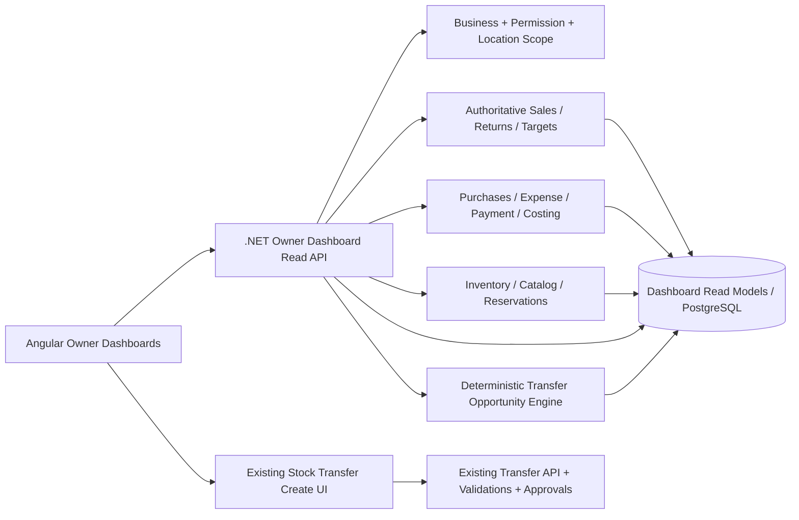
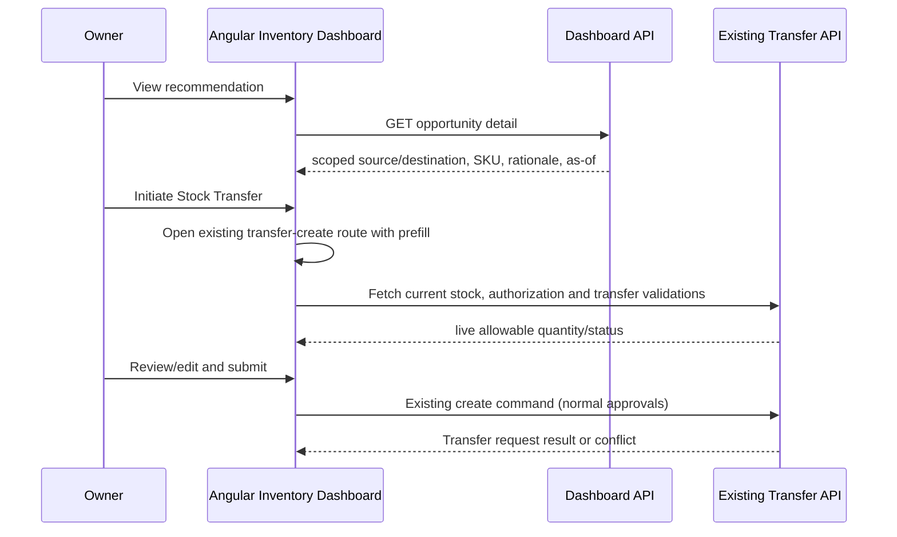

# IraniMart POS v2 — Owner Dashboards
## Low-Level Design (LLD)

**Document ID:** IM-POSV2-OWN-DASH-LLD-001  
**Version:** 1.3 — includes the Business Owner's final permission decision (§8) and stock cost posting (§7.1.1)  
**Prepared:** 2026-11-06  
**Status:** Requires read-only repository/schema mapping before implementation  
**Companion:** `01_OWNER_DASHBOARDS_SRS.md`

> This LLD is adapted to the known **Angular frontend + .NET 10 modular monolith/Clean Architecture + EF Core/Npgsql/PostgreSQL** direction for IraniMart POS v2, with MediatR/FluentValidation and established authorization/audit/concurrency policies. Entity/table/class names below are **proposed logical names, not claims that those names exist**. Inspect actual code and docs first, then map to their authoritative equivalents. The architecture may use existing dashboard event/snapshot infrastructure if already implemented and validated; it must not require a new microservice merely for these two pages.

---

## 1. Architecture and ownership boundaries



**Module placement:** `OwnerDashboard` / `ManagementReporting` read feature inside existing modular monolith, not an independent transaction owner. Application layer composes read models and authoritative source services. Domain modules continue to own transaction lifecycle, cost valuation and stock updates. Dashboard does **not** write into source tables.

**CQRS:** Queries via MediatR if that is the project's existing application pattern; commands remain exclusively in owning modules. Prefer a lightweight query/repository abstraction; raw SQL/Dapper for heavy aggregations is acceptable if consistent with project rules, while EF Core remains appropriate for simple lookups.

### 1.1 Logical file organization (adapt to actual repo)

```text
backend/
  [OwnerDashboard module]/
    Application/
      Queries/{GetSalesSummary,GetShowroomPerformance,GetCashFlowSeries,GetSalesTrend}
      Queries/{GetInventorySummary,GetStockValueByLocation,GetBestSellers}
      Queries/{GetSlowMovers,GetTransferOpportunities,GetProductInsights}
      Services/{IDashboardAuthorizationScope,IDashboardDateService,IStockOpportunityEngine}
      Contracts/{Request,Response}Dtos
      Validation/
    Infrastructure/
      Queries/{SalesDashboardReadRepository,InventoryDashboardReadRepository}
      Projections/ (only if needed)
    Api/
      OwnerDashboardController
frontend/angular/
  features/owner-dashboard/
    owner-dashboard.routes.ts
    data-access/{owner-dashboard.api.ts,owner-dashboard.models.ts,owner-dashboard.state.ts}
    shared/{dashboard-filter-bar,metric-card,empty-state,product-drawer}
    sales-finance/{page,showroom-performance,cash-flow-chart,sales-trend}
    inventory-intelligence/{page,stock-value-by-location,best-sellers,slow-movers}
    inventory-intelligence/{transfer-opportunities,transfer-detail-drawer}
```

No new folders should be created before checking existing Angular module structure and naming standards.

## 2. Read/write and consistency contract

| Dataset | Authoritative owner | Reporting semantics |
|---|---|---|
| Sales / returns / exchanges | Existing POS Sales domain | Completed/posted eligible sales and proper reversals; session business date |
| Targets | Existing sales target settings/service | Approved effective daily targets per showroom/date |
| Purchases | Existing Purchasing/Receiving/Accounting | One recognition event per purchase per defined accounting policy |
| Operational expenses | Existing Expense/Finance | Posted expense for KPI; paid expense entries for cash-out chart |
| Payment collection | Existing payment/cash session ledger | Eligible posted receipts/refunds, no journal double counting |
| COGS and cost price | Approved inventory costing/accounting service | Cost allocation to sales, not period purchases |
| Stock balance | Existing inventory ledger/current balance | On-hand/available/reserved/damaged/transit per inventory policy |
| Main code / SKU | Existing Product catalog | Stable main product code and exact variant identity |
| Transfer creation | Existing Stock Transfer domain | Full validation, permission, audit and approval pipeline |

### 2.1 Consistency model

- Date-range sales/finance series may be computed from authoritative posted transactions or a proven read projection with `dataAsOfUtc` watermark.
- Inventory totals, valuation and opportunity recommendations must share a **single consistent snapshot/valuation watermark** where feasible.
- If SQL reads are from transaction tables, use an appropriate database snapshot/repeatable read boundary for grouped card requests **without long-running write-blocking locks**. PostgreSQL MVCC allows consistent read-only transactions; carefully limit their duration.
- Prefer projection + snapshot when latency and data volume demand it. If projections are asynchronous, expose `dataAsOfUtc`, `sourceHighWatermark`, and an explicit stale status.
- A recommendation is advisory at generation time and must be **revalidated inside the real transfer command** at creation/approval.

## 3. URL routing and frontend shell

Recommended routes (adapt to existing Angular router):

```text
/dashboard/sales-finance
/dashboard/inventory-intelligence
```

Menu group **Dashboard** contains two child links; preserve screen-specific query params or in-memory state for applied filters. On direct navigation, validate query params, apply safe defaults and enforce route guard as a UX measure only (server is authoritative).

### 3.1 Angular state and components

Use typed data contracts, Reactive Forms for complex filters, Angular Signals for local view/query state where supported by the installed Angular version; RxJS/HttpClient for API streams and cancellation. Do not introduce a second global state library solely for dashboards.

```ts
interface DashboardFilter {
  locationIds: string[] | 'all-authorized';
  preset: 'today' | 'yesterday' | 'last7' | 'last30' | 'thisMonth' | 'lastMonth' | 'custom';
  fromDate: string; // yyyy-MM-dd, business-local
  toDate: string;
  categoryIds?: string[];
}
interface WidgetPeriodOverride { fromDate: string; toDate: string; isOverridden: boolean; }
interface SnapshotMetadata { dataAsOfUtc: string; businessTimeZone: string; stale: boolean; }
```

**State separation:** filter draft vs applied filters. Apply commits, Reset restores defaults; avoid fetch on every date keystroke. Component loading/error state per widget. `switchMap` cancels stale requests on quick filter changes. Use trackBy/track with stable SKU/location IDs and virtual scrolling or server paging for View All tables.

**Date UI:** unambiguous displayed date format (e.g. `06 Nov 2026`) with ISO payload. On-screen prototype `06/11/2026` could be misread in US locale.

**Widget period precedence:** initial KPI Today, cash chart Last 7 Days, trend Last 30 Days, inventory analysis Last 30 Days; after global Apply, widgets inherit applied period unless explicitly overridden. Display `Last 7 Days` etc next to each chart. This contract must be implemented uniformly.

## 4. API design

All routes below are **proposed**; reuse existing API conventions, base paths, response wrappers and auth policy names. IDs should use existing GUID/int types; examples use opaque strings.

Base: `/api/v1/owner-dashboard`

| Method/path | Returns | Access intent |
|---|---|---|
| `GET /meta` | filter options and capability flags | either dashboard permission |
| `GET /sales/summary` | six financial KPIs, period, provenance | `dashboard.sales_finance.view` |
| `GET /sales/showrooms` | showroom sales/targets | `dashboard.sales_finance.view` |
| `GET /sales/cash-flow` | cash received/paid series | `dashboard.sales_finance.view` |
| `GET /sales/trend` | net sales/target series | `dashboard.sales_finance.view` |
| `GET /inventory/summary` | stock value, quantities, health KPIs, snapshot | `dashboard.inventory_intelligence.view` |
| `GET /inventory/locations` | per-location stock value/qty | `dashboard.inventory_intelligence.view` |
| `GET /inventory/best-sellers` | server-paged product rows | `dashboard.inventory_intelligence.view` |
| `GET /inventory/slow-movers` | server-paged slow product rows | `dashboard.inventory_intelligence.view` |
| `GET /inventory/transfer-opportunities` | server-paged recommendations | `dashboard.inventory_intelligence.view` |
| `GET /inventory/transfer-opportunities/{key}` | source/destination breakdown and rationale | `dashboard.inventory_intelligence.view` |
| `GET /inventory/products/{productId}/insights` | main-product / exact variant breakdown | `dashboard.inventory_intelligence.view` |

### 4.1 Common query parameters

```text
from=2026-10-08
&to=2026-11-06
&locationId={authorizedLocationId}      # omitted = all authorized applicable
&categoryId={optional}
&page=1&pageSize=15
&sortBy=netUnitsSold&sortDirection=desc
&search=BRK-1005
```

Use ISO local business-date values, not UTC start/end timestamps supplied by client. Server transforms to source-specific time criteria. `locationId` is a reporting filter validated as belonging to the current Business; omitting it means every location of that Business. `sourceLocationId`/`destinationLocationId` for recommendation endpoints are validated the same way.

Example response envelope:

```json
{
  "data": {
    "netSales": "85500.00",
    "target": "100000.00",
    "shortfall": "14500.00",
    "targetExceeded": "0.00",
    "purchaseValue": "32000.00",
    "operationalExpense": "6800.00",
    "operatingProfit": {"value": "21400.00", "status": "estimated"}
  },
  "context": {
    "businessTimeZone": "Asia/Dhaka",
    "fromDate": "2026-11-06",
    "toDate": "2026-11-06",
    "locationScope": "all-authorized-showrooms",
    "dataAsOfUtc": "2026-11-06T04:42:00Z",
    "currency": "BDT"
  }
}
```

Money in JSON should be transmitted in a project-standard decimal-safe representation (example strings); never derive authoritative financial sums from browser `number`. Map examples to project serialization standards before shipping. **Do not expose hidden cost/profit fields as null-but-included if policy requires their absence**; define an explicit redacted/forbidden contract.

Example best-seller row:

```json
{
  "productId": "product-id",
  "mainCode": "BRK-1005",
  "productName": "Premium Black Borka",
  "variantId": "variant-id",
  "sku": "BRK-1005-BLK-XL",
  "variantLabel": "Black / XL",
  "categoryName": "Borka",
  "netUnitsSold": 148,
  "netSales": "532800.00",
  "currentAvailableStock": 84,
  "stockAsOfUtc": "2026-11-06T04:30:00Z"
}
```

Example opportunity row:

```json
{
  "recommendationKey": "opaque-snapshot-key",
  "productId": "product-id",
  "mainCode": "BRK-1005",
  "variantId": "variant-id",
  "sku": "BRK-1005-BLK-XL",
  "sourceLocationId": "outlet-5",
  "sourceAvailableQty": 42,
  "sourceNetSoldQty": 3,
  "destinationLocationId": "outlet-1",
  "destinationAvailableQty": 6,
  "destinationNetSoldQty": 48,
  "suggestedQty": 20,
  "priority": "high",
  "reasonCodes": ["source_excess", "destination_low_cover", "velocity_gap"],
  "stockAsOfUtc": "2026-11-06T04:30:00Z",
  "analysisFromDate": "2026-10-08",
  "analysisToDate": "2026-11-06"
}
```

### 4.2 Errors and API controls

- `400` invalid range/unsupported sort/size, `401` unauthenticated, `403` unauthorized, `404` nonexistent or cross-tenant resource per existing convention, `409` no longer valid on transfer creation via existing workflow, `429` rate-limited if appropriate, `503` stale source unavailable.
- Server cap range and page size; allow-listed sorting expressions only. Parameterize SQL and validate search length.
- Add cancellation tokens, timeouts, immutable result DTOs and response-version consideration if changes are likely.
- Summary endpoints should return per-widget `status`/data-quality flags when fields are unsupported, not guessed numeric placeholders.

## 5. Logical data mapping and read model

**Do not run DDL based solely on these names.** Map actual schema using read-only discovery; preserve current database migration discipline.

### 5.1 Source entities to locate

| Logical source | Needed keys/fields | Cautions |
|---|---|---|
| `Sale` / `SaleLine` | BusinessId, OutletId, BusinessDate, status, line variant, qty, discounted/VAT totals | returns/exchanges, backdated permission and held sales |
| `SaleReturn` / `Exchange` | original linked sale, effective date, signed units/amounts, COGS reversals | avoid counting both return and exchange legs incorrectly |
| `OutletDailyTarget` | OutletId, weekday/business date, target amount, effective dates | configured daily/weekly/monthly target override precedence |
| `PurchaseReceipt` / `PurchaseInvoice` | posted date, location, recognized value and VAT | choose only authoritative recognition event |
| `Expense` / `ExpensePayment` | posted amount, date, location and paid status | chart cash payments distinct from expense accrual |
| `PaymentLedger` / Cash session | actual receipt/refund, tender, posted time and business date | guard against cash session handover as sales inflow |
| `Product` | business ID, stable main code, name, category, active state | main code must be shown separately |
| `ProductVariant` | variant ID, exact SKU, size/color, active state | exact identity required for transfer suggestion |
| `InventoryBalance` / `StockLedger` | location, variant, on-hand, reserved, blocked, cost value | current snapshot, row locking and in-transit semantics |
| `InventoryCost` / COGS | unit cost method, valuation value at snapshot, sale-line cost | never infer from selling price |
| `InventoryAvailabilityHistory` | in-stock days, stockout windows and first receipt | required for defensible velocity |
| `LocationAssignment` / Permission | location type, business, role, effective user assignments | owner/all semantics, Step-5 assignments |
| `TransferRequest` / `TransferLine` | existing create flow, pending qty, source/destination, status | revalidate/approval; no direct writes |

### 5.2 Optional projection tables (only after discovery/performance evaluation)

Proposed read projections:

```text
DashboardDailySales(
  business_id, location_id, business_date, net_sales, net_units,
  target_amount, revenue_ex_vat, cogs, source_watermark_utc)
DashboardDailyCashFlow(
  business_id, location_id, business_date, cash_received,
  operational_expense_paid, watermark_utc)
DashboardVariantDailySales(
  business_id, location_id, variant_id, business_date,
  net_units, net_sales, eligible_in_stock_days, watermark_utc)
DashboardInventorySnapshot(
  snapshot_id, business_id, location_id, variant_id,
  on_hand_qty, reserved_qty, blocked_qty, transferable_qty,
  unit_cost, inventory_value, captured_at_utc)
DashboardTransferOpportunity(
  snapshot_id, business_id, variant_id, source_location_id,
  destination_location_id, suggested_qty, priority, reason_json,
  calculated_at_utc)
```

Use `numeric(18, 2)` or greater *only where compatible with existing monetary precision rules*; unit quantities must follow the project's quantity precision (clothing usually integers, but don't force an incompatible global convention). Index/query keys must always include `business_id`.

**Projection policy:** Rebuildability from authoritative source, idempotent update handlers, no fabricated values, an explicit backfill procedure and reconciliation tests. Prefer transactional outbox/RabbitMQ event subscription only if existing event contracts are complete and trustworthy; periodic reconciliation job corrects drift. Don't create a parallel inventory ledger.

### 5.3 Example safe read-query pattern (illustrative SQL, NOT executable against unverified schema)

```sql
-- Logical example only. Replace names and columns after schema mapping.
SELECT
    s.business_id,
    s.outlet_id,
    s.business_date,
    SUM(l.net_amount_ex_vat) AS net_sales
FROM canonical_posted_sale_lines l
JOIN canonical_posted_sales s ON s.id = l.sale_id
WHERE s.business_id = @business_id
  AND s.outlet_id = ANY(@authorized_outlet_ids)
  AND s.business_date >= @from_business_date
  AND s.business_date <= @to_business_date
GROUP BY s.business_id, s.outlet_id, s.business_date;
```

**Critical:** `canonical_posted_sale_lines` is a placeholder for an approved reporting view/CTE that correctly incorporates returns, exchanges, discounts, sale status and VAT; do not run it literally. Partition/index likely on `(business_id, business_date, outlet_id)` with transaction-specific stable keys, but inspect existing indexes before adding any.

## 6. Financial calculation services

### 6.1 Sales summary

```text
net_sales(period, locations)
  = sum(eligible posted net sale revenue)
    - sum(eligible return/reversal revenue)

target(period, locations)
  = sum(effective per-showroom daily target)

shortfall = max(target - net_sales, 0)
exceeded  = max(net_sales - target, 0)
achievementPct = target > 0 ? 100 * net_sales / target : null

purchaseValue = sum(authoritative recognized purchase value)
operatingExpense = sum(posted attributable operating expenses)

operatingProfit = netRevenueExVat - COGS - AttributableOperatingExpense
  only if sources are complete and policies match;
  otherwise status=estimated / unavailable with explicit basis.
```

Return policy must define the period of reversals, not simply back-edit historical posted sale records. Financial dashboard should use a shared money/rate rounding rule and sum in SQL/.NET decimals before output formatting.

### 6.2 Cash flow series

`cashReceived` = actual qualifying posted receipts − refunds/reversals; `expensePayments` = posted actual operational-expense disbursements. A cash session deposit/handover between cash drawers and bank is an internal movement, not an additional sale receipt. Expense categories and payment accounts are distinct: category is **why** the spend happened; payment account is **where the money came from**.

### 6.3 Sales target series

Use existing target precedence: effective weekday daily target and any editable approved overrides; weekly/biweekly/monthly aggregated policies as implemented by the Target module. Do not sum an independent monthly target on top of daily targets. When no effective target exists return `null`, and flag incomplete target coverage for period totals.

## 7. Inventory calculation services

### 7.1 Snapshot inventory metrics

```text
onHandQty(location, sku) = authoritative physical balance
availableQty = max(0, onHandQty - reservedQty - blockedQty - otherUnavailableQty)
transferableQty = max(0, availableQty - pendingOutboundQty - sourceSafetyQty)
stockValue = authoritative cost valuation of eligible owned/on-hand stock
```

Depending on existing stock ledger, pending outbound may already be reserved and **must not be subtracted twice**. Explicitly document the balance equation from actual tables. Damaged stock may still have book value though not available for sale; the total value card must use the **approved accounting inclusion rule** and distinguish it from transferable/available stock.

**Stock Value by Location:** Group identical inventory snapshot valuation entries by authorized location, including central warehouse when permitted; compare sum of location values to summary value with no per-row premature rounding.

#### 7.1.1 Stock cost classification and posting

`StockCostLedger` (`Application/Inventory/Costing`) is the one classifier, used by both the dashboard snapshot and transfer dispatch. It applies the accepted P2-06 weighted-average pool without changing it. For a variant at a location:

1. Rows that move no stock are ignored. Unreliable rows are left out of the pool.
2. The balance is **Unvalued** if the pool quantity differs from on-hand, the pool value is negative, or any reliable inbound row at zero value is unproven.
3. Otherwise it is **Valued** at a positive pool value, or **VerifiedZero** at zero value with proven zero inbound rows.

Zero evidence is read from existing documents, so no schema change is needed: `GrnLedgerCost.IsZeroCostDocumented` for GRN lines, and for transfers an origin whose whole inbound history is proven free. A system return takes its origin from the original transfer's source.

| Writer | Rule |
|---|---|
| `StockLedgerWriter` | A stock movement is reliable only at a positive cost or through `WriteVerifiedZeroCostEntry`. Supplying a zero records it as unreliable. Rows that move no stock keep their previous flag |
| GRN completion | Ledger value is `TaxableAmount ?? qty × UnitCost`, the value its journal debits to Inventory |
| Purchase and receive | Ledger value is `qty × UnitCost`, the value `PurchaseReceiptJournalPoster` debits to Inventory |
| Transfer create, draft and requisition | `UnitCost` is 0 until dispatch. A client value is ignored; the API field stays for compatibility |
| Transfer dispatch | Classifies the source under the inventory row's `xmin` protection. Valued: pool average, and value rounded as the pool removes it. VerifiedZero: zero. Unvalued: an unreliable row with no cost |
| Transfer receipt | Values accepted units as a share of the dispatch row. Full acceptance carries the exact value |
| System return | Values the rejected share as the dispatch value less the accepted and lost shares, so the original value is fully accounted for |

Transfers post no journal, so they create no gain, loss or COGS. Missing and damaged units leave the ledger with no journal; see the gap analysis §10.

#### 7.1.2 Stock cost corrections

Ledger rows are immutable, so a correction is a new row: `TransactionType = cost_correction`, `ReferenceType = stock_cost_correction`, `ReferenceId` = the corrected movement's id, zero quantity, and the corrected unit cost and value. `StockCostCorrectionSet` applies it at the original movement's place in the replay, so the weighted average is what it would have been. The dashboard, transfer dispatch and receipt, and the P2-06 report all read it. With no correction rows they behave as before. P2-06 applies a correction from its own business date, so a report as of an earlier date is not restated.

`StockCostCorrectionPlanner` decides what can be corrected, in written order:

| Movement | Corrected to | Only when |
|---|---|---|
| Uncosted GRN receipt | The GRN line value, using whichever value basis equals the posted journal's Inventory debit | The GRN total agrees with its journal, and exactly one GRN line matches |
| Transfer out with no reliable value | The source average at that moment | Reliable history, including earlier corrections, explains the source's whole balance |
| Transfer in or system return | Its share of the dispatch value | The dispatch has a reliable value |

Anything else is left unchanged and listed with its reason. Run it with `tools/RetailPOS.StockCostCorrection`, which previews by default, needs `--apply --actor --confirm-count` to write, and refuses any database not on the local machine. Corrections, the claim on each stock row and the audit event commit in one transaction, and a second run finds nothing to do. Two applies at once are serialized on the Business row. A stock take, a stock count's post-generation movement summary and the Stock Movement report do not count a correction as movement. The Stock Transaction and Product Ledger reports list it, labelled Cost Correction, with zero quantities, as its audit trail.

**Out-of-stock definition:** count active showroom-variant pairs that are eligible to sell but have `availableQty ≤ 0`. To avoid explosion, showroom assortment/eligibility must identify which variants are intended for that showroom. When assortment does not exist, label the limitation; do not claim every catalog SKU is out of stock everywhere.

### 7.2 Best sellers

Use net positive sale units minus eligible returned units in analysis period, by **exact SKU/location**, optionally aggregated at main-code level. Sorting is descending `netUnits`, then descending `netSales`, then stable SKU. Zero unit sales excluded. Current available stock is joined from latest authorized inventory snapshot. A SKU sold in one location but only stocked in another should not appear at the selected sales location without eligible sales.

### 7.3 Slow-moving classification algorithm

Proposed **configurable starting thresholds**, not approved final business policy:

- `analysisDays = 30` default.
- `minEligibleInStockDays = 14` (exclude insufficient availability/history).
- `minOnHandQty = 1`.
- `zeroSales` if net eligible units sold = 0 AND eligible in-stock days ≥ threshold.
- `slowMoving` if `velocityUnitsPerEligibleDay < 0.20` with sufficient inventory/age; optionally require a minimum coverage multiple.
- `normal` otherwise.
- `insufficientEvidence` if insufficient stock-history/first receipt data; exclude from top slow lists or flag explicitly.

```text
eligibleSellingDays = days(product was active, listed and actually in stock)
velocity = netUnitsSold / eligibleSellingDays
coverageDays = currentAvailableQty / velocity   if velocity > 0
coverageDays = null ('No observed sales')         if velocity = 0
```

The default `0.20` represents fewer than approximately six units per 30 eligible days; this must be approved/configured by category if different demand patterns apply. For apparel variants, consider seasonal lifecycle, promotions, days since first available and variant availability. No sale history must not be misrepresented as `Never Sold` when historic data is incomplete.

### 7.4 Transfer opportunity algorithm (deterministic)

**Input:** `businessId`, authorized eligible showrooms, analysis period, current snapshot watermark, exact `variantId`, SKU, sale velocity, in-stock days, available/transferable stock, source safety reserve, destination target coverage and demand, pending transfer status.

**Proposed configurable policy (requires business approval):**

```text
minHistoryDays = 14
sourceExcessCoverageDays = 60
sourceRetainedCoverageDays = 30
promotionTargetCoverageDays = 21
minDemandVelocity = 0.5 units/eligible selling day
minVelocityRatio = 2.0       # destination/source, when source velocity > 0
minRecommendationQty = 1
```

**Algorithm:**

1. Load scoped per-showroom per-SKU metrics for the **same exact variant** and approved period. Exclude inactive/retired SKU, missing stock evidence, inappropriate warehouse nodes and stale valuation/availability inputs.
2. Identify candidate destination with reliable demand (`destinationVelocity ≥ minDemandVelocity`) and low current stock coverage (`destinationAvailable / destinationVelocity < targetCoverageDays`).
3. Identify candidate source with excess stock (`sourceAvailable > sourceRetainedQty`), sufficient history and materially lower sales velocity or significantly higher coverage.
4. Compute source protected qty: `max(configuredMinimumStock, ceil(sourceVelocity * sourceRetainedCoverageDays))`.
5. Compute source spare qty: `max(0, sourceTransferableQty - sourceProtectedQty)` **if transferability does not already include this protection**; implement the safety subtraction exactly once.
6. Compute destination need: `max(0, ceil(destinationVelocity * targetCoverageDays) - destinationAvailable - inboundCommittedQty)`.
7. `suggestedQty = floor(min(sourceSpareQty, destinationNeed))`; reject if ≤ 0. Respect whole units for discrete clothing SKUs.
8. Rank High/Medium/Low based on destination stockout risk, demand reliability, reduction in source excess, and recommendation freshness. Emit human-readable reason codes and all input factors.
9. Deduplicate by `(business, snapshot, exactVariant, source, destination)`. Where multiple source locations compete, allocate destination need in ranked order so total suggestions do not jointly exceed need; likewise cap aggregate offered source spare across destinations.
10. Optional lower-confidence flag where history unavailable: no recommended qty until evidence meets minimum threshold (conservative default).

**Worked illustrative example (matching prototype):**

- `BRK-1005 / Black XL` at Outlet 1: 48 units sold in 30 eligible days, available 6 ⇒ 1.6/day, ~3.75 days cover.
- Outlet 5: 3 units sold in 30 eligible days, available 42 ⇒ 0.1/day, ~420 days cover.
- Source minimum retained for 30 days ≈ 3 pieces (or configured min). 42−3 = 39 possible, before reservation/outbound constraints.
- Destination 21-day target ≈ ceil(1.6×21)=34; need 34−6=28 pieces, before inbound commitments.
- Formula could suggest **28** absent other limits. The Figma prototype's **20-piece** suggestion is illustrative and **not mathematically established**; to yield 20, configure a specific max-per-transfer cap or include pending inbound demand/source constraints, and display that factor. Never hardcode 20 simply to copy the prototype.

### 7.5 Recommendation-to-transfer handoff



Handoff data: `sourceLocationId`, `destinationLocationId`, `productId`, `variantId`, `suggestedQuantity`, optional `recommendationKey` for traceability. Transfer API never trusts proposed quantity, stale snapshot or user-visible reason; it rechecks business, role, assigned locations, source balance, concurrency and allowed status transitions. Prevent inventory decrease at recommendation/view stage.

## 8. Security and policy enforcement

### 8.1 Resolution order

1. Authenticate identity and resolve current business context from server session/token.
2. Check the dashboard permission for the endpoint: `dashboard.sales_finance.view` or `dashboard.inventory_intelligence.view`. No other module permission is consulted for reads.
3. Resolve the reporting scope: every outlet and warehouse of the current Business. Step 3 inventory access, Step 5 assignments, the default outlet and the selected operational location play no part.
4. Validate any location filter as belonging to the Business, then filter all source data at the query boundary by that Business and filter.
5. Sales, COGS and Expenses use this one scope. A selected showroom narrows all three. All Locations includes warehouse and business-level expenses.
6. Recommendation rows report `canInitiate` from the existing `stock_transfers.create`, `stock_transfers.transfer_from_any_location` and `StockTransferSource` rules, as a usability hint only.
7. Transfer creation stays in the existing flow, which re-checks permissions, location rights, stock and approvals.

### 8.2 Specific threats and mitigations

| Threat | Mitigation |
|---|---|
| Changing `businessId`/location ID in URL | Never trust client business ID; server-side effective scope, tenant predicates |
| Business-wide data reaches a user without the dashboard permission | Policy on every endpoint; 403 before any query. Holders see all of the Business by approved decision |
| Dashboard permission used to act on transactions | Read-only endpoints in read-only database transactions; transfer creation keeps its own permissions |
| Stale recommendation causes negative stock | Live transactional revalidation and existing concurrency controls (`xmin`/row-lock approach) |
| Duplicate transfer requests | Existing idempotency keys, pending-transfer checks and audit |
| Search or sort injection | Parameterization + allow-listed sort keys, bounded search strings |
| Cross-business SKU matching | Composite business + variant identity predicates |
| Timezone misclassification | Server-side business date and posted payment date mappings |

## 9. Performance, caching and refresh design

**Initial recommendation:** implement correct read repositories first and measure query plans with realistic business data; introduce projections only when needed. Optimize indexed queries and avoid per-row nested data access.

- `sales/summary`, `sales/showrooms`: potentially 60–120-second cache per business/scope/filter (subject to freshness needs).
- `cash-flow`, `sales/trend`, best sellers: 2–5-minute cache for historical fixed periods; latest business day invalidated by relevant posting events where possible.
- inventory/summary, stock-by-location and recommendations: 1–5-minute max-age or event-driven invalidation; always show snapshot watermark.
- keys must include business, normalized authorized location scope, permissions/cost access, date range, category, page and approved options; never share cached sensitive results across users with differing scopes.
- If reporting infrastructure already uses Elasticsearch snapshot DB/outbox/RabbitMQ, evaluate its freshness and financial correctness; ES search indices may support discovery, but authoritative finance/stock valuation should remain governed by consistent relational projections or validated summaries.
- Prohibit client-side polling loops that hammer APIs; Refresh should fetch once and display progress.
- Telemetry: `owner_dashboard_query_duration`, `snapshot_age_seconds`, `recommendations_generated`, `recommendations_suppressed`, source/report reconciliation drift, expensive SQL logs stripped of sensitive data.

## 10. Database performance and indexes

Verify actual PostgreSQL schema and `EXPLAIN (ANALYZE, BUFFERS)` with sanitized data; recommended patterns rather than mandatory migrations:

- sales fact lookup by `(business_id, business_date, outlet_id)` and posted statuses; line lookup by sale FK and variant.
- variant movement by `(business_id, location_id, variant_id, business_date)` with date filtering.
- inventory balance unique by `(business_id, location_id, variant_id)` if business model allows.
- projection snapshot by `(business_id, snapshot_id, location_id, variant_id)`.
- search by canonical main code or normalized SKU prefix; full-text/trigram only if table size warrants it.
- apply tenant/location predicates **before** aggregation and pagination.
- use latest snapshot chosen once per query; avoid independently fetching inconsistent snapshots for total and location sum.

All migrations, if later approved, should be non-destructive and reviewed for locking/rebuild cost. This design creates no transactional schema changes by default.

## 11. Testing strategy and verification matrix

### 11.1 Unit tests

- Date range validation, business date boundary and no timezone drift.
- Shortfall/over-target, target missing/zero, no dividing by zero.
- Returns/exchanges signed accounting and sales unit aggregation.
- Estimated profit unavailable when no COGS; exact money rounding.
- Stock valuation and physical-vs-available balance rules.
- Zero/slow/insufficient-history classifiers; first receipt and stockout handling.
- Recommendation safe qty, priority, dedupe, source and destination global allocation.
- No suggestion when same location, missing history, 0 destination demand, forbidden location, blocked/reserved stock, pending transfer.

### 11.2 Integration tests (PostgreSQL-backed)

1. Multi-business isolation with overlapping product codes.
2. Owner all-location view versus manager assigned-outlet view.
3. Warehouse-only user without default outlet.
4. Real posted vs draft/held/voided sale statuses.
5. Sale attributed to cash-session business date across midnight.
6. Return/exchange posted in selected period, with correct COGS reversal.
7. Purchase/GRN posted only once under recognized policy.
8. Expense category and payment account differences; payments vs accrual.
9. SQL aggregate of stock-by-location equals stock-value summary.
10. Snapshot freshness and stale flags.
11. Product main code plus multiple SKUs in the same business.
12. Exactly matched variants for transfer suggestions and safe stock limits.
13. Concurrent stock change between recommendation and transfer create -> existing transaction rejects/adjusts safely.
14. Existing transfer approval/audit/idempotency behaviour untouched.
15. Users without the dashboard permission get 403; holders get full business-wide figures with no assignments.

### 11.3 Frontend tests

- Menu routes, active state, default widget periods, filter draft/apply/reset.
- Location filtering, empty/error/retry, rejected invalid date range.
- Table search, sorting, pagination, View All and row selection.
- Product drawer exact SKU and Main Code.
- Opportunity drawer rationale, revalidation error, prefill into real transfer-create route.
- Cross-screen preserved filters and responsive layouts.
- Accessible keyboard path and data-table equivalent for visual charts.

### 11.4 Financial/data reconciliation

For at least 3 business dates and 2 locations, compare dashboard values to approved existing reports/ledger using the **same status, date and VAT rules**. Define allowed differences: **zero** for exact integer stock counts; currency differences only within established rounding rules. Validate the sum of location sales against total and inventory valuation decomposition at the same snapshot watermark. Seed datasets must include realistic returns, exchanges and transfer-in-transit edge cases.

## 12. Suggested incremental build plan

| Phase | Deliverable | Exit gate |
|---|---|---|
| P0: Discovery | Read-only map of actual schemas, roles/permissions, dates, cost rules, API standards, transfer workflow | Owner/tech lead signs off unresolved SRS decisions and logical-to-physical mapping |
| P1: Shared Shell | Routes, authorization, shared filter components, DTO conventions, query infrastructure | Tests for permissions and date semantics pass |
| P2: Sales Read Models | Sales KPIs, targets, showroom chart, cash flow, trend | Reconcile with authoritative Sales/Finance results |
| P3: Inventory Snapshots | Inventory KPIs, valuation per location, best/slow tables, product drawer | Cost permission, quantity and valuation reconciliation |
| P4: Recommendations | Deterministic eligible opportunity engine, details, priority, explanations | No invalid source/destination/qty in seeded cases |
| P5: Transfer Handoff | Prefill existing transfer request, revalidation, audit | Existing transfer lifecycle unchanged and end-to-end covered |
| P6: Hardening | Performance, responsive UI, access regression, telemetry and freshness | Product acceptance and no regressions |

Deploy dashboard read functionality behind flags if valuation or accounting integration is not validated. Do not postpone correctness checks to after UI launch.

## 13. Open technical decisions requiring confirmation

| ID | Decision | Proposed starting point |
|---|---|---|
| LLD-D01 | Exact physical source tables/REST conventions | Inspect codebase, record in mapping appendix |
| LLD-D02 | Data source for profit and COGS | Existing accounting/costing authority; otherwise disable profit value |
| LLD-D03 | Stock valuation policy including damaged/in-transit | Match approved stock valuation and avoid double counting |
| LLD-D04 | Eligible stock-days history quality | Conservative suppression when unavailable |
| LLD-D05 | Slow thresholds by category | 14 eligible days, <0.20 units/day proposed; owner approves |
| LLD-D06 | Transfer safety/coverage defaults | Source 30 days, destination 21 days; configurable |
| LLD-D07 | Suggested transfer cap | None without explicit policy; demo 20 must be justified by real rule |
| LLD-D08 | Reporting projections vs direct SQL | Start measured optimized reads, adopt read projections if justified |
| LLD-D09 | Allowed date interval and cache freshness SLA | Finalize by production-like load tests |
| LLD-D10 | Permission names and module path | **Decided:** two new catalog keys, `dashboard.sales_finance.view` and `dashboard.inventory_intelligence.view` |
| LLD-D11 | Returns/exchanges net sales reporting date policy | Match posted finance/POS contract |
| LLD-D12 | Source for cash collected vs payments | Posted payment ledger; not sales document totals |

## 14. Read-only discovery checklist for coding agent

Before modifying code, the coding agent must:

1. Read repository `CLAUDE.md`, `.claude/rules`, existing `.github` instructions and relevant `Docs` (Sales/POS, Inventory, Purchase, Expense, Accounting, authorization, transfers).
2. Identify backend/Angular app structure and real route/component conventions.
3. Find product main code, exact variation identifiers and cost fields; note data-quality exceptions.
4. Trace completed sale → line/VAT/discount → return/exchange → business date → COGS.
5. Trace target policies including daily weekday primary and weekly/biweekly/monthly rollups.
6. Trace purchase receipt and expense posting/payment accounts.
7. Trace stock on-hand, reserved, blocked, transit and transfer pending statuses.
8. Trace current user permissions, owner overrides, Step-5 location mapping and warehouse-only users.
9. Trace existing stock transfer create endpoint and approval/validation/row-lock or `xmin` concurrency implementation.
10. Locate any existing dashboard/Elasticsearch snapshots, outbox or RabbitMQ/MassTransit infrastructure and verify consistency.
11. Produce `OwnerDashboard_Source_Mapping.md` with verified table/entity/API references, policy ambiguities and query plans **before** writing migrations or backend implementation.
12. Run focused automated tests; report unrun PostgreSQL integration/E2E tests truthfully. No production data writes.

---

## 15. Mandatory Able Pro integration and component mapping

**Local UI reference:** `design-reference/able-pro/able-pro-angular-v3.3.0` (repository-relative). This is a source to **inspect**, not an already verified dependency or a directive to replace the frontend framework. Do not assume this directory structure or component names beyond the provided root path until source inspection.

### 15.1 Read-only discovery — before UI edits

1. Inspect the referenced Able Pro project's `package.json`, Angular/TypeScript/Bootstrap versions, routing, reusable/shared components, styles/tokens, assets, charts, tables, forms, date controls, overlays and responsive layouts.
2. Inspect the existing IraniMart POS v2 Angular app's version, shell/layout, design tokens, menu/route declarations, UI dependencies, chart libraries and standard form/table components.
3. Read the applicable Able Pro licence, third-party asset notices and redistribution terms; record which assets/components may be reused. If unclear, flag and do not copy restricted assets.
4. Create an explicit **AblePro_UI_Component_Mapping.md** with columns: `Dashboard section`, `Able Pro reference file/component`, `Existing POS v2 component`, `Implementation choice (reuse/adapt/rebuild)`, `Compatibility/licence notes`.
5. Do not copy the demo `Dashboard/Default/Analytics` pages verbatim or import their fake metrics, sample users, advertising buttons, promotional banners or unrelated functionality.
6. Do not create a second application root, another routing system, competing sidebar/topbar, duplicate theme, incompatible Angular dependency graph or global CSS overrides that break existing POS screens.
7. If styles differ, prioritize current IraniMart branding and shell, then reproduce Able Pro's component composition and visual polish through scoped feature styles/tokens.

### 15.2 Required UI pattern mapping

| Owner Dashboard need | Able Pro pattern to inspect | Implementation contract |
|---|---|---|
| Two dashboard routes | Sidebar nav, nested active items, header | Integrate with existing POS routes, menu permission gating and current shell; active state tracks route. |
| Financial/inventory KPI rows | Compact statistic cards, icons, subtle status borders, sparklines | Reusable typed KPI component; real API data and loading/empty/error states; currency formatting. |
| Global filters | Select inputs, date controls, compact toolbar | Angular reactive/typed forms; apply/reset only updates committed query state; preserve date/time policy. |
| Showroom/value comparisons | Progress bars, horizontal bar charts, chart/table switch | Accessible chart plus textual values and equivalent table; controls not inert. |
| Cash vs expense and sales trend | Time-series/grouped bar and line charts | Reuse compatible chart adapters; dynamic axes, tooltips and responsive rendering. |
| Best sellers, slow movers, transfer table | Data tables, toolbars, sort/search/pagination | Accessible sticky or horizontally scrollable tables; Main Code and variant always identifiable; server-side data contracts. |
| Opportunity details / transfer initiation | Modal, off-canvas/drawer, form validation, badges | Feature-local overlay; exact SKU; permission checks; prefilled but unsubmitted existing transfer workflow. |
| Status/priority | Badges, tooltips, progress/status colors | Include textual status, explanations and consistent semantics. |
| Empty/loading/error | Placeholders/skeletons, alerts | Loading and no-data clearly distinguish from zero values and restricted permissions. |

### 15.3 Implementation constraints

- Use **existing POS v2 Angular structure and approved dependency versions**; the Able Pro reference is not authorization to downgrade/upgrade Angular or replace the application shell.
- Prefer existing local design system components first where functionally equivalent; otherwise adapt verified Able Pro components or recreate their styling using permitted assets and current libraries.
- Keep dashboard components lazy-loaded/feature-scoped where supported, avoid introducing global CSS conflicts, and unsubscribe/cancel in-flight requests on filter changes using established project patterns.
- Theme tokens, spacing, breakpoint behavior, chart colours and table typography should be consistent between the two dashboards.
- Enforce the two dashboard permissions through the existing route guard and server policies. Dashboard reads have no per-location constraint; transfer actions keep theirs. Hidden buttons are not security enforcement.
- Screenshot-based visual comparison is a QA activity, not a substitute for functional tests. Test responsive layouts, table truncation, BDT formats, focus handling, forms, overlays and sidebar route behavior.
- Keep a short provenance note for adapted components and retain legally required notices.

### 15.4 Additional engineering acceptance gates

- **UI gate A:** `AblePro_UI_Component_Mapping.md` reviewed alongside verified source paths and dependency compatibility.
- **UI gate B:** Side-by-side screenshot QA of Sales & Finance and Inventory Intelligence against the owner-provided Figma prototype, using Able Pro component styling.
- **UI gate C:** Existing POS app smoke tests (layout, navigation, product, inventory, transfer, user screens) pass with no global theme or router regression.
- **UI gate D:** No Able Pro demo content, fake values or vendor promo UI in production components; all remote data/API states handled.
- **UI gate E:** Do not modify `design-reference/able-pro/able-pro-angular-v3.3.0` during source mapping; treat it as a read-only reference unless explicitly authorized.

---

**End of LLD v1.2**

## Addendum (2026-11-06): Target integration as built

Replaces the `OutletDailyTarget` sketch in the integration table; the model is in POS LLD §31. `SalesTargetPerformance` compares targets with sales per showroom, then totals them, so nothing is double counted.

- `sales/summary` adds `targetCoverage` and `today`; existing fields keep their shape and now carry values.
- `sales/showrooms` and `sales/trend` fill `target` and `targetStatus`. The status set adds `off_day`.
- Trend buckets use the same period rule. A bucket with no target returns `null`, and the chart breaks the line there.
- Partial comparison: the sales compared are those on outlet-days with a target, including off days, so `netSales` can be larger than the sales behind the percentage. The note says so.
- A "This Month" preset ending today is not an exact month, so a monthly override is not used for it; the daily targets are.
